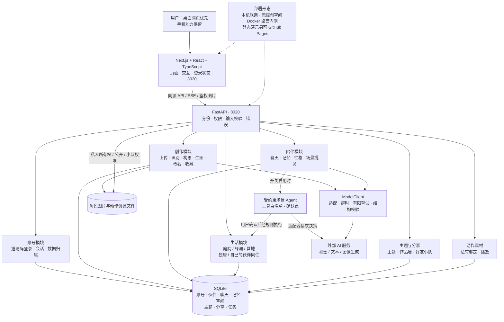
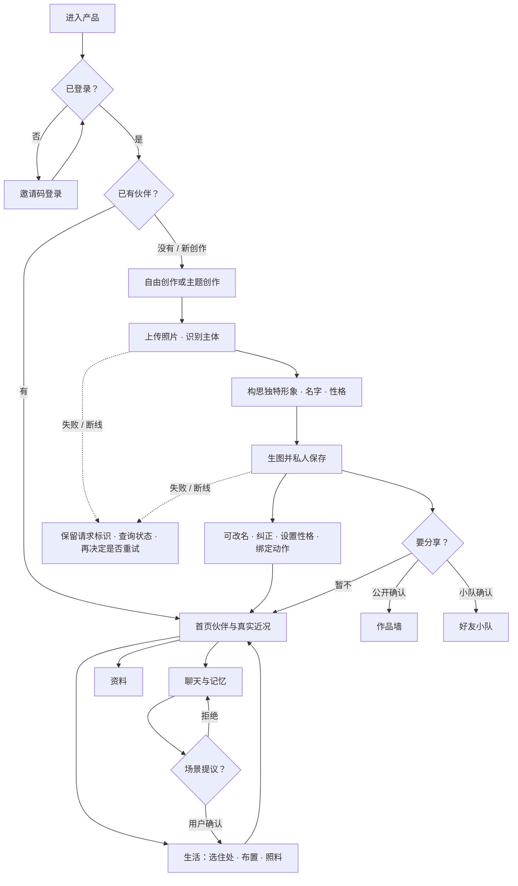

# AI 万物伙伴 V1.2 PRD

<!-- phone-bed-cycle-human-passed-20261025 -->
## 2026-10-25 手机上床、离床回院子与刷新保持：逐项真人通过

用户本次普通刷新后明确回答：“仍在院子观察，位置正常”。结合前两项“从床侧坐沿，再转身躺下，过程正常”和“正常起身，回院子并停下观察”，当前Build `XfEHVppTiPk6D4JfSS-Y1` 紫绒手机上床→离床回院子观察→刷新保持已逐项通过，本轮验收收口。刷新保持记为第7项有限真人通过；原6项通过、3条失败与全部历史保留，不扩为其他未测流程、真实AI、24小时或全产品验收通过。

[刷新真人回执与三项依据](验收证据/阶段8/火山ECS迁移-20261015/phone-bed-side-facing-repair-20261025-1792938479581/phone-observe-refresh-human-pass.json)。本轮只记录结果，无代码或生产变更，未启动付费任务或恢复异地备份。
<!-- /phone-bed-cycle-human-passed-20261025 -->

<!-- phone-sleep-exit-human-pass-20261025 -->
## 2026-10-25 手机离床回院子观察：真人通过

用户在紫绒睡觉页面直接点“观察”、中途不刷新后明确回答：“正常起身，回院子并停下观察”。本项当前Build `XfEHVppTiPk6D4JfSS-Y1` 手机验收通过，记为第6项有限真人通过；原5项通过、3条失败及历史完整保留。下一项仅验普通刷新后院子位置与观察活动保持，目前待答；不扩为其他未测流程、真实AI或24小时验收通过。

[手机真人回执](验收证据/阶段8/火山ECS迁移-20261015/phone-bed-side-facing-repair-20261025-1792938479581/phone-sleep-exit-human-pass.json)。本轮只记录结果，无代码或生产变更，未启动付费任务或恢复异地备份。
<!-- /phone-sleep-exit-human-pass-20261025 -->

<!-- phone-bed-side-facing-human-pass-20261025 -->
## 2026-10-25 手机床侧入床真人通过

用户对本轮手机复验明确回答：**“从床侧坐沿，再转身躺下，过程正常”**。当前状态为 `human_passed_phone_bed_side_entry`；通过范围仅为Build `XfEHVppTiPk6D4JfSS-Y1` 下紫绒手机“观察到院子→睡觉”的床侧坐沿、转身躺下过程。

这是新增第5项有限真人通过，作为当前入床项的最新结论替代上次“仍从床尾上床”失败；旧3条失败及原4项有限通过全部保留。此结论不扩大至全产品、AI交流、真实24h或其他未测流程。此前“等待手机回答”段落保留为历史。

[用户真人验收回执](验收证据/阶段8/火山ECS迁移-20261015/phone-bed-side-facing-repair-20261025-1792938479581/phone-human-pass.json)。
<!-- /phone-bed-side-facing-human-pass-20261025 -->

<!-- phone-bed-side-facing-repair-published-20261025 -->
## 2026-10-25 床侧坐沿前朝向修复已发布，手机复验待答

北京时间23:28完成唯一正式切换及postcheck，Build `XfEHVppTiPk6D4JfSS-Y1`。修正伙伴接近床侧、准备坐沿时先朝床尾再转回的多余转向；保持床侧坐沿后向内转身躺下的路径、原3件布置、真实体型和碰撞守卫。

本地与云端各39项相关验证（37＋独立2）通过。本地另通过类型检查、严格lint和禁网构建；云端复用该本地构建，并通过Linux启动检查。Root本地390×845浏览器完成连续观察/睡觉切换并核对最终近床段107帧/7.32秒，看到床侧坐沿、向内转身和躺稳，终态journeyActive0/blocked0、15贴图正常。此107帧仅覆盖最终近床段，不是完整旅程录制或手机真机证据。线上HTML含当前Build，实际返回的15个脚本（含3个相关渲染chunk）均与active构建字节一致；它只证明服务器实际响应。

仅2运行源更新/213前端输入，134后端输入、79业务表、89schema、配置及保护单元保持。前端PID518031→521932、active/NRestarts0；后端PID491435不变；provider36→36、新模型调用0。16静态/15图片检查通过，无rollback或数据库恢复；异地仍disabled/inactive、cost=false。

**当前为 `deployed_waiting_phone_facing_human`，新手机真人复验pending，未新增真人通过。** 已发出指引：手机普通刷新一次→紫绒“观察”到院子→“睡觉”，中途不刷新，核对是否床侧坐沿再转身躺下；未记录未知工具call id。上一版“仍从床尾上床”等3条真人失败、原4条有限通过和全部历史保留；本轮不据技术验证宣布手机问题完全解决或全产品完成。AI交流、自动安排、真实24h及旧launch_hold边界保持。

[本轮修复与发布证据](验收证据/阶段8/火山ECS迁移-20261015/phone-bed-side-facing-repair-20261025-1792938479581/README.md)。
<!-- /phone-bed-side-facing-repair-published-20261025 -->

<!-- phone-bed-side-facing-repair-reopened-20261025 -->
## 2026-10-25 重新开工：先修床侧坐沿前的地面面向

用户最新要求“重新修复”，本轮已重新开工。已发现一处确定代码问题：sleep dock在地面先强制最终yaw=0朝床尾，再转向床侧，产生多余转向。本轮最小目标是让伙伴地面接近和坐沿前面对床侧，不先朝床尾；坐沿后的向内转身躺下、碰撞/接触守卫、真实体型、原3件布置和其他业务保持。

**这处多余转向尚未被证明是手机失败的完整根因；当前尚未修好、未发布、未新增真人通过。** 源owner仅获授权做必要controller/path面向修复和对应红绿测试，先留旧行为红例，再以同例复验及相关免费回归。手机录屏仍可补定位证据，但不再作为唯一下一步或暂停开发的理由。

原4条有限真人通过、189个执行键和全部真人失败/正式部署/技术验证记录保留。本阶段暂不改session或执行态，待实际结果再追加；不调用模型、不新增付费调用，不动异地暂停。

已确认行为：地面上床前面向实际床侧，坐沿后才进入既定转躺过程；不得用取消碰撞、挪家具、缩体型或瞬移绕过。技术红绿与手机真人结果分开，不把面向问题修复等同于整项人验通过。

[本轮最小范围与证据](验收证据/阶段8/火山ECS迁移-20261015/phone-bed-side-facing-repair-20261025-1792938479581/README.md)。
<!-- /phone-bed-side-facing-repair-reopened-20261025 -->

<!-- phone-side-entry-post-publish-human-failure-20261025 -->
## 2026-10-25 最新手机真人失败：新版仍从床尾上床

正式新版 `hQKjSo5842Edi52Yx1E6O` 的手机完整侧边入床真人复验未通过。用户先在新版手机“观察→睡觉”完整动作问题下回答“仍从床尾进入、穿床或卡住”（`call_fa0b685ab11849d2ad545394b177d9d7`），进一步明确“仍从床尾上床”（`call_5f3ab5fc3a97497990c93ac45b6f456d`）。当前已确认的是手机所见仍从床尾入床，不能把它当作新侧边动作通过。

当前状态为 `published_side_entry_human_failed_investigating`。Root正在只读采当前现场；**未确认旧缓存、二楼或具体根因**，不据本地/云端绿测试否定真人反馈，也不预先要求刷新来解释失败。本轮新记录阶段不改运行源、生产、配置或异地，不新增模型/付费调用。

hQK的正式部署/postcheck和35项本地＋35项云端技术通过仍作为真实历史保留；它们不替代本次手机人验。原4条有限真人通过与所有失败/画面/脚本记录保持。执行态只追加本次失败第189项，旧188键和值不改；session追加此失败及只读诊断状态。以下之前“待手机回答/已发布”的段落保留为历史，以本段为最新人验结论。

[本次真人失败原话与保全证据](验收证据/阶段8/火山ECS迁移-20261015/手机床侧上床发布后真人失败-20261025/README.md)。
<!-- /phone-side-entry-post-publish-human-failure-20261025 -->

<!-- phone-bed-side-entry-published-20261025 -->
## 2026-10-25 床侧上床修复已发布，手机完整入床复验待答

正式前端已唯一切换并完成真实 postcheck，Build `hQKjSo5842Edi52Yx1E6O`。紫绒普通睡眠进床改为从床侧走近、坐到床沿、向内转身再躺下；接触路径距离计入最短yaw及真实坐卧/呼吸/抬腿姿态，保留原离床修复、家具/伙伴尺寸与全部原布置。

本地与云端均为本轮去重35项（8套33＋独立筛选2），类型/lint/禁网构建及Linux启动通过。Root隔离实际UI用390×845完整热链记录84帧，复核床侧坐沿/转身/躺稳及普通离床回院子，终态journeyActive0/blocked0、15贴图正常，无刷新和外呼；12帧冷终态不作为完整入床证据。它是本地浏览器验证，不能替代手机真人。

仅3运行源变化/213前端输入，134后端输入、79业务表、89schema、配置、后端和保护单元保持；provider36→36、新模型调用0，无rollback或数据库恢复，异地disabled/inactive、cost=false。首轮候选准备因旧测试套/29/4例常量绑定遗漏在测试前停止，源码未应用、未切换；原14项局部合同漏检及全部失败输出保留。第二独立命名空间以新鲜baseline、精确AST/实际manifest/负例和独立审查完成35项云验及唯一发布。

**新版侧边上床手机真人复验仍待用户回答；原4条有限真人通过保持，不扩为本轮通过或全产品完成。** 已发出指引：普通刷新一次→观察到院子→睡觉→核对是否从床侧坐沿再转身躺下，完整过程无穿床/卡住；回答pending，不记录未知工具call id。

本轮床侧上床需求已实现并通过技术验证；最终体验闸门仍为真实手机完整入床。无安全路线的保护、原布置和离床要求保留，不把新版发布自动判为真人验收完成。

[本轮验收与保全证据](验收证据/阶段8/火山ECS迁移-20261015/手机床侧上床修复-20261025/验收记录.md)。
<!-- /phone-bed-side-entry-published-20261025 -->

<!-- phone-bed-side-entry-pose-distance-scope-20261025 -->
**本轮实现范围细化（未通过/未发布）：** 侧边上床候选1在严格碰撞保护下停住；即使该次未发生穿透，卡住也不算通过。审计发现 `living-home-journey.ts` 的接触路径距离漏计 yaw 等纯姿态变化，旋转段被压成极小进度，可能越过已验证角度。为完成同一床侧坐沿→转身躺下需求，本轮最小运行源范围扩为 `living-world-engine.ts`、`living-contact-collision.ts`、`living-home-journey.ts` 三项：接触插值距离需计最短 yaw 角距及 bedSeat、bedBreathing、bedLegLift 等真实姿态变化，保留姿态节点和整段碰撞扫掠。213项前端/134项后端保全范围、原布置和离床相关回归不变；候选1独立失败留档，不宣称修好。
<!-- /phone-bed-side-entry-pose-distance-scope-20261025 -->

<!-- phone-bed-side-entry-scope-20261025 -->
## 2026-10-25 当前修复：从床侧坐到床沿，再转身躺下

用户已明确手机所见是“床尾到床上”穿床，并要求“应该从床侧边上床才对”。本轮按床侧走近→坐床沿→转身躺下实现，重点验完整入床过程；原离床修复、全部家具布置/坐标及历史记录保留。此前睡觉最终躺稳的有限真人通过不代表入床轨迹通过。

已读取的 g59 / floor r162 现场：紫绒 id5 为 sleep/bedroom；floor seq=applied=4，targets={}、commands=[]、active=null、states=[]，现场没有活动二楼覆盖。本轮以该普通卧室路径复现；不把用户未明说的层数当作真人确认。

**本轮已确认需求（床侧上床）：** 选择可达且安全的床侧，不移床或收回家具；伙伴先到侧边并坐到床沿，再收腿转身躺到床垫。禁止从床尾、床架、床垫或被子内部走穿、瞬移到位或以最终躺稳掩盖过程穿透。无可行路径时保留安全位置并反馈，不擅自关闭碰撞。

[本轮范围、现场与验收计划](验收证据/阶段8/火山ECS迁移-20261015/手机床侧上床修复-20261025/README.md)。
<!-- /phone-bed-side-entry-scope-20261025 -->

<!-- post-deploy-phone-bed-entry-direction-20261025 -->
**最新方向澄清：手机“床尾到床上”入床穿体。** 用户先明确受影响端为“手机”（`call_5453095dcee842a28795acbcec004d4a`），又主动补充“床尾到床上”。因此本轮新失败的具体方向是入床，不能继续默认作离床；层数和根因仍未确定。所有先前离床失败、粗失败及 33 项部署验证原文完整保留，不以单项本地绿否定真人。[手机入床细化收据](验收证据/阶段8/火山ECS迁移-20261015/手机睡觉转观察发布后真人复验失败-20261025/post-deploy-phone-bed-entry-direction-receipt.json)。
<!-- /post-deploy-phone-bed-entry-direction-20261025 -->

<!-- post-deploy-bed-penetration-detail-20261025 -->
**最新细化：用户进一步明确“仍然穿过床体”。** 本轮正式新版离床真人复验确认为床体穿透失败；哪端、哪层仍待已发出的自由文本追问，暂不推断二楼或同步根因。原粗失败及全部历史不改写。[细化收据](验收证据/阶段8/火山ECS迁移-20261015/手机睡觉转观察发布后真人复验失败-20261025/post-deploy-bed-penetration-detail-receipt.json)。
<!-- /post-deploy-bed-penetration-detail-20261025 -->

<!-- phone-sleep-observe-post-deploy-human-failure-20261025 -->
## 2026-10-25 最新手机复验未通过：发布后仍有离床/同步异常

正式 Build `7XcbNgLcheOqY52oRif7L` 发布后的手机真人复验明确失败。用户在“手机普通刷新→睡觉躺稳→观察，中途不刷新，核对无穿床、回院子及电脑同步”的问题下回答“仍然穿床、卡住或两端不同步”（`call_762f95e8ab6442e69150a1e23da0a1b1`）。具体三分表现等待已发出的追问，不能先推断是哪一种，更不能写已修好或通过。

本次失败追加为新阶段；原 4 条有限真人通过、旧床穿透失败、33 项本地/云端测试及唯一发布/postcheck 记录完整保留。它们不替代最新真人结论。执行态仅新增第 187 个失败键，原 186 键和值保持；当前继续同一睡觉→观察流程的只读差异诊断，不改运行源或生产，不付费、不盲重跑 33 项，也不要求用户再次刷新。

证据：[发布后真人失败收据及记录保全](验收证据/阶段8/火山ECS迁移-20261015/手机睡觉转观察发布后真人复验失败-20261025/README.md)。
<!-- /phone-sleep-observe-post-deploy-human-failure-20261025 -->

<!-- phone-sleep-observe-bed-exit-deployed-20261025 -->
## 2026-10-25 离床穿透修复已发布，手机新版本真人复测待回复

正式前端已完成唯一切换及 postcheck，Build `7XcbNgLcheOqY52oRif7L`。仅 3 个运行源修复真实睡觉→观察离床路径与必要床面接触兼容；床、楼梯、原 3 件家具及伙伴真实尺寸保持。79 表/89 schema、配置、后端及保护单元不变；provider 36→36，新模型调用 0，异地备份保持 disabled/inactive、成本开关 false，无回退或数据库恢复。

本地相关 33 项、类型/lint/禁网构建通过；云端首轮保留 28 绿和唯一显式 15 秒超时原红，授权后只续验该 1 例及未执行的 4 变体，再过 Linux，去重 33。隔离副本仅改计时数字，断言/帧数/运行源/正式包不变。独立 7 例已包含在 33 项中，重复测量不另计。杯形脚悬空的 22mm 顶点投影误判已撤销，真实三角面距离约 0.154mm，原误判与纠正证据并存。

Root 390×845 有限实际 UI 复核坐起、短落地、无明显穿床并见进入院子；院内仍有走向/让路，不能据此宣布完整观察停稳或手机人验通过。新正式版本手机复验尚待用户回答，状态 `bed_exit_fix_deployed_awaiting_phone_retest`；原 4 条有限真人通过及“伙伴穿透了床”失败全部保留。先手机和电脑各普通刷新一次加载新版，再睡觉躺稳→观察，中途不刷新，待确认不穿床、回院子及电脑同步。全部按钮、全部碰撞、多人和 24 小时等未验范围不扩展。

证据：[本轮独立阶段验收记录](验收证据/阶段8/火山ECS迁移-20261015/手机睡觉转观察离床修复-20261025/验收记录.md)；原 185 执行键和值保持，仅新增本轮 deployed 阶段键。
<!-- /phone-sleep-observe-bed-exit-deployed-20261025 -->

<!-- zirong-phone-live-update-deployed-20261025 -->
## 2026-10-25 当前补丁：活动切换无需强刷新修复已上线，手机真人复验待确认

- 用户明确每次切换活动都要强刷新，本轮不将刷新后恢复算作活动验收通过。已修复保存成功后等待库存导致的持续忙碌、同步读取超时冻结动画，以及g50紫绒相聚切散步反复让路。库存按请求/账号/空间防旧响应覆盖；已安全站在地面的散步伙伴从真实当前位置进入漫游。原家具、真实身体半径、碰撞与接触/门通道退出规则保留。
- 正式Build `pmVD88jGs12DdQ_XtBzNn`；本地与ECS均20文件175项＋专项7项通过，类型/lint/禁网构建/Linux验证通过。手机CSS390×845观察→相聚→散步、桌面观察→散步，在库存延迟30秒/同步延迟6秒下共5次合成命令无需刷新；终态journeyActive0/blocked0/按钮可用。CSS验证与自动测试不替代用户真机验收。
- 仅前端单次切换；2源/213前端输入已核对。134后端输入、79业务表、89schema、配置及其他服务保持；provider36→36，新模型/付费调用0；AI交流/自动安排/24h/Decisions与launch_hold不变。异地disabled/inactive、cost=false，全部旧记录及原失败证据保留。正式页g50读取成功，白可可/紫绒散步、叶叶相聚，journeyActive0/navigationBlocked0。
- 下一项仍为紫绒手机散步复测：先加载新版一次，之后连续切换观察→散步，中途不刷新；等待用户明确结果再判定。普通沙发休息多人退出互锁、多人睡觉布局重建挡退出旧问题仍单列未修，不宣称全部功能完成。以下既有范围、旧发布与失败均保留为历史。
- 证据：`docs/PRD/版本/V1.2/验收证据/阶段8/火山ECS迁移-20261015/手机活动无需强刷新修复-20261025/验收记录.md`。

<!-- meeting-return-recovery-deployed-20261025 -->
## 2026-10-25 当前补丁：三人返回与刷新修复已上线，动作真人复核待确认

- 用户已确认手机与电脑基本同步。针对g45新增的白可可散步出门受阻及刷新后相聚未就绪，返回目标改为实际可达区域内的稳定目标；占位取伙伴真实位置；就地相聚保留真实身体半径与既有0.04米安全间距。两张长椅、树、全部布置与保存坐标保留。
- Build `IVwKwP1BjTGggSlJWIcW8`：本地与ECS均18套164项＋独立社交7项通过，类型/lint/禁网构建/Linux启动通过；A/B×刷新/看电视转散步各1200帧未blocked、普通地面碰撞0、无瞬移，聊天双方轮流气泡。正式页g45白可可散步、叶叶/紫绒相聚、journeyActive0/navigationBlocked0，阻挡提示消失，15贴图正常。
- 仅2前端源码/213前端输入；134后端源、79业务表、89schema、配置、后端和本项目其他服务单元保持。provider36→36，无新模型/付费调用；AI交流、自动安排、24h、Decisions未启动，launch_hold不变；异地disabled/inactive、cost=false，全部历史/失败证据保留。
- 仍待：本轮新版手机真机和两个真人账号动作复核；普通沙发休息多人退出互锁、多人睡觉后重建布局阻挡退出的旧问题仍单列未修，不将本轮通过冒充全部完成。以下旧阶段范围与发布记录均作历史保留，以本段为本轮最新结论。
- 证据：`docs/PRD/版本/V1.2/验收证据/阶段8/火山ECS迁移-20261015/保留布置的三人返回与刷新修复-20261025/验收记录.md`；私有原始证据：`.runtime/meeting-return-recovery-20261025-1792904331359`。

<!-- preserved-layout-meeting-deployed-20261025 -->
## 2026-10-25 当前补丁：相聚选址修复已上线，真人休闲验收待复测

- 用户确认保留全部布置。原长椅、树、新长椅及保存坐标均保留；叶叶与紫绒在原安全位置自然面对、手势和轮流免费预设气泡，不强迫穿过矮凳去圆心。真实身体半径/碰撞守卫保留，真实眼位遮挡检查会在门/几何改变后失效重核。
- Build `SrOn5hXb3wHu1MOoXZukx`：本地/ECS均16套155项＋独立社会稳定7项通过，类型/lint/禁网构建/Linux启动通过；A/B及刷新各900帧零瞬移/零家具碰撞，原看电视伙伴不动。正式页g43叶叶/紫绒相聚、journeyActive0、navigationBlocked0、轮流气泡已核对。
- 仅2前端源/213输入；134后端源码、后端服务和全部其他项目单元保留；79业务表/89schema与配置不变，新表列0。provider36→36，无新增付费/模型调用；真实AI/自动安排/24h/Decisions未启动，launch_hold不变；异地disabled/inactive、cost=false，所有旧记录与失败证据保留。
- 既有人工通过记录仍有效；本次手机真机/双真人休闲往返尚待复测。另有原版同样存在的部分多人坐卧接触退出undock停滞，未冒充本轮修复，不据本补丁宣称全产品完整交付。

[完整验收与保全证据](验收证据/阶段8/火山ECS迁移-20261015/保留布置的相聚选址修复-20261025/验收记录.md)

以下保留此前诊断、状态与历史；与本段冲突的“待修相聚阻塞”是发布前记录。
<!-- /preserved-layout-meeting-deployed-20261025 -->

> 2026-10-21 11:52:23（北京时间）家庭共同住处可转动院子/客厅/卧室、睡觉上床及仅真实台词气泡已上线。气泡按同区最近一轮逐句交替，仅台词，无状态/标题，不循环；未启动真实AI交流。三维版本前端本地/ECS各297、后端各154；追加气泡版本前端各299，类型/严格Lint/构建、隔离启动、17静态项通过。线上免费sleep→刷新→rest往返21→23，4号原状态已恢复，布置/其他伙伴/旧记录保持；追加版本无活动命令、业务表未改（仅会话）。当前BUILD hUfsJ0uCe04ufTkn5XbP2，后端324008保持、前端324944，active/NRestarts0；新增模型0/provider36→36。异地双暂停、真实24h未启、launch_hold保持，全部失败/备份记录保留，用户视觉和新真实AI效果仍待验。 [开发与验证报告](验收证据/阶段8/火山ECS迁移-20261015/可转动家庭空间与睡觉谈话气泡-20261021/开发与验证报告.md)。

> 2026-10-21 10:52:47（北京时间）客厅休息坐沙发修复已上线：修正室内沿用地面落点，身体下沿贴合坐垫，真实髋膝坐姿；前三位原沙发，超出时同风格加座，最多10位不挤占。原坐标/活动/布置不改，暂停及刷新仍坐着，离开休息恢复原姿态。前端本地/ECS各229项、类型/Lint/构建、服务账号隔离及12静态项通过；线上既有4号休息画面与刷新检查通过，本轮活动命令0。BUILD aBacnz9viy_nU4qu7z0jw，5前端源，后端PID保持318889，模型36→36；异地双暂停、真实24h未启。首轮浮点断言及Mac元数据归档拦截记录完整保留，修正打包后通过，用户视觉满意度待确认。[报告](验收证据/阶段8/火山ECS迁移-20261015/客厅休息坐沙发修复-20261021/开发与验证报告.md)。

> 2026-10-21 10:10:53（北京时间）家庭庭院道具比例与室内休息联动已上线：休息进客厅、散步/观察回院子，相聚保持区域并受同区校验；原庭院美术、布置/归属/成长/季节保留。前端本地/ECS各209项、后端各129项及类型/Lint/构建、17静态项通过。线上4号免费休息→刷新→观察往返通过，revision17→19，恰好两条新活动/回执，旧记录及其他伙伴不变，测试伙伴已恢复。BUILD -_T6BcNvaTcBE6w0m-xC_，后端因区域接线已主动重启，前后端active/NRestarts0，模型36→36、新增0。异地双暂停、真实24h未启，旧备份/全部记录保留。真人视觉满意度、其他场景室内及真实AI效果未扩大通过；此前“仅前端部署”系道具单项的历史计划，现以本次前后端接线发布为准。[报告](验收证据/阶段8/火山ECS迁移-20261015/庭院道具比例与室内休息联动-20261021/开发与验证报告.md)。

> 2026-10-18 聊天等待优化（沿内测反馈及不新增付费调用约束）：普通聊天保留流式显示、持久化与失败恢复；使用已有连接复用，增加聊天独立的关闭思考配置及不含正文的首字/总耗时计时。仅使用本项目同模型同渠道真实验收已采用的参数，不改变识别/生图或其他规划的思考设置，不新增模型测速、重试、额度。真实提速未测不填。见[聊天等待修复方案](技术文档/聊天等待与首字计时修复-20261018.md)。

> 2026-10-18 杯子内测继续修复（沿用不新增付费调用的授权）：已确认花束后来成功保存，新杯子仍在角色资料类型校验处失败。将识别模型的新返回约定简化为主体的平铺角色字段，由系统验证并组装；兼容旧对象和完整、无歧义的序列化/单元素包装，不选择多对象中的某一个、不补造缺失资料。错误仅记录候选序号和固定类型，原文不留存；模型次数、额度、画质与内测范围保持，真实新调用不得由修复任务触发。见[结构契约修复方案](技术文档/识别角色结构契约修复-20261018.md)。

> 2026-10-18 识别结构异常修复（用户已要求离线验证后上线、不增加付费调用）：在主对象资料完整时，允许次要候选的可选角色构思为空，不因其拒绝整张照片；主对象构思的必填字段、图片校验及所有候选的实物字段继续严格验证。缺失字段使用固定安全错误码区分，并明确提示是识别服务返回结果异常，不误导为照片文件不支持。不臆造资料、不自动补调模型，不把合成验证说成花束原图真实复验。见[修复方案](技术文档/识别结构异常修复-20261018.md)。

> 2026-10-18 生图耗时排查（用户明确要求不增加费用）：使用既有计时与隔离测试寻找免费优化；允许验证后启用既有后端连接复用，保持当前模型、提示词、画质与额度。此次不额外调用模型，不将握手节省估算宣称为真实生图提速；供应商参数和效果未验证前不自动应用。方案见[生图耗时排查与连接复用](技术文档/生图耗时排查与连接复用-20261018.md)。

> 2026-10-18 用户界面修正（用户截图确认）：聊天输入区未输入时保持空白，去除占位与快捷键文案；普通伙伴预览不展示内部动作生成任务、等待素材列表及更新任务按钮，无动作素材时展示静态形象，有就绪动作时保留播放。针对返回与生图后的显示等待，保留原图，允许鉴权后的轻量预览及当前登录会话内有界短时图片复用；不扩大动作生成、模型预算或内测范围。方案与验证见《输入区与图片加载修复-20261018》。

> 2026-10-16 部署范围补充（用户已确认）：当前项目独立部署至已有火山ECS，不再等待魔搭开放数据通道。源站及全部数据保留，历史数据未导入新站；新站部署完成不代表原站历史完整迁移。沿用邀请码、每日30次上限与Whisper关闭，不新增云资源或付费模型验收授权。执行边界见[火山执行方案](技术文档/火山共享ECS迁移执行方案-20261015.md)。

## 文档信息

| 项 | 内容 |
| --- | --- |
| 文档名称 | AI万物伙伴 · V1.2 产品需求文档 |
| 版本 | V1.2 |
| 更新日期 | 2026-10-06 |
| 负责人 | 小龙兰 |

基线规则沿用 [V1.1 PRD](../V1.1/PRD.md)；本版记录 V1.2 增量、桌面内测范围与分批细则。实现与闸门以 [项目状态](../../../项目状态.md) 为准。

## 1. 用户问题、使用场景与产品目标

### 1.1 为什么做

成年人希望从日常物品或植物创造**独特、可持续陪伴**的虚拟伙伴：不只看一张生成图，而是能聊天、布置生活场景、积累共同记忆，在复杂现实之外有一个可回来停留的温柔空间。

### 1.2 为谁服务

- 主要：会用中文网页的成年人（桌面内测优先；手机能力保留，实体机验收本轮暂缓）  
- 内部：维护者配置邀请码、模型额度与部署  

### 1.3 使用场景

| 场景 | 用户要完成的事 | 产品承担 |
| --- | --- | --- |
| 第一次认识 | 用照片生成自己的伙伴 | 识别→构思→生图→私人收藏 |
| 日常陪伴 | 聊天、改名、调整性格 | SSE 对话、性格版本保存 |
| 一起生活 | 选住处、布置、照料 | 庭院／绿洲／营地；独居或与自己的伙伴同住 |
| 同题创作与分享 | 主题创作、作品墙、好友小队 | 私人默认；公开／小队须预览确认 |
| 回来继续 | 看到真实近况再聊或进生活 | 首页伙伴优先；不编造未发生事件 |

### 1.4 本期目标与边界

- **桌面主链路内测**：邀请码登录 + 创作／聊天／生活主路径可在已部署环境验证；短信、生成性能优化、实体手机测试**不阻塞**本轮桌面内测，亦不标为已通过。
- **形象规则**：生成形象应为独立、完整的拟人角色；植物以叶片／茎与原有色彩纹理构成身体，可省略照片中附带的盆土、承托花盆、底座；杯子等本身为主体的物件保留主体结构。生活空间可布置物件不受影响。9号「蔓蔓」静态方向已采用，不自动等于动作全量、生成性能或24小时闸门通过。
- **绿洲四季**：须形成可分辨的季相（鲜绿、强日照沙地、枯黄落叶、薄雪等），地形与可布置物件独立；夏季使用独立背景，不与「未设置」共用。精致微缩布置（落点预览、分类物件、起步方案先预览再应用）为已确认方向，正式接入前完成素材与持久化细则。  
- **性能（2026-10-16更新）**：仅模型生图阶段目标为**约10秒**；上传开始至最终图片显示的完整流程时限另定。撤销原全链路≤8秒硬门槛，不将“约10秒”擅自改为≤10000ms的硬上限；历史耗时与当时结论保留，不自动改判通过。详见第21节。

伙伴是持续角色（身份、性格、动作、关系、经历），不要求一律人类外形，须保留来源物件显著特征。细则见第14节与第22节。

## 2. 输入、过程和产物

| | 内容 |
| --- | --- |
| 输入 | 照片（格式／大小校验）；可选主题；邀请码；聊天文本；生活操作；性格编辑；手动记忆 |
| 过程 | 登录→创作（识别／构思／生图）→收藏→聊天／生活／资料；可选公开或小队分享；断线先查请求状态 |
| 产物 | 伙伴（名字、人设、开场白、形象图、性格修订）、消息与记忆、生活空间存档、主题作品、小队提交、动作资源绑定 |
| 长期保留 | SQLite 业务数据 + 私有图片／动作文件；原图不长期落盘 |

## 3. 系统架构

本节概括本机开发与桌面内测架构，依据 [项目架构与流程图](验收证据/交互梳理/项目架构与流程图.md)、[架构与功能总览](../../../架构与功能总览.md) 与仓库代码核对。本机默认前端 **3020**、后端 **8020**（隔离验收可用其他端口）。模型密钥仅服务端；前端经同源代理访问后端。

### 3.1 系统架构概览

逻辑上为单前端 + 单后端，不是微服务拆分。桌面内测按用户确认走**免费魔搭创空间**（闲置可休眠；休眠期间后台生活暂停已获接受）；付费云主机采购未授权（`deploy/ecs` 仅准备模板与本地工具）；**Vercel 不适合**本项目常驻 SQLite 与后台任务，未作为完整产品宿主。短信能力代码可保留，正式签名／资质与收信验收暂缓；当前桌面内测以**邀请码登录**为准。

### 3.2 主业务流程

### 3.3 模块职责

| 模块 | 职责 |
| --- | --- |
| 前端（3020） | 伙伴／创作／发现导航；聊天、生活、资料分区；邀请码登录入口；动作播放与降级静态 |
| 账号 | 邀请码登录（摘要存库、明文仅私有交付）；会话；账号隔离；短信模式保留未作本轮正式验收 |
| 创作 | 上传校验、识别、构思、生图、改名、纠正、额度与失败恢复 |
| 陪伴 | SSE 聊天、手动记忆、性格读写、场景提议（须确认） |
| 生活 | 三场景、独居／同住、布置／照料／成长／收纳／撤销 |
| 主题与分享 | 个人主题、作品墙发布／撤下、好友小队邀请与提交 |
| 动作 | 私有动作资源绑定与播放；失败保留静态形象 |
| ModelClient / Agent | 模型调用边界；场景 Agent 白名单工具，主开关未开时不得宣称为正式启用 |
| SQLite + 文件 | 业务持久化与私有图片／动作资源 |
| 部署 | 本机联调；魔搭 Docker 桌面内测（现行）；`deploy/ecs/` 含单机 systemd／HTTPS／挂盘／备份模板（未采购、未上云主机）；静态动作演示可走 GitHub Pages；Vercel 不承载完整常驻后端 |

更细图解见 [项目架构与流程图](验收证据/交互梳理/项目架构与流程图.html)。

## 4. 页面与字段

### 4.1 页面与控件

| 页面／区域 | 主要字段与控件 | 说明 |
| --- | --- | --- |
| 登录 | 邀请码（密码框） | `AUTH_MODE=invite`；不展示固定测试码 |
| 首页（伙伴） | 概览列表：形象、名字、住处、最近活动 | `GET /api/v1/characters/overview` |
| 创作 | 上传、主题、结果（改名／纠正／去聊天／住处） | 断线先查 `photos/requests/{id}` |
| 发现 | 主题、作品墙、好友小队 | 公开与小队范围分离 |
| 伙伴 · 聊天 | 消息、输入、记忆 | `POST .../chat`（SSE） |
| 伙伴 · 生活 | 住处、布置／照料／收纳 | `/api/v1/living/*` |
| 伙伴 · 资料 | 改名、性格、记忆 | 性格 `PUT/PATCH .../personality` |
| 动作 | 播放／失败重试／减少动态 | `/api/v1` motion 系列 |

### 4.2 主要接口与字段（摘自代码）

API 前缀默认 `/api/v1`（私有图片路由除外）。

| 能力 | 方法与路径 | 请求／响应要点 |
| --- | --- | --- |
| 邀请码登录 | `POST /auth/invite` | 请求 `{code}`；响应 `{token, user:{id,phone}}`（邀请账号 phone 对外为空串） |
| 短信验证码／登录 | `POST /auth/code`、`POST /auth/login` | 仅 `AUTH_MODE=sms`；本轮桌面内测不作为正式验收 |
| 当前用户／登出 | `GET /auth/me`、`POST /auth/logout` | Bearer 会话 |
| 上传识别 | `POST /photos` | 响应 `PhotoOut`：`id,status,objects[{id,label,visual_features,category}],theme_id` |
| 识别回执 | `GET /photos/requests/{request_id}` | 断线恢复查询 |
| 生成伙伴 | `POST /characters` | `CharacterCreate`：`object_id, free_creation?, label?, visual_features?`；SSE 进度 |
| 伙伴列表／详情 | `GET /characters`、`GET /characters/{id}` | `CharacterOut`：`id,name,persona,opening_line,image_path,status,created_at,theme_id` |
| 首页概览 | `GET /characters/overview` | `character` + `residence{space_id,scene_type,mode}` + `recent_activity` 等 |
| 改名 | `PUT/PATCH /characters/{id}` | `{name}` 1–40 字 |
| 再创作 | `POST /characters/{id}/recreations` | 保留原伙伴；耗额度 |
| 性格选项／读写 | `GET /personality-options`；`GET|PUT|PATCH /characters/{id}/personality` | 写：`expected_revision, mode(original\|custom), tags[], custom_text, priority?`；冲突 409 |
| 聊天 | `POST /characters/{id}/chat` | `{message, request_id?}`；SSE |
| 消息／记忆 | `GET .../messages`；`POST|GET .../memories` | `MessageOut`／`MemoryOut` |
| 生活空间 | `/living/spaces` CRUD、成员、actions、season | 庭院 home／绿洲 desert／营地 forest；private｜shared |
| 作品墙／小队 | `/wall`、`/teams` 等 | 发布／撤下／邀请／提交须鉴权 |
| 动作 | `/characters/{id}/motion-*`、motion-candidates | 绑定包 `pack_id`、activity、state |

完整错误码与鉴权细节见各阶段技术手册；上表覆盖主链路字段，竞赛／聚会等扩展接口不在此展开。

## 5. 状态与可做的事

| 对象 | 状态（产品语义） | 可做 | 不可做 |
| --- | --- | --- | --- |
| 账号会话 | 未登录／已登录／已注销 | 邀请码登录；登出 | 越权读他人伙伴与私有图 |
| 生成任务 | 进行中／成功／失败／未知 | 查询回执；失败后由用户决定重试 | 状态未知时自动重复付费生成 |
| 伙伴 | 私人收藏 | 聊天、生活、改名、性格、动作播放 | 未确认的场景提议直接改场景 |
| 公开作品 | 私人／已发布／已撤下 | 作者发布或撤下 | 围观者编辑或进私人会话 |
| 小队 | 成员可见提交 | 邀请、提交、退出 | 把队内提交当成公开发布 |
| 场景提议 | 待确认／已确认／已拒绝／过期 | 确认后执行；拒绝不执行 | 迟到旧确认改写新场景 |
| 动作资源 | 未准备／准备中／ready／失败 | ready 可播放；失败可重试 | 失败时假装已播放 |

## 6. 成功标准

| 维度 | 通过条件 | 现状口径 |
| --- | --- | --- |
| 创作闭环 | 形象与人设保存完整；失败可识别；成功前不误开聊天；断线可核对且不重复扣费 | 工程与桌面内测有记录；真实质量持续抽检 |
| 角色一致性 | 保留来源物件显著特征；性格／开场白／回复一致 | 独立拟人方向已写规则；多样本待验 |
| 生成时延 | 模型生图约10秒；完整流程上限另定（第21节） | **新口径待验证；原8秒记录保留** |
| 生活规则 | 布置／照料／撤销／提议确认符合既有规则与第22节 | 规则代码有验证；主开关以项目状态为准 |
| 隔离与安全 | 跨账号私有资源 404；密钥不进前端 | 有云端／工程检查记录 |
| 动作 | ready 可播；失败静态降级 | 已绑定样例伙伴；非全量用户资产 |

## 7. 交付阶段与优先级

| 阶段 | 范围 | 状态 |
| --- | --- | --- |
| V1.1 基线 | 创作、聊天、三场景、主题墙与小队等 | 工程基线在；上线闸门未全部关闭 |
| A 批 | 导航、排版、模块联动 | 正式前端分区已交付；细则见第19节 |
| B 批 | 模型生图约10秒，完整流程时限另定 | 新口径待验证；旧全链路8秒门槛已撤销，历史记录保留；付费测速须单独授权 |
| C 批 | 自主生活、共同空间、四季 | 需求见第22节；真实试跑预算另定 |
| D 批 | 心情与语音 | 需求见第23节；正式音质待验 |
| 桌面内测 | 邀请码 + 魔搭部署主链路 | 有部署与验收记录；≠全部 V1.2 关闭 |

### 7.1 已交付能力摘要

下列为项目状态与证据已记载的交付，**不等于** V1.2 全部闸门关闭：

| 能力 | 事实摘要 |
| --- | --- |
| 邀请码登录 | 每人独立私密邀请码；桌面内测采用；短信正式验收暂缓 |
| 桌面内测部署 | 魔搭创空间 Docker 免费部署与主链路验收有记录；服务可恢复正常模式 |
| 正式前端导航 | 伙伴／创作／发现；聊天／生活／资料分区已接入 |
| 性格设置 | 结果页／资料页预设多选、自填、保存与恢复；公网曾修网关 PUT |
| 动作素材与绑定 | 私有动作资源、播放器；9号「蔓蔓」休息／散步／观察等已采用绑定（证据包） |
| 独立 3D 角色方向 | 用户确认并采用 9 号蔓蔓静态方向（植物成体、可省略附带盆土／花盆／底座）；不自动等于动作／生成性能／24小时通过 |
| 作品墙与小队 | V1.1 R5 工程与离线验证；真实社区质量仍待验 |

仍未关闭：模型生图约10秒的验证与完整流程时限制定、正式短信、实体手机、部分稳定性／双人校准等，见项目状态与第21节。

## 8. 模型与成本

- **接入方式**：服务端 `ModelClient` 经可配置的 HTTP 兼容端点调用视觉识别、文本构思／聊天、图像生成；密钥仅环境变量／服务端配置，不进前端。  
- **图像／对话**：沿用当前已跑通配置；更换供应商或提速评测须单独方案与预算，不得静默切换。历史全链路测速曾录得约45秒量级慢样本，原8秒规则下未达标；新口径仅模型生图约10秒，完整流程时限另定，历史结果不自动改判。
- **动作／语音**：另有配置项与额度账；正式音质与全量动作以授权批次为准。  
- **费用规则**：无维护者明确额度授权不得发起付费调用；失败／未知先查回执，禁止自动重复扣费；生成额度与生活／语音额度分账。  
- **离线流程验证**：可先跑通状态机，须显式标注，不得当作真实模型效果证据。

## 9. 数据与非功能要求

| 项 | 要求 | 现状 |
| --- | --- | --- |
| 存储 | SQLite + uploads 与动作资源 | 本机与魔搭持久卷方案；账号隔离 |
| 备份 | 完整库／文件／ledger 可离线备份恢复；异地传输工具已备 | `deploy/ecs` 含备份／巡检模板；云主机未采购，不以已上线异地备份宣称 |
| 性能 | 模型生图约10秒；完整流程时限另定；动画准备另计上限 | 新口径待验证，完整流程标准待定 |
| 可用性 | 桌面内测可恢复服务；闲置休眠时后台生活暂停纳入范围 | 魔搭免费档可能休眠 |
| 限流 | 邀请码登录按来源限流 | 以配置与手册为准 |

## 10. 内容安全与隐私

| 红线 | 要求 | 来源 |
| --- | --- | --- |
| 数据驻留 | 上线要求国内、不出境；实际部署区域待上线方案核实 | 补全清单已确认；V1.1 §8 |
| 原图 | 识别后不长期保存原图文件；保留识别结果与生成依据 | V1.1 F02 |
| 密钥 | 仅服务端；前端产物不得含密钥 | 工程验收口径 |
| 账号隔离 | 私人伙伴、图片、聊天、记忆按账号隔离；公开／小队字段最小化 | F09、架构图 |
| 场景改写 | 模型不可绕过确认直接改生活场景 | F06 |
| 费用 | 无明确授权不得发起付费模型调用；失败恢复先查状态 | 项目状态／B 批 |
| 儿童与真人 | 首版正式支持物品和植物；真人暂缓 | V1.1 §3.3 |

## 11. 上线与账号

| 项 | 规则与现状 |
| --- | --- |
| 登录 | 桌面内测：`AUTH_MODE=invite`；短信模式代码保留，正式收信验收暂缓 |
| 账号数据 | 邀请登录不要求手机号；兼容非手机命名空间标识；保留既有账号 |
| 桌面内测宿主 | 魔搭创空间 Docker（仅公开体验、代码私有）；接受闲置休眠 |
| 静态演示 | GitHub Pages 可承载无后端演示，不等于完整产品上线 |
| Vercel | 不适合常驻 SQLite／后台 worker；未作完整宿主 |
| ECS | `deploy/ecs` 已备 systemd、HTTPS、挂盘、备份与巡检模板；采购与实际上云未授权 |
| 域名与备案 | 桌面内测使用魔搭平台分配地址；自有域名、备案与商用 HTTPS 证书在采购云主机或对外正式发布前确定，当前未采购、未备案 |

## 12. 非目标

- 不把离线流程验证、静态演示站、供应商宣传或局部测速宣称成真实完整流程性能已通过；模型阶段约10秒须明确分段，完整流程时限另定。
- 不把 GitHub Pages 静态演示或仅前端托管称为完整产品上线  
- 本轮不阻塞于正式短信、实体手机测试；但不将其标为已通过  
- 不新增商业化商店、人类用户即时私聊、排行榜（见第7节）  
- 不删除已有功能；不自动提高付费额度  
- 不以未采购云主机或静态演示冒充完整常驻上线；`deploy/ecs` 模板≠已部署  

## 13. 验收用例

转写自本版闸门与项目状态，不编造新的通过结论。

| # | 检查项 | 期望 | 结果口径 |
| --- | --- | --- | --- |
| AC01 | 邀请码登录 | 正确码进入；错码／过期失败；隔离 | 以桌面内测证据为准 |
| AC02 | 创作主链路 | 上传→识别→生图→私人保存；断线可查状态 | 真实调用须单独授权与记费 |
| AC03 | 性格保存 | 保存后重读一致；冲突先核对 | 工程与公网修复记录已有 |
| AC04 | 动作播放 | ready 可播；失败静态降级可重试 | 绑定伙伴以证据包为准 |
| AC05 | 生活布置 | 保存／撤销／刷新恢复；提议须确认 | 规则以 V1.1 F05／F06 为准 |
| AC06 | 跨账号隔离 | 他人404私有资源 | 云端检查有记录 |
| AC07 | 模型生图约10秒 | 仅模型生图阶段；完整流程时限另定，“约”尚非精确硬上限 | **新口径待验证；历史结果不自动改判通过** |
| AC08 | 正式短信 | 真实收信 | **本轮暂缓** |

## 14. 本轮优先目标与边界

面向已有 V1.1 用户和首次进入的成年人，先让用户明白产品能做什么、自己在哪里、接下来能做什么。核心仍为从日常物品或植物创造独特伙伴，持续聊天并一起生活。

新增体验目标：让伙伴在春夏秋冬中持续生活，让用户在复杂的现实生活之外，拥有一个熟悉、温柔、可以回来歇一会儿的地方。四季应影响日常活动与共同记忆；四季的变化方式由用户选择，不由系统替用户决定。具体规则见第 22.11 节。

**伙伴的产品定义**：生成图片是角色外观的起点。伙伴进入自己的生活圈、组队和共同空间后，应作为一个持续存在的虚拟角色参与生活，拥有身份、性格、动作、关系和经历。用户看到的应是“谁正在和谁做什么”，而不只是图片并排展示。这里的“人物”指具有持续身份与行为的角色，不要求所有伙伴变成人类外形，仍保留来源物件的独特特征。2026-10-20用户进一步明确：伙伴须作为立体角色进入同一空间，大家一起生活；共同生活不能以背景图上并排放置头像卡片或仅播放动作视频作为最终交付。原“未限定必须采用3D技术”的表述由本次明确要求取代。立体角色、空间内移动与相互互动及真实状态联动均须分别开发并验收，现有图片显示修复不构成本项完成。具体联动见第22.13节。

### 14.1 产品目的：被吸引，愿意留下，获得不同的感受

目标不只是功能可以使用，而是进入后被吸引、愿意留下，并获得独特的陪伴感。首屏要吸睛且让人一眼明白用途；第一次创作带来“这是属于我的伙伴”的惊喜；后续通过角色一致的交流、自主生活、四季变化与共同记忆，让用户愿意回来。温馨、可爱、浪漫、梦幻与鲜明的视觉表现共同服务于这个目的。

留存依靠值得再次体验的内容与持续关系，不以强制任务、惩罚缺席或让用户愧疚为手段。用户可只聊天、安静看看伙伴生活，或主动参加共同活动；不能把“留下”简单等同于在线时间越长越好。

### 14.2 从首次认识到持续陪伴

| 用户阶段 | 用户看到和做什么 | 模块如何衔接 | 希望形成的感受 |
| --- | --- | --- | --- |
| 第一眼 | 鲜明的视觉、伙伴示例、一句用途说明、一个注册／登录入口 | 示例通向创作说明，登录后回原操作 | 好看，也明白这是做什么的 |
| 第一次创造 | 拍照或上传，自动识别构思并生成独特伙伴 | 展示真实进度；结果可纠正、可改名，私人保存 | 日常物件有了新的生命，伙伴属于我 |
| 第一次相处 | 文字或语音交流，选择生活场景 | 同一名字、人设、聊天与记忆延续；住处由用户安排 | 它有自己的性格，也会回应我 |
| 再次回来 | 首页先看伙伴与真实近况 | 直接继续聊天、看生活或参与照料；四季按用户所选节奏变化 | 熟悉的生活在延续，又有一点新变化 |
| 主动拓展 | 主题创作、作品分享、小队相聚、合作与趣味比赛 | 独立入口，主动加入与发布；私人住处和私密交流保留 | 可以一起玩，也有自己的空间 |

### 14.3 范围与实施基线

V1.2 按需求分批：**A：模块导航、排版与联动优化；B：模型替换与生成提速；C：伙伴自主生活、小队共同空间与四季；D：心情适配与语音会话。** B批最新性能要求为仅模型生图阶段约10秒，完整流程时限另定（2026-10-16用户确认）；原全链路8秒硬门槛撤销。B的方案与分段测量准备前置，在A的创作链路稳定后优先验证，再推进C、D扩展；候选与新评测预算待确认。批次编号用于跟踪，不代表同时开发。A的界面工作可独立推进，但完成A、C或D不表示生成性能达标；完整流程标准尚未确定或质量未通过时，不能宣布本版生成体验或整体验收完成。

实现基线为 V1.1 `0f13a8b`。V1.1 R6.3–R6.5 备份恢复、真实质量、短信和上线仍未完成，保留为交付前待办；进入本版需求设计不等于关闭旧版闸门。继续保留 Tiffany 蓝绿、多彩卡片、温馨可爱风格，当前主要调整信息层级和交互。

## 15. 现状问题与证据

以下为浏览器和源码核对后的问题线索；尚未开展新用户可用性测试，不将推断写成用户测试结果。

| 编号 | 当前表现 | 对用户的影响 | 改进方向 |
| --- | --- | --- | --- |
| U01 | 首页／主题页手机导航为“收藏、创作”，伙伴页增加“聊天、场景” | 全局功能与单个伙伴的功能混在同一层，位置和数量变化 | 固定全局导航，伙伴内另设局部导航 |
| U02 | 首页叫“我的伙伴”，导航叫“收藏”；创作入口又有“创造新朋友／创造新伙伴” | 同一件事出现多种名称 | 统一入口名称，情感文案保留在正文 |
| U03 | 好友小队入口在主题页流程说明下方 | 从首页不易知道有好友活动，也不易理解小队与作品墙区别 | 设稳定的发现入口，区分公开作品与私密小队 |
| U04 | 桌面伙伴详情同时摆放资料、完整场景编辑器和聊天；手机隐藏了部分场景界面 | 同一个详情页承担过多任务，跨设备模块组织不同 | 伙伴页统一“聊天、生活、资料”任务层级 |
| U05 | 首页伙伴卡片统一显示“等你来聊聊” | 不能据此知道真实近况、所在场景或上次互动 | 使用已有真实记录；没有数据时不编造状态 |
| U06 | 生成结果同时出现改名、聊天、选择场景、回收藏、分享、纠正、再创作 | 下一步选择过多，缺少明确主操作 | 一项主操作，其他动作按优先级分组 |
| U07 | 场景选择有“进去看看／搬进来”，入口依附当前伙伴 | 容易混淆“看场景”和“改变伙伴居住地”，同住又可能被理解为与好友同住 | 显示当前伙伴和住处，搬家明确确认，“同住”说明为自己的伙伴 |
| U08 | 主题创作跳到结果后，小队提交和公开发布分布在不同页面 | 创作前的意图容易在结果页丢失 | 保留主题、来源和返回目标；发布和提交仍由用户确认 |

依据：[页面与源码核对记录](验收证据/交互梳理/现状核对与PRD补全清单.md)、[架构与流程图](验收证据/交互梳理/项目架构与流程图.md)。四张现状截图仅作为改版前证据。

## 16. 信息架构与首页（已确认，按阶段接入）

2026-09-22：交付独立交互原型与第1阶段前后端手册后，用户确认“嗯 commit，再继续开发”，据此接入下述固定入口与伙伴三分区。后续模块仍按各自开发阶段实施，不因导航接入而视为已完成。

### 16.1 固定全局入口

| 入口 | 回答的问题 | 内容 |
| --- | --- | --- |
| 伙伴 | 我的伙伴在哪里，今天和谁在一起？ | 伙伴列表、真实近况、继续聊天、进入住处 |
| 创作 | 怎么从照片认识新伙伴？ | 自由创作／主题创作，上传、进度、结果与恢复 |
| 发现 | 有什么主题，可以和谁一起玩？ | 主题活动、公开作品墙、我的好友小队；页内明确写“主题与好友” |

登录后的手机底部、桌面主导航保持相同顺序和名称；进入详情时不增加或替换全局入口。主题创作归“创作”，作品墙和小队归“发现”；当前项始终可辨认。

未登录首页仍只保留一个“注册／登录”账号按钮，不增加整块注册表单。用一句话和示例说明“把日常物品变成独特伙伴，一起聊天和生活”，示例明确标注，不冒充用户已拥有的伙伴。登录后回到用户原本要完成的操作。

### 16.2 已登录首页

首屏优先伙伴与可执行动作，压缩重复欢迎语和大面积介绍。已有伙伴显示名字、形象、真实居住场景，以及有记录才展示的最近互动摘要／时间；不虚构心情、在线状态、未读消息或新事件。

每张卡片以“和它聊聊”为主入口，“去它的住处”为次入口；未安排住处时写“选择住处”。资料与改名放在伙伴内部。创作入口始终可见，但不重复堆放多个相同大按钮。

没有伙伴时只突出“创造第一位伙伴”，配一个简洁示例。无近况、加载失败和真正的空收藏分开呈现；失败给重试，不误导用户重复生成。

### 16.3 伙伴内部

统一伙伴抬头：形象、名字、当前住处和返回来源。局部导航固定为“聊天／生活／资料”，均属于同一个伙伴。

- 聊天：对话与输入框优先；相关场景提议在对话中展示，确认后给“去生活里看看”的入口。
- 生活：先直接进入该伙伴当前住处，未选择时再引导选择。场景选择、搬家、同住成员管理为次级操作；编辑画布只在“布置”状态展开相应工具。
- 资料：名字、性格、记忆、再创作与删除管理。名字可编辑；性格先由AI生成，随后支持分组多选预设、自行填写或二者组合，见第21.7节。改名不绘图；再创作保留旧伙伴并沿用额度规则；删除仍需确认。

伙伴内部切换不丢失已输入未发送的聊天文字，不重置当前对象或误切他人存档。手机和桌面保持相同功能归属，排版可分别适配。

## 17. 模块联动契约

| 从哪里来 | 做什么 | 完成后去哪／保留什么 |
| --- | --- | --- |
| 首页伙伴卡片 | 聊天／进入生活 | 定位明确伙伴；返回恢复列表位置 |
| 自由创作 | 上传后自动识别与创造 | 保存私人伙伴；结果主操作“和它聊聊”，次操作“安排住处” |
| 主题活动 | 按主题创造 | 保留主题；结果可预览后发布到该主题墙，未确认不公开 |
| 好友小队 | 为小队主题创作或选择已有作品 | 保留小队与主题；回到小队预览提交，失效或退出时保留私人伙伴并解释原因 |
| 伙伴聊天 | 提出场景操作 | 显示目标住处与变更；用户确认后保存，跳转生活查看同一结果；拒绝不改变场景 |
| 伙伴生活 | 布置、照料、搬家、切换同住 | 保存后反馈明确；聊天与首页读同一当前住处，不各自保留相互冲突的状态 |
| 资料 | 改名／记忆管理 | 首页、聊天、生活和相关展示使用最新结果；失败不假报保存成功 |
| 生成结果／伙伴资料 | 选择预设或自填性格，预览并保存 | 展示当前有效性格；后续聊天、语音和生活读取同一设定，取消不修改；详细规则见第21.7节 |
| 任一私人入口 | 登录过期／需登录 | 轻量登录；成功后回到原操作，不自动重新扣额、生成或发布 |

所有来源只识别产品内部已知目标，禁止外部地址任意跳转。操作中的请求标识保留，断线或刷新先查询已保存状态；未知结果不自动重做。切换账号清空旧账号的临时界面状态，不暴露旧图片或草稿。

现有“生活同住”指用户自己的多个伙伴共用布置；现有“好友小队”指不同用户围绕主题展示作品。新增 C 批拟扩展伙伴共同生活，但不能把现有小队直接视为已拥有共同空间。小队作品页与共同生活页分开，开启共同生活需要明确选择；规则见第 22 节。

## 18. 排版与反馈规则

### 18.1 视觉方向与信息层级

沿用此前确认的吸睛、多彩、时尚、可以适度夸张的方向，并增加 Tiffany 蓝绿元素；温馨、可爱、浪漫、梦幻体现在角色、光影与相处体验里。早期淡紫、淡粉是探索过程，不再作为全站必须浅色、小清新的限制。参考图中的卡片、角色和色彩可借鉴，不直接引入其排行、商店、稀有度或数值体系。

2026-09-26伙伴形象补充：用户提供四只物体小精灵参考图，明确希望“古灵精怪”。新形象向有性格的立体物体小怪灵探索：圆润紧凑的身体、短小肢体、可辨识的陶瓷／果皮等材质，狡黠、慵懒、好奇或臭屁等有差异的表情，搭配与原物有关的小魔法细节。保持原照片主体和至少两项显著特征；具体造型为待样图确认的设计，不能把参考图角色逐个复制、将所有角色套成同一笑脸，或据此增加战力／稀有度／排行榜。此要求用于新生成画风探索，不自动重绘已有伙伴，不改变聊天性格、动画准备或8秒时限。

2026-09-26样图评审：R7.14杯子与苹果两张样图整体方向认可，材质与细节精致度仍低于参考图。古灵精怪的立体小怪灵方向作为后续开发基线，材质与细节精致度列为持续优化项；该方向认可不等同于固定API、同图独特性或8秒整体验收通过。

每屏优先说明“当前模块／当前伙伴／主要行动”。同一区块仅一个强调色主按钮；高频动作可见，管理动作放在具名次级菜单。减少重复标题、长介绍与大块空白，不依靠色彩承担全部信息区分。

手机检查 360／390／430px，平板 768px、桌面 1440px；操作区不能被底部导航、键盘或安全区遮住；触控目标至少 44×44 CSS px，支持键盘和可见焦点。正文与背景对比度目标至少 4.5:1。卡片、按钮、反馈样式统一，Tiffany 蓝绿作为背景与局部呼应。

明确呈现加载中、空数据、失败、成功和待确认状态；即时按钮反馈不等于业务成功。生成进度基于真实阶段，不显示虚构百分比或“10 秒一定完成”。返回、取消、撤销的影响在有差异时说清楚。

### 18.2 从此前反馈保留的交互验收点

以下作为回归检查，不表示旧问题当前仍全部存在：

- 登录：手机号、获取验证码、填写与提交的步骤可理解；按钮不可用时能看懂原因，弹层在手机和桌面都能完成操作。
- 生成：不长期停留在无解释的“正在识别”；失败给可执行的下一步，恢复上次结果与主动新创作分开，不重复扣额。
- 名字：生成后可改名；未修改、保存中、已保存与保存失败有明确反馈；保存名字不重绘形象。
- 场景：选中、悬停不让物件漂移；拖动、撤销和刷新结果一致。计数要说明含义与上限，例如“树木 1/7”不能让用户误以为成长等级；具体数值继续沿用已有规则，调整规则须另行确认。
- 用户界面：正式体验不展示框架调试浮标、内部日志或原始技术错误。开发环境工具与产品功能区分清楚。

### 18.3 动态伙伴与悬停跳舞

2026-09-27 小样反馈：用户对R1.6真实视频表示“先暂时这样吧”，本轮表情／转身方向临时保留，暂停继续打磨。圈数、速度、音轨和水印问题留待后续；不等同于正式接入或8秒／10秒验收通过，不另行授权生成费用。

2026-09-27 动作反馈补充：用户连续认为局部切图摆动僵硬，明确希望加入自然表情变化和转圈等连续动作。首个质量小样目标为眨眼／调皮微笑、身体完整转一圈回到正面，保持原角色与背景。先评估连续动画素材路线；这条需求不代表已授权新增模型费用、不放宽既定动画准备10秒要求，不将平面贴图旋转作为转身交付。

**已确认方向**：新生成的伙伴，以及用户再次查看的已有伙伴，都有动态表现；鼠标移到伙伴上时，伙伴本体左右跳舞，手脚、身体有动作，背景保持稳定。此处是主动设计的伙伴展示交互，不能与场景物件意外漂移混为一谈。

悬停跳舞是角色展示中的一种互动；生活空间中的动作还应由角色实际活动触发，不能只在鼠标移入时才有生命感。动画表现与角色活动状态的对应见第22.13节。

**效果已由用户选定**：伙伴本体有动作、背景稳定。整张静态图片的移动／旋转不能作为交付替代。具体采用何种动画资产和实现方式，先在技术手册评估；当前没有指定生成视频或骨骼方案，也没有授权额外模型调用费用。

**推荐交互与验收边界，待手册细化**：

- 覆盖新伙伴生成结果、我的伙伴列表和伙伴详情展示，旧伙伴同样可体验，不要求为此重新创建角色。
- 悬停的检测区域保持稳定，动画不改变卡片尺寸、按钮位置和场景存档坐标；避免图片移动后反复触发进入／离开，产生抖动或停不下来。
- 鼠标移开后停止并回到静止状态；不在整个列表里同时自动跳舞。动画不能阻碍点击进入聊天、资料或生活场景。
- 肢体动作适配实际角色结构：已有手脚的角色可以摆手、踏步和扭身；没有这些部位的角色采用自身躯体或既有附属部位的舞动，不凭空长出手脚或变成另一只伙伴。背景及卡片边框稳定，不能整图平移假装角色在动。
- 手机触发方式已确认：增加小型“跳个舞”按钮，点击播放伙伴本体动作，不改变原卡片进入详情的行为，不抢占页面滚动或场景拖动。未就绪时说明动画准备状态，不假装已经播放；按钮同时支持键盘操作，减少动态效果偏好下保留可用的静态体验。
- 表现保留伙伴原来的形象、名字与性格，不因加入动态而更换角色身份、覆盖原图或修改用户存档。必要的动态资源状态与旧伙伴兼容方式先设计再实现。
- 动态效果不得掩盖静态出图的真实等待或增加交互卡顿。静态图执行第21节最新口径：模型生图约10秒，完整流程时限另定。若动态资源需要额外生成，先明确其流程、耗时与成本并经范围确认；不能用尚未准备好的动画冒充已完成结果。
- 静态图片的最新规则为仅模型生图阶段约10秒，完整流程时限另定（第21节）；最终图片实际显示后，动画仍最多再等待10秒准备就绪。模型生图、完整流程、动画准备分别计时；不把静态出图延后到动画完成，不将模型约10秒误当作动画要求或整条流程上限。动画准备超10秒仍按原规则不达标；资源就绪后悬停立即本地播放，不把每次悬停做成远程生成。
- 动画失败或超时保留静态伙伴，明确提示“动态暂未准备好”，用户可手动重试；不自动重试或阻塞聊天、资料、生活入口。重试先核对已有任务状态，避免重复生成动态资源；迟到结果与资源替换规则在手册说明。首次旧伙伴缺少动画时从展示现有图片并开始准备动画计时，使用同样10秒上限；已准备的动画直接使用缓存，不重开生成。
- 图片加载失败、资源未就绪、低性能设备或用户选择减少动态时，静态伙伴和原有操作仍可用，但降级不等于动态效果已验收通过。

验收须覆盖新旧伙伴、不同尺寸和宽高比、持续悬停／移出／快速反复移入、列表多卡片、移动端与键盘操作、页面切换及资源失败；检查角色效果符合用户选定方向、无抖动漂移、无布局跳动、无额外重复请求，原业务流程与性能标准仍通过。当前只登记需求，尚未开发动态功能。

## 19. A 批验收任务

### 19.1 模块与流程验收

| 任务 | 通过条件 |
| --- | --- |
| 初次进入并登录 | 能理解产品用途；一个账号入口；登录后回原任务 |
| 找到已有伙伴并开始聊天 | 从首页一次点击到对应伙伴聊天区，不串伙伴 |
| 进入住处并布置 | 已有住处可从首页或伙伴生活入口直接进入；不用重复选择场景；保存、刷新结果一致 |
| 聊天改变场景 | 提议、确认、执行反馈和生活视图指向同一伙伴、同一空间；拒绝无变化 |
| 从主题创造并发布 | 主题上下文保留，生成后私人保存；预览确认才公开，撤下有效 |
| 从好友小队创造并提交 | 不要求用户自行重新查找小队；提交前预览确认，离队不自动公开 |
| 改名、返回与重进 | 已保存名字一致；返回列表位置恢复，聊天草稿不意外丢失 |
| 异常恢复与跨账号 | 失败有解释及下一步；未知结果先核对，不重复生成／扣额／分享；账号数据隔离 |

建议对 5 名未看过说明的试用者做任务测试：至少 4 人能独立指出“伙伴、创作、发现”的用途并完成找伙伴聊天、进入住处、找到好友小队三项任务。该目标为推荐验收标准，尚未实测；浏览器自动化通过不能替代真实用户理解验证。

### 19.2 吸引与陪伴体验的验证（跨批规划）

除“能操作成功”外，还需要验证用户为什么愿意留下。以下为推荐观察项，尚无实测基线，不把它们当作已达到的结果；C、D 相关项在对应功能可试用后验证，不扩大 A 批开发范围。

| 目标 | 观察方式 | 需要据此改进什么 |
| --- | --- | --- |
| 被吸引且看懂 | 首次进入后，让用户说出用途、最想点的入口与困惑点 | 视觉表现是否吸睛，主信息是否被装饰淹没 |
| 愿意认识伙伴 | 记录进入创作、完成创作、主动开启第一次交流的转化，以及离开的原因 | 等待、失败与生成质量是否打断惊喜 |
| 感到独特与被陪伴 | 让用户描述伙伴性格、与原物的关联，以及一次有印象的回应 | 角色是否千篇一律，会话是否自然且连贯 |
| 愿意再次回来 | 后续试用观察次日／七日回访及自述回访原因，区分聊天、生活和活动 | 回来是否有真实内容和延续感，而非只剩任务提示 |
| 仍保有选择权 | 检查跳过活动、纠正心情、设置四季、离开小队后能否正常继续 | 陪伴是否舒适、自主，没有被安排或被催促的感觉 |

转化与回访指标的样本口径、采集方案和目标值在技术手册及试用方案中明确，不先承诺留存百分比；此处不授权接入第三方分析服务或采集聊天正文。

### 19.3 流程完整与全模块响应

**规则要求的验收优先级**：首先整条流程必须跑通，其次每个模块操作与响应都要流畅，不能出现明显等待、卡顿或无反馈。单个接口返回成功、页面能打开或按钮有动画，不能代替完整业务流程验收。生图按第21.3节执行模型阶段约10秒目标，完整流程时限另定；其他模块仍需明确可测量的响应标准。

**完整流程覆盖**：

| 流程 | 必须连续验证的步骤 |
| --- | --- |
| 第一次认识伙伴 | 首页理解用途 → 注册／登录 → 上传 → 自动识别构思与出图 → 私人保存 → 改名／下拉调整性格 → 开始交流或安排住处 |
| 回来继续生活 | 登录或恢复会话 → 首页伙伴与真实近况 → 聊天 → 进入原住处 → 布置／照料／生活活动 → 返回与刷新，状态一致 |
| 主题与分享 | 从主题进入创作 → 保留来源 → 私人结果 → 预览确认发布 → 回到原作品墙／小队，不自行公开 |
| 共同生活 | 邀请与接受 → 主人选择伙伴相聚 → 共同操作与任务 → 召回／退出 → 回私人住处，原数据保留 |
| 语音与心情 | 选择伙伴 → 录音发送 → 转写 → 符合当前性格的回复与播放 → 心情纠正／切回文字，继续同一会话 |
| 比赛 | 选择自己的伙伴或跨账号邀请 → 按规则参加 → 过程与结果 → 赛后交流 → 返回生活，无重复结算 |

每阶段先验证本阶段涉及的完整链路及其影响到的既有功能；尚未开发的模块明确标“未实现”，不因离线联调通路通了就宣称整个产品跑通。第8阶段才汇总验证以上全部本版交付链路。

**异常流程同样属于跑通**：至少覆盖登录过期、刷新／重进、网络中断、重复点击、服务失败、任务结果未知、跨账号切换及权限失效。用户应能看懂当前结果并继续或恢复，不陷入死路；关键操作不重复扣额、生成、发布或结算，已保存状态不丢失。

**逐模块性能要求**：

- 记录用户操作至首次可见反馈、至真实业务完成的两类耗时；界面先响应不等于业务已经完成。图片、音频和数据真正可用后才计相应完成时间。
- 检查导航、列表、伙伴详情、改名／性格保存、场景拖动与保存、聊天、语音、邀请和比赛；拖动与输入不能抖动、漂移、掉字或因后台请求锁住整个页面。
- 各阶段技术手册在开发前写明模块计时起止点、测试设备／网络、数据量、并发、样本量和异常处理。仅模型生图阶段已确认约10秒目标；完整流程时限及“约10秒”的精确容差另定，不擅自增加逐次≤10000ms或其他未确认的硬门槛。既有动画准备等独立上限不随本次调整变化。
- 完成后给出逐项实测、慢请求与失败记录，首次访问和连续使用分别检查；不通过预加载示例、缓存命中单个最快样本、进度动画或忽略慢请求宣称达标。
- 发现明显卡顿或超出已定上限时，定位前端渲染、传输、后端、排队、模型等实际原因，修复并复验。不能把所有延迟都归给网络，也不能承诺网络和外部服务在任何条件下绝对零延迟。

流程断点及本阶段响应不达标项是验收失败，不用完成更多功能来覆盖；先解决并提供证据，再进入依赖这些能力的开发阶段。

> 推进顺序与暂缓项以第7节为准。以下为分批细则。

## 20. PRD 确认与继承

### 20.1 交流结论索引

本表合并此前相关交流，记录最终有效结论，具体规则只在对应章节展开。已确认的需求不等同于代码已经实现；涉及当前开关、缺失能力及验证状态以对应章节说明为准。

| 主题 | 最终有效结论 | 归属／状态 |
| --- | --- | --- |
| 核心目的 | 吸引用户进入，愿意留下，获得不同的体验和现实之外的一丝慰藉 | 第 1、6 节；已确认目标 |
| 伙伴是角色 | 图片是外观起点；伙伴在自己的圈子里具有持续身份、性格、动作、关系和经历，组队后是真实状态驱动的角色互动 | 第1、10.13节；产品方向已明确，表现技术待手册评估 |
| 首页与联动 | 先看伙伴和近况，再去聊天、布置；创作、好友活动入口清楚 | 第 3–4 节；方向已定，具体导航待审阅 |
| 视觉 | 吸睛、多彩、时尚，可适度夸张，增加 Tiffany 蓝；保持温馨、可爱、浪漫、梦幻 | 第 18 节；沿用最新方向 |
| 动态伙伴 | 本体跳舞、背景稳定；静态图按第21节模型约10秒／完整流程另定，显示后动画最多再等10秒；动画超时保留静态、手动重试；手机用“跳个舞”按钮 | 第18.3节；动画时限不随模型生图目标调整，资源方案待技术验证 |
| 注册登录 | 未登录首页一个注册／登录按钮，不铺大块注册表单；保留必要账号流程 | 第 16.1 节；已确认 |
| 独特伙伴 | 照片触发生成形象、名字与性格；名字可自动生成，也可修改 | 第 4、9 节；沿用核心能力 |
| 性格修改 | AI先生成；保留推荐选项并加入用户五组特征，支持多选预设、自行填写或组合；建议3–5个性格词 | 第21.7节；最新自由输入要求覆盖此前仅下拉限制，第2阶段新增 |
| Jev 技术候选 | 先纳入需求，后续逐步评估和迭代，当前不立即接入 | 第24节；用户确认登记方向，未确定供应商接入与真实调用预算 |
| 识别与绘图 | 借鉴照片→识别与构思→文本描述→生图的链路；不只按名字画，也不假定参考产品使用某个已知模型 | 第 21.2 节；流程要求，具体替代模型未定 |
| 自动与纠正 | 上传后自动选主体并生成，完成后可纠正，不强制中途确认对象 | 第 21 节；已确认 |
| 同主题与同图片 | 同主题允许各不相同的伙伴；同图也可主动新创作，同一请求恢复则保留原结果 | 第 21 节；差异质量仍需验证，不能保证绝无相似 |
| 主题与分享 | 大家围绕同一主题创作并展示差异，例如水果；私人保存和主动发布分开 | 第 17 节；沿用现有主题功能，不在本轮擅自新增活动频率 |
| 生成速度 | 仅模型生图阶段约10秒，完整流程时限另定；旧全链路8秒硬门槛撤销 | 第21节；新口径待验证，不自动改判旧结果，真实评测预算另定 |
| 生成额度 | 每账号初始 5 次；技术失败返还，成功后因不满意再创作仍扣 1 次 | 沿用 V1.1；再创作主环境开放情况见第 21.5 节 |
| 多种住处 | 不限花园，保留家庭庭院、沙漠绿洲、森林营地，由用户选择 | 第 22 节；沿用场景基础 |
| 自主生活 | 伙伴自主规划、聊天并完成任务，接受额外 AI 成本方向 | 第 22 节；新增方向已定，具体付费额度未授权 |
| 私人家与相聚 | 保留原住处，去小队空间相聚；私人交流与共同生活分开 | 第 22 节；已确认方向 |
| 小队组合与活动 | 共同空间最多5位用户、每人2位伙伴共10位；成员可添加和照料，只能移动或撤回自己的物件 | 第22.8节；容量与基本布置权限已确认，其他管理细则待审阅 |
| 趣味比赛与交流 | 两种参赛范围、三类比赛与奖励都做；伙伴自主参赛；每日前3场基础10资源、胜者另10，每类首次完成获装饰 | 第22.12节；容量、时长、计分、投票、退出、故障、公平条件及奖励兑换已定，先写手册再开发验证 |
| 分歧与回家 | 首版加入温和分歧、独处和和好，用户可关闭；不强迫用户安慰，不强制每次意见不同都哭泣 | 第22.7节；方向已确认，具体频率与表现待样例验证 |
| 四季与选择权 | 伙伴经历春夏秋冬，变化节奏由用户自己选，不替用户默认决定 | 第 22.11 节；已确认方向，具体设置待审阅 |
| 语音与心情 | 点按说话、说完发送、伙伴语音回复；主动选心情或按当前表达轻量理解，可纠正 | 第 23 节；已确认，不包含绘画 |
| 开发顺序 | 先整理需求，分别写前端／后端技术手册，再按手册开发；自主生活先做离线流程验证，再定真实试跑预算 | 第 7、10–11 节；沿用已定执行方式 |

### 20.2 已纠正的理解

- “会话”指说话，不是画画；此前绘画建议作废，不加入待开发清单。
- “每季两周、八周一轮”由统一节奏修正为供用户选择的方案，不作为默认启用值。
- 早期偏淡紫、淡粉的探索已被后续更吸睛、多彩、适度夸张并加入 Tiffany 蓝的方向补充，不把旧参考当作唯一视觉限制。
- 生成名可以修改，不代表改名就要重新生图；同一请求的恢复也不等于重新创作。
- 现有主题作品小队不等于伙伴已经能跨账号一起生活；新共同空间需要单独设计与验证。

### 20.3 尚待审阅或验证

| 类别 | 待定内容 | 不影响哪些已定结论 |
| --- | --- | --- |
| 页面交互 | 具体导航名称、分区与返回细则、试用验收标准 | 首页伙伴优先、模块联动清楚的目标 |
| 自主生活 | 作息细则、每轮步骤与成本上限、退出处理及温和剧情触发／恢复细节 | 有人查看最多每10分钟规划1轮，无人查看每空间每天最多2轮；温和剧情可关闭，容量与布置权限已定 |
| 趣味比赛 | 赛场与物件视觉审阅；技术手册落实有效行动校验、计时与结算 | 容量、每目标1分、去重、同分／零分、部分／全员退出、单人继续、故障取消、同等比赛条件及奖励兑换均已确认，见第22.12节 |
| 四季设置 | 四季场景与动作样例的体验审阅 | 现实模式手动选南／北半球、按月份计算；虚拟季节1／2／4周；共同修改过半同意、24小时截止，未通过时成员变更须取消重提；通过立即切换，不清空成长或中断任务 |
| 会话细则 | 音色目录、供应商与费用 | 单段60秒，到时停止等待发送；用户已发送原始录音与伙伴回复音频均保留7天，可主动删除；取消或未发送录音不归档 |
| 性格选择 | 标签同义整理、输入长度上限、组合冲突提示与保存校验 | 原推荐＋用户五组特征；支持多选和自填，可组合；3–5词只是建议，不强制凑满 |
| 真实模型 | 生成候选、差异质量标准、评测样本与费用、自主生活试跑预算、完整流程时限及模型约10秒的精确判据 | 仅模型生图阶段约10秒及先做离线流程验证的顺序 |
| Jev 候选 | 适用场景、接口能力、样例效果、失败回退、延迟与费用 | 先记录需求，后续迭代，不阻塞现有阶段 |

本文件中的“推荐”“样例”“候选”不因整理入 PRD 就自动成为已确认规则。接受额外 AI 成本方向不等于授权具体收费调用，实际模型、总费用和次数仍须明确。

### 20.4 继承与版本边界

V1.1 的手机号验证码登录、每账号初始 5 次生成及失败返还规则、原图临时处理、私人图片权限、公开与小队分享边界、国内数据与上线约束继续适用。上线预算与 B 批模型成本仍待定，当前 A 批方案不引入新费用。

本轮整理交流只更新 V1.2 需求，不改写 V1.0／V1.1 原始记录，不关闭未完成验收。只有选项编号、无法对应到具体题目的历史答复，不推测其含义或扩展为新规则。后续按本文已确认范围补技术手册；技术实现和验收结果另存对应目录，不混入需求结论。

## 21. B 批目标：模型与生成速度（2026-10-16更新）

2026-10-16用户将性能要求改为“生图的时间可以达到10s左右”，并明确确认“仅模型生图阶段约10秒，完整流程另定”。因此当前要求为：**仅模型生图阶段目标约10秒；从上传开始到最终图片加载展示的完整流程时限待另行确定。原全链路≤8秒（8000ms）硬门槛撤销。** “约10秒”不等于已确认逐次≤10000ms、某个P95门槛或固定容差。历史实测耗时和原规则下的结论保持原样，不能因规则变化自动标通过。本次仅修改需求，不授权充值、模型替换或新的付费测速。

### 21.1 已知问题

现有服务三组真实测试分别为约 42.6 秒、识别限流失败、51.9 秒。成功样本中识别／构思约 27.914 和 36.423 秒，绘图接口约 11.933 和 13.266 秒。两段都需要评估，单纯更换绘图模型不能据此保证全链路达标。

来源：[V1.1 真实全链路测速报告](../V1.1/验收证据/阶段3/真实全链路测速报告.md)。现有测试是同一张杯子插画的有限样本，不代表多样照片的质量与 P95。

### 21.2 功能与体验要求

| 编号 | 需求 | 边界 |
| --- | --- | --- |
| P01 | 评估识别与生图模型替换，按整条链路选择组合 | 不能仅看单模型宣传耗时；提供实测速度、成功率、画质与费用 |
| P02 | 保持照片 → 对象识别与角色构思 → 文字描述 → 最终形象的流程 | 绘图依据物体特征、完整角色设定和独特性要求，不是只按名字合成 |
| P03 | 保留自动生成、结果可纠正、名字可修改 | 不恢复必须中途点“确认对象”的等待；改名不重新绘图 |
| P04 | 保留温馨、可爱、浪漫、梦幻和独一无二的形象要求 | 同主题的不同照片应有可辨别差异，不能用固定模板图替代真实生成 |
| P05 | 提示具体失败原因并支持安全恢复 | 区分繁忙／限流、识别失败、生成失败和连接中断；结果未知时先查询状态，不自动重复付费 |
| P06 | 保留已有伙伴与场景数据 | 模型替换不重绘旧伙伴，不改变已保存的名字、聊天、记忆或生活场景 |
| P07 | 同一图片可主动重新创作不同伙伴；请求恢复保持原结果 | 前端区分“继续上次／重新创作”；后端保存请求与独立角色构思，不能把网络重试当成新创作 |

### 21.3 性能与质量验证

继续记录上传、识别与构思、模型生图、最终图片下载、落盘和浏览器展示的分段与总耗时。模型生图阶段从提交生图请求计至取得最终图片结果（图片字节或可用结果地址），包含供应商排队、请求传输及异步等待／轮询；单独下载阶段与浏览器展示时间不混入该分段。若接口直接返回图片字节，说明响应传输已计入，不能拆成不可观测的纯GPU时间。完整流程仍从开始上传至最终有效图片显示计时，具体上限另定；占位图、预览图和进度提示均不算最终完成。

**判定规则**：

- 逐次报告模型生图耗时与“约10秒”目标的差异，同时完整保留上传到最终图片显示的总耗时；不得继续以全链路8000ms判定新批次，也不得将完整流程擅自改成10秒硬上限。
- “约10秒”的精确容差、统计口径及完整流程上限尚待确认。在此之前不自动生成逐次≤10000ms的合格判据，不宣称完整流程正式性能验收通过。失败、空白、图片加载失败和仅显示进度不能记作成功；所有慢样本、失败与重试原样保留。
- P50、P95、最快值、平均值及最慢值用于描述分布和定位问题；不得自行将其中某项升级为用户已确认的硬门槛。界面响应快、播放动画、显示模板或后台生成都不等于最终结果已可用。
- 必须同时检查最终形象质量、原物关联和独特性，不用不符合质量要求的图片换取达标数字。若现有候选组合无法兼顾，保留阻塞并继续评估，不擅自放宽产品要求。

使用多类真实物品照片验证，报告样本数、逐次总时间与分段耗时、P50／P95／最慢值、失败原因和实际或有来源的成本；测试包括首次请求、连续请求、约定并发、手机与桌面及代表性网络条件。具体输入规格、设备／网络条件、并发档位与样本量在技术手册列明，不以临时缩小测试范围掩盖慢请求。有限样本通过不代表可以承诺所有未来网络和服务状态下绝不超时。

**等待体验与恢复（实现细则在技术手册明确）**：按真实阶段显示等待状态，不能在8秒时仅因旧门槛便宣称业务失败，也不能承诺“10秒一定完成”。完整流程的等待提示阈值及最终性能上限另定；本次文档调整不自动变更既有网络／任务超时保护。任务状态未知时保留原标识并先查询，不自动重复付费生成；超时提示不等于任务已取消，返还及扣费仍按可核对的最终状态与既有规则处理。

新口径下的性能与质量验证分别如实记录，不能用离线演示、供应商宣传或局部接口测速代替完整流程实测。新生成链路正式性能验收需先明确约10秒的判据与完整流程目标，再结合质量、成功率和费用评估；旧8秒失败记录不删除，也不作为当前门槛继续使用。既有本地入口保留用于排查，不擅自删除已有能力。

### 21.4 B 批实施前需确定

- 候选服务、具体模型、账号／接口可用性及单次生成费用上限。尚未选定替代模型。
- 新一批真实评测的样本量与总费用额度，以及质量评分标准。此前“三组／1 元”授权已结束，不能自动沿用。

执行顺序：完善并确认本 PRD → 撰写对应技术开发文档与评测方案 → 在新的明确额度内评测 → 按结果实施 → 真实复验。当前仅登记需求，不代表批准任何新费用或已完成模型替换。

### 21.5 同图不同伙伴：当前代码与后续校验

2026-09-22 按用户问题核对源码与非敏感配置：前端新上传使用新的请求标识；后端图片摘要用于核对同一请求是否换了输入，不是全站“同图只能生成一次”的限制。相同图片重新发起独立创作会进入新请求，网络重试或恢复同一请求则返回原结果。

已有“再创作”实现会保留物体特征，并把旧角色提供给模型，要求重新构思名字、性格和形象。当前主配置的生成额度开关关闭，因此再创作入口尚未正式开放。本次仅做静态核对，没有调用模型证明同图差异质量。

现阶段没有生成后图像相似度判定，不能保证每次形象都明显不同。文件名、角色 ID、图片哈希或名字不同不等于视觉不同。后续推荐把“新角色构思”和“重复结果检查”分别设计：允许同图产生不同表情、姿态、轮廓细节和性格，但保留物体可辨认特征；明显重复时给用户解释与选择，不静默循环收费重画。具体差异标准、检测方式、误判处理与再试成本先写入技术手册并以真实样例确认，不作“绝无重复”的承诺。

### 21.6 形象、名字与性格的生成关系及改名

2026-09-22 按用户问题核对当前代码，生成顺序为：照片 → 识别物体与可见特征 → AI 构思名字、性格和外形描述 → 将物体、照片特征及角色构思组合为文字生图提示 → 生成形象并保存伙伴。识别与构思可在一次调用中完成；旧路径可能分开调用，但角色构思在绘图前准备，不是出图之后才追加性格。

当前用户输入主要是照片，必要时纠正对象及特征；创建接口没有用户自填名字或性格的字段。生图接口接收文字描述而非原始照片，以主色、轮廓、纹理等照片特征为优先依据，性格影响表情和姿态；名字仅作角色称呼，不应替代物体特征或绘制成图片文字。当前没有供用户自由修改性格的接口与界面，不把它当作已实现能力。

伙伴生成完成后，主人可以在生成结果或伙伴详情中改名，没有“只可修改一次”的限制。名字为去除首尾空白后的1–40字，改名不消耗生成额度、不重新绘图、不改变性格，也不改写既往聊天记录。未改动名字时保存按钮禁用是避免重复保存，不表示次数用尽。

依据：`backend/app/schemas/schemas.py` 的创建／改名契约、`backend/app/services/appearance.py` 的生图素材与提示、`backend/app/api/characters.py` 的生成与改名流程，以及 `frontend/components/rename-companion.tsx`。此处为当前逻辑核对，没有新增业务代码或真实模型验证。

### 21.7 AI 初始性格、预设多选与用户自定义

**已确认需求**：伙伴初始性格先由AI生成；用户可以从分组下拉中选择预设、自行填写想要的性格，或选择后补充描述。用户最新补充覆盖此前“只能下拉、不能自行填写”的限制。预设保留原推荐性格，并加入社交、情绪、做事、道德／立场、趣味反差五组特征，支持组合而非单选；每角色3–5个词作为易理解的人设建议，不要求凑满。当前代码尚未实现该编辑能力；本项在第2阶段开发，第3–6阶段接入同一有效性格。

**推荐交互，待审阅细则**：

- 生成结果与伙伴资料提供“性格”下拉框，初始展示“AI 原生性格”及其简短描述；不要求用户再次选择才能开始聊天。
- 用户选择候选性格后显示一句容易理解的风格说明，点“保存性格”才生效；取消保留原设定。以后可以再改，并可以恢复“AI 原生性格”。
- 用户可只选预设、只自填或两者组合；界面展示已选标签、自定义描述与最终设定预览，不要求每组都选或至少选满3项。保留／恢复原生性格是独立操作，不要求旧伙伴先补齐标签才能继续使用。
- 自定义输入可以写词语或简短描述，例如“平时话少，但聊到植物就很健谈”。保存前提示具体长度上限与重复／冲突，限制在手册中按完整描述需要明确；空内容不清空已有性格，不静默截断或改写用户表达。预设与自定义冲突时让用户修改或明确主次，不擅自忽略其中一部分。
- 自定义文本只作为角色设定素材，不能改变账号权限、系统规则、扣费或工具执行约束；身份、记忆与当前性格分别保存。后端校验所有权、选项标识、描述长度和版本，不依赖前端限制；实现不因允许自填就授权任何额外模型调用。
- 标签名称、提示说明及组合一致性规则在手册中落实；去除重复选择，同义标签提示合并。对明确冲突的组合给出解释并让用户调整，不静默替换用户选择；合理反差如“嘴硬心软”或“外表凶、内心软”必须保留，不能因有反差就判错。

| 已保留的原推荐选项 | 表达与行为倾向示例 |
| --- | --- |
| AI 原生性格 | 保留这个伙伴出生时独特的性格描述 |
| 温柔体贴 | 说话柔和，愿意倾听，邀请而不催促 |
| 活泼开朗 | 表达轻快，乐于分享和发起互动 |
| 安静内敛 | 表达简洁，喜欢安静相处，不过度追问 |
| 好奇探索 | 对场景变化和新事物感兴趣，愿意探索 |
| 幽默俏皮 | 用轻松有趣的方式交流，不嘲讽用户或其他伙伴 |
| 沉稳可靠 | 表达清楚，有耐心，做事有条理 |

**用户新增的性格素材**：下列各行保留原意，主词作标签，附带短语用于说明和组合设定；最终展示文案在手册中整理，不删除已提出的类型。

| 分组 | 性格标签／原始描述 |
| --- | --- |
| 社交型 | 外向热情：健谈、爱社交 |
| 社交型 | 内向安静：话少、慢热 |
| 社交型 | 讨好型：圆滑、怕冲突 |
| 社交型 | 直球型：有话直说、不绕弯 |
| 情绪型 | 乐天乐观：爱开玩笑 |
| 情绪型 | 阴郁沉稳：偶尔毒舌 |
| 情绪型 | 敏感细腻：易共情 |
| 情绪型 | 冷静理性：情绪稳定 |
| 情绪型 | 暴躁易怒：一点就着 |
| 情绪型 | 佛系淡定：无所谓 |
| 做事型 | 完美主义：较真、强迫症倾向 |
| 做事型 | 拖延懒散：临时抱佛脚 |
| 做事型 | 行动派：想到就干 |
| 做事型 | 谨慎保守：先观察再决定 |
| 做事型 | 野心强：好胜、爱竞争 |
| 做事型 | 佛系躺平：不争不抢 |
| 道德／立场 | 正直守矩：原则强 |
| 道德／立场 | 实用主义：结果导向 |
| 道德／立场 | 腹黑算计：喜布局 |
| 道德／立场 | 天真单纯：易相信人 |
| 道德／立场 | 犬儒嘲讽：不信童话 |
| 趣味反差 | 外表凶、内心软 |
| 趣味反差 | 嘴硬心软 |
| 趣味反差 | 社恐但工作很猛 |
| 趣味反差 | 天才但生活白痴 |
| 趣味反差 | 温柔但底线极硬 |
| 趣味反差 | 搞笑担当／气氛组 |

用户给出的组合示例也作为验收样例保留：`冷静理性 + 毒舌 + 护短`、`热情外向 + 大大咧咧 + 怕孤独`、`慢热内向 + 完美主义 + 嘴硬心软`。标签库同时覆盖其中的“毒舌、护短、大大咧咧、怕孤独、慢热”等可独立组合特征；“热情外向／外向热情”等同义展示归一，不能因模板未包含而让用户例子无法选择。

以上是虚拟角色的写作特征，不给现实用户作人格或心理诊断。“强迫症倾向”按用户的角色素材保留，其表现应落实为较真、注重细节等可观察习惯，不凭标签宣称角色患有临床疾病。毒舌、暴躁、腹黑等风格可以有辨识度，但不因此获得辱骂用户、强迫互动、越权操作、破坏存档或改变比赛规则的权限；“怕孤独”也不触发缺席惩罚。规则边界与人设差异同时验证。

**与其他模块联动（推荐生效规则）**：

- 下拉组合调整当前性格特征，保留照片来源、角色身份、名字、独特背景与共同记忆；不能把选择相同标签的伙伴变成完全相同的角色。保存有序标签组合和有效描述，避免各模块自行解释成不同人设。
- 保存后新的聊天与语音回复采用新性格；自主生活下一次规划、比赛后续交流读取同一有效设定。已有消息、已生成音频和已完成事件不重写；正在执行的任务不因改性格被重复执行或重新计分。
- 修改性格不自动重绘已有形象，不扣伙伴生成额度；页面说明“会影响之后的交流与生活，当前形象保持不变”。重新创造形象仍走独立再创作流程及其额度规则。
- 保存原生性格和当前选择，生成回复时以当前选择为准，不把相互冲突的新旧描述同时当作有效指令。前后端校验可选值与所有权，保存失败或结果未知时先核对已保存状态。
- 性格是伙伴的稳定偏好，用户当前心情是会话情境，两者分开。例如活泼伙伴面对难过的用户仍应体贴，不因为性格活泼就强行开玩笑。音色规则已确认：初始按性格匹配，用户可以试听和更换；之后改性格不自动换声音。保存的当前音色与当前有效性格分别读取，具体语音规则见第23.4节。

**验收**：AI 原生性格可见；无需修改即可聊天；选择、取消、保存、再次修改、恢复原生性格、刷新及重启后结果一致；越权和非法选项被拒绝；旧图片／消息／记忆不变且不扣生成额度。新消息使用当前性格，后续语音、生活、比赛阶段分别验证联动效果，不提前宣称尚未开发的模块已通过。

## 22. C 批：伙伴如何生活，以及如何一起生活

### 22.1 目标与决定

用户希望空间里有持续发生的生活：伙伴能自主规划、互相聊天、完成任务，用户进入时可以参与，而不是只看静态形象和摆放物件。此为新需求规划，当前代码不具备完整自主生活与跨账号共同场景。

| 项目 | 结论 | 状态 |
| --- | --- | --- |
| 私人空间与共同空间关系 | 私人住处保留；小队空间用于相聚，退出后可回家 | 已确认 |
| 自主程度 | AI 可规划、聊天、完成任务；愿意考虑额外运行成本 | 已确认方向；预算尚未授权 |
| 推进方式 | 先完整规划、写技术手册、离线流程验证，再确认真实试跑预算 | 已确认；当前不调用收费服务 |
| 谁能一起生活 | 推荐自己的伙伴和经主人同意加入的其他用户伙伴均可参与；共同生活不限制创作主题 | 推荐规则，待整体审阅 |
| 小队活动主次 | 共同生活为主，轻量合作目标辅助 | 推荐规则，待整体审阅 |
| 矛盾与回家 | 首版加入温和分歧、独处、恢复与和好，用户可以关闭 | 已确认方向，具体触发／恢复细则待验证 |

共同生活不继承旧“主题作品”对角色题材的限制，但旧小队作品提交仍遵循主题规则。现有作品小队默认保持原状，不自动把历史提交者、照片、聊天或角色搬入新场景。

### 22.2 三种空间关系

| 方式 | 谁住／谁参与 | 用户进入后可以做什么 |
| --- | --- | --- |
| 私人独居 | 自己的一位伙伴 | 看日常、聊天、布置、照料、设定生活目标 |
| 自己的伙伴同住 | 同一账号选择的多个伙伴，沿用已有共居存档 | 观察伙伴互动、切换聊天对象、共同经营同一布置 |
| 小队共同空间 | 成员各自选择自己的伙伴，并确认参与 | 观察相聚、共同布置和照料、参加合作目标、查看共同日常 |

“家”与“当前活动位置”区分保存。推荐一个伙伴同时最多参加一个小队活动空间；出访期间私人住处显示“去某小队相聚了”，不同时在两个空间执行任务。回家结束出访但不退出用户的小队成员关系，原住处及其物件不重建、不覆盖。私人植物仍按既有照料窗口结算自然成长；出访伙伴不能远程重复浇水。

伙伴主人可随时召回；小队解散、主人退出、角色取消参与或权限失效时，出访结束，伙伴回原住处。原住处因明确删除而不存在时，引导主人重新选家，不擅自新建或进入他人空间。

### 22.3 伙伴的一天：用行为表达生活

下面为推荐作息主题，不是要求用户按点上线，也不是每个时间段固定调用一次模型。伙伴性格影响活动选择和表达，时间、天气、场景与可用物件决定哪些行为可执行。

| 时段示例 | 私人生活 | 有同伴时 |
| --- | --- | --- |
| 早上 07:00–10:00 | 醒来、看看院子、选择今日小目标 | 打招呼、商量今天先做什么 |
| 白天 10:00–18:00 | 散步、看书、检查植物、处理获准的照料任务 | 一起观察、轮流照料、合作布置 |
| 傍晚 18:00–22:00 | 休息、欣赏今天的变化 | 在长椅旁相聚、分享小发现、留下日常记录 |
| 夜间 22:00–07:00 | 安静休息，暂停常规自主对话与工作 | 共同空间安静下来；用户仍可主动访问或聊天 |

第一版按空间统一时区（默认 Asia/Shanghai）确定时段；角色不必具有人的身体结构，例如杯子伙伴可以摇晃、眨眼、靠近长椅表达活动。不存在长椅时不能叙述“坐上长椅”，不存在伙伴时不能生成与它的对话。

动作由场景内移动、朝向、姿态、表情与短气泡表达；只使用已支持动作，不承诺任意复杂肢体表演。用户点击伙伴可看到“正在做什么、为什么、下一步”，再选择聊天、邀请一起行动或让它休息。

### 22.4 用户进入空间时看到什么

1. 顶部明确空间名称、私人／小队属性，以及自己的伙伴在哪里。
2. 场景显示伙伴当前状态：休息、闲逛、聊天、任务中、回家独处等，不把所有状态统称为在线。
3. 主操作是“和伙伴互动”，并提供“布置”“共同目标”“生活记录”入口。布置工具只在编辑时展开。
4. 进入时最多展示 3 条有存档依据的近况；点开查看完整记录，记录标明来自用户操作、伙伴自主行动或成长结算。
5. 小队里始终显示“带伙伴回家”；私人住处提供“去小队相聚”。已参加时直接回同一空间，不重复建立副本。

聊天保持两类清楚入口：“和我的伙伴说话”为私人对话；“伙伴们的相处”为队内可见的角色互动。后者不新增人类用户群聊，不将任何人的私人聊天、记忆或手机号导入共同对话。

### 22.5 AI 自主生活的边界

模型负责提出计划、生成角色对话和选择下一步；系统负责核实场景事实、权限、时机、次数、预算及保存。一次生活循环为：读取当前空间与可公开角色信息 → 提出有限计划 → 校验 → 执行一个获准步骤 → 记录结果 → 再安排下一步。

| 行为 | 推荐执行规则 |
| --- | --- |
| 休息、散步、看书、观察、短交流 | 可在主人开启自主生活的范围内自行发生；根据可用场景物件与参与者限制 |
| 浇水等无消耗照料 | 主人允许后可自行决定何时做；只对当前空间、现有植物执行，不能提前囤积多天照料 |
| 放置装饰、种树、改变天气 | 默认提出方案；用户确认目标或明确授予该类权限后，才在指定区域和数量内执行 |
| 移动其他用户角色或改其设置 | 不开放；只能由对应主人决定参与、召回及修改角色 |
| 回家独处 | 在主人允许的“自主回家”范围内发生；先安全结束当前步骤，再更新位置，主人能看到去向 |
| 删除、公开发布、邀请成员、付费生成 | 保留用户直接确认；自主生活不取得这些权限 |

“打开自主生活”不是授予一切操作权限。开启时用简单选项说明活动、照料与任务范围；私人空间由主人开启，小队由发起人开启空间功能、各成员分别允许自己的角色参与。其他用户未授权的伙伴不能被模型代演或控制。

保留现有直接聊天的提议／确认规则；新增的是主人明确授权后可执行的生活任务，不把过去的聊天确认自动扩大成永久许可。

### 22.6 生活目标与自然成长

已确认首个合作目标为“一起布置休息角落”：种下一棵树、摆一张长椅，并共同照料至树木成熟。用户主动选择后才开始，不自动分配或开启。AI 可拆成观察、建议位置、获准布置、定时检查与照料等步骤，沿用既有成长与授权规则。成员不必同时在线，不强制每个人完成同样次数。

沿用既有树木规则：一次照料覆盖接下来 24 小时，约 72 小时有效成长成熟，缺照料暂停、不枯萎、不死亡，收纳期间暂停。连续点击或多个伙伴浇水不叠加成瞬间成熟；AI 照料也遵循相同限制。现有花丛是装饰，不把树木成长规则伪称为已经支持花朵生长；花卉独立养成另行设计。

完成条件由真实存档判定；模型说“完成了”不算完成。场景、目标和成员贡献需实际一致；失败不记成功贡献。第一版纪念卡推荐用已有角色图、场景快照与文字制作，不额外调用生图。无需新货币、排行榜或强制连续签到。

### 22.7 伙伴关系、分歧与回家

私人住处首先是独立、安全可控的生活空间。“委屈后回家”可以是角色故事的一种表现，并不是保留房子的唯一原因。

已确认第一版加入温和分歧、独处和和好，并允许关闭。只产生有场景依据的轻微分歧，例如一个伙伴喜欢热闹、另一个想安静，或对装饰位置意见不同。表达可以短暂低头、眼眶湿润或说“我想回家安静一会儿”，但不辱骂其他角色、评价角色主人的现实人格或强迫用户选边。关闭后不再发起新分歧剧情；正在独处的伙伴仍可自然恢复，不能卡在低落状态或影响正常功能。共同事件与个人关闭偏好的作用范围在手册中写清，不让未开启的伙伴被强制加入剧情。

温和剧情流程：出现意见不同 → 尝试表达与协商 → 仍想独处时回私人住处 → 休息或做喜欢的事 → 恢复平静 → 愿意时再相聚。允许先独处，也允许直接和好，不把每次差异都强制升级成哭泣。

推荐普通低落在约 15–30 分钟的休息过程中缓解，并在一个日常周期内恢复参与意愿；具体时间与触发频率待样例验证。用户可以安慰、邀请或尊重它的独处，不在线也能恢复，不以用户缺席或未付费制造痛苦。伙伴之间的轻微分歧不得造成植物损坏、物件删除或他人任务失败。

关系呈现用少量可解释状态，例如初识、熟悉、默契、暂时想独处；不先做一组难懂的数值。角色关系来自已记录的相处事件，不冒充用户之间建立了好友关系。界面明确是角色的故事表现，不声称模型具有真实痛苦。

### 22.8 共同空间的权限与并发

已确认：每个小队共同空间最多5个账号，每位用户最多带2位伙伴，总计最多10位伙伴。该上限只约束共同空间，不限制个人伙伴收藏。一个人也可以用自己的伙伴体验共同生活。

已确认基本布置权限：成员都能添加物件和照料，只能移动或撤回自己添加的物件；不能移动、删除或通过撤销覆盖别人的贡献。角色仍由自己的主人操作或授权。

已确认退出后的贡献处理：贡献物件保留在共同空间，标注“已离开成员”；主动退出前可自行撤回自己的物件。退出时伙伴与访问权撤出，不自动搬走物件、不持续公开退出者的私人资料。系统保留贡献归属用于权限与审计，退出不自动把所有权改给创建者或其他成员，也不因此授予其他成员移动或撤回权限。重新加入后的归属恢复在手册中落实，解散按下述已定规则处理。

已确认成员管理：创建者可以邀请、移除成员及转交管理权；被移除者收到通知，伙伴回私人住处，访问与活动权限撤销，贡献物件沿用上述离队保留和归属规则。管理权不包含修改他人伙伴、私人资料或移动他人物件的权限；转交后由新管理者承接管理职责，具体交接和通知流程写入手册。

已确认解散规则：创建者（管理权转交后为现任管理者）发起，过半成员同意后解散，不能单方面解散。物件退回各自贡献者库存，包括已离队成员的物件；保留共同回忆，不因解散删除已有共同经历，也不扩大私人数据可见范围。伙伴回家、空间任务终止、库存返还和权限撤销需一致且可恢复，重试不得重复返还。解散投票从发起起24小时截止，过半同意可提前通过；截止未通过则不解散。尚未通过时若成员加入、退出或被移除，取消本次投票，须按新名单重新发起，旧选票不迁移；季节投票同样适用。已通过决议不因后续成员变化自动撤销，竞态顺序在手册中明确。

物件放入共同空间时说明归属、离队及解散规则。开放区域等其他共有设置仍待明确；共同季节按第22.11节已确认的过半同意和24小时投票规则，不自动将管理权限扩大到季节单方修改。

并发操作按场景版本校验，冲突时刷新并说明；不能后写覆盖他人结果。撤销仅撤回本人最近且仍安全可撤销的操作，不恢复整份旧快照覆盖他人新操作。退出、移除、取消授权后，排队中的旧任务必须再次核验权限，不得继续操控该伙伴。

### 22.9 离线、暂停与费用

用户离开后，存档中的自然成长按时间结算。开启自主生活且已具备运行预算时，后台可按节奏执行持久化任务；后台未运行、预算用尽或模型失败时，只展示实际发生的活动，不补写虚构对话冒充离线执行。

已确认第一轮采用适中频率：有人查看时，每空间最多每10分钟一轮自主规划；无人查看时，每空间每天最多2轮自主任务。按空间计量，不因多个用户同时查看而成倍增加；这是上限而非必须执行次数，也不是具体费用授权。

每轮最多2次模型请求（含重试）、最多3个计划步骤、角色间对话最多2个来回仍为技术预算建议，在手册中明确。界面小动作不逐帧调用模型，呼吸、走动动画、时钟及自然成长由规则驱动，不受10分钟规划间隔约束，也不能把这些动画记成额外模型任务。

内测按项目已确认总预算执行，不自动向小队成员收费，也不消耗“生成伙伴”的 5 次额度。成本记录按空间、调用、用途与成功／失败计量，设置全项目与单空间限额；限额耗尽时暂停 AI 自主部分，继续允许用户手动互动。多人观看同一空间不会各自触发重复循环。

正式试跑前需给出候选服务、输入输出量、预计轮数、重试上限和人民币总费用上限。用户已接受 AI 成本方向，尚未授权具体额度；当前不调用收费服务。自主任务只能调用白名单工具，不具备任意网络请求、脚本执行或其他账号操作能力。

### 22.10 第一版推进与验证

| 子阶段 | 交付 | 验证重点 |
| --- | --- | --- |
| C0 规则与场景样例 | 私人一天、同住互动、合作种树、委屈回家四种可审阅故事；角色授权与费用方案 | 用户能理解伙伴为什么行动、何时需要用户介入；规则不互相冲突 |
| C1 私人自主生活 | 一位伙伴自主计划、执行、对话入口与生活记录；保留已有三场景 | 权限、次数、状态持久化、暂停恢复、角色事实一致 |
| C2 小队相聚与合作 | 先以家庭庭院验证跨账号空间、伙伴选择、共享布置与合作目标，再适配绿洲／营地 | 本人／成员／非成员隔离，并发不互相覆盖，退出后排队任务失效 |
| C3 关系与回家情节 | 轻微分歧、协商、独处、恢复、再次相聚 | 不把故事当成用户责任，不伤害场景和别人任务；两处不重复执行 |
| C4 真实样例复验 | 已授权额度内验证 AI 计划、对话与任务完成效果 | 模型输出合规、真实任务完成、耗时与费用、失败恢复；与离线流程验证结果分开 |

每阶段先写对应前端／后端技术手册，再实现；不一次铺开。至少覆盖：正常一天、没有可用物件、伙伴被召回、成员中途退出、两人同时照料、服务重启、模型超时、重复请求、预算耗尽、夜间静息，以及模型提出越权或虚构事件。

人工审阅样例要检查：性格可辨识、理由与场景相符、对话自然、合作进度真实、情绪变化温柔且可恢复。未经过真实调用的部分只标“离线流程验证通过”，不宣称已实现自主智能效果。

### 22.11 四季生活与陪伴感

**已确认方向**：伙伴像人一样经历春夏秋冬，通过持续生活给用户慰藉。用户自己选择现实或虚拟四季；虚拟模式可选每季1周、2周或4周，分别4／8／16周一轮，不自动预选两周一季。实施进度：R3.1 已实现私人设置、季节计算、场景配色及恢复并完成工程验证及提交前桌面／手机复验；共同投票、自主日常与事件联动尚未完成，见[阶段3报告](验收证据/阶段3/开发与验证报告.md)。

**选择与修改（以下规则已确认，界面在交互原型中落实）**：

- 设置生活空间时，平等展示“跟随现实四季”和“虚拟四季”，不预选、不自动提交。选择虚拟模式后，由用户选择每季1／2／4周并确认；现实模式由用户手动选择北半球或南半球，按月份划分，不获取定位。北半球3–5月为春、6–8月为夏、9–11月为秋、12–2月为冬；南半球相反，9–11月为春、12–2月为夏、3–5月为秋、6–8月为冬。日期按空间统一时区计算，说明这是一套月份规则，不接入实时天气。
- 用户可以稍后选择，仍可聊天、布置与生活；未选择时保留场景基础外观，不暗中启动季节轮转。设置入口随时可找，修改前说明目标季节与生效时间。私人设置确认后、共同设置投票通过后立即切换环境表现；正在进行的任务和比赛继续，不清空或加速已有成长进度，不因季节切换重复结算奖励。
- 私人住处由主人设置。共同空间使用同一套季节；已确认成员可以提出修改，须过半成员同意才生效，未通过保持原设置。按成员账号一人一票，不按伙伴数量增加票数；5位成员需要至少3位同意，“未回复”不算同意，不能仅按已投票者的多数修改。共同设置不改变成员私人住处，创建者不能绕过投票单方面修改。
- 季节投票从发起起24小时截止，达到过半成员同意即可通过，不必等满24小时；截止未通过则结束并保持原设置，不将未回复当作同意。页面显示截止时间、所需票数与结果。
- 共同空间首次季节由创建者主动选择，成员加入前可见；后续修改按过半同意和24小时投票规则。创建者未选时保留基础场景，不擅自启用现实或虚拟模式；虚拟季节长度也由创建者选择。尚未通过的投票期间发生成员加入、退出或移除时，取消该投票，须按新名单重新发起，旧选票不迁移；不得直接按缩小后的成员数让旧投票自动通过。已通过的设置立即生效。

**四季如何体现在生活里（内容样例，待审阅）**：

| 季节 | 空间变化 | 伙伴的自主日常 | 用户可以一起做的事 |
| --- | --- | --- | --- |
| 春 | 新芽、柔和春光、偶尔细雨 | 观察新芽、散步，照顾已有植物 | 种下一棵树，聊聊最近期待的小事 |
| 夏 | 明亮日照、树荫、夜间萤火 | 到已有树荫下休息，傍晚相聚 | 听伙伴讲今天的见闻，一起布置凉快的角落 |
| 秋 | 暖色光线、落叶与成熟的景色 | 看落叶、整理庭院，回忆共同生活 | 回看真实发生的生活片段，分享一天的小收获 |
| 冬 | 柔和冬光、适合场景的冬日氛围 | 安静休息，在已有暖光或营火旁聊天 | 说一会儿话，或只是安静待在一起 |

以上不是四套强制任务。庭院、绿洲、森林营地应有各自季相，不统一套上雪景；行为引用真实存在的物件，不能凭空生成已完成的种植、收获或共同回忆。天气是虚拟表现，除非另行确认，不接入真实位置或天气服务。

**模块联动与连续性**：

- 场景展示当前季节和变化方式；首页近况展示实际发生的一两件小事，聊天与语音可引用这些真实记录。用户可以不参与活动，不要求每日打卡才能维系关系。
- 季节作为自主计划的环境条件，由已有执行边界校验行动；切季不额外解除任务权限或费用限制。季节表现尽量由确定性规则驱动，不为每次渲染额外调用模型。
- 保留已有 24 小时照料、约 72 小时有效成长规则。切季或修改节奏不重置伙伴、植物进度、布置或回忆，不因冬天让植物死亡，也不借切换季节重复领取奖励。
- 季节设置、起点、切换记录和活动状态持久化。离线后按已选择的节奏恢复当前季节，不补跑大量模型对话，不虚构用户离线期间双方共同参与的事件。
- 欢迎用户回来时表达熟悉与接纳；不因缺席责备用户，不把伙伴难过设计成催促登录、付费或照料的手段。慰藉是体验目标，不能承诺替代现实关系或解决用户所有情绪问题。

**离线流程验收补充**：覆盖未选择／稍后选择、两种节奏、修改预览与确认、跨季离线恢复、服务重启、不同场景季相、共享空间设置冲突；检查成长与存档不被重置、事件不重复、语音和近况引用同一季节及真实记忆。先按已确认流程编写前后端技术手册，再做离线流程验证；真实自主生活试跑预算仍需另行确定。

### 22.12 趣味比赛与赛后交流

**已确认方向**：生活里不同伙伴可以比赛、交流，让日常更有乐趣。首版两种参与范围均支持：同一用户选择自己的伙伴比赛；邀请其他用户的伙伴参赛。跨账号参赛须由对方主人接受邀请，不因伙伴已在系统中就自动获得参与权限。比赛属于 C 批生活活动，不建立与伙伴关系脱节的另一套系统；不把此前暂缓的排行榜、商店或商业化自动纳入范围。

已确认伙伴自主参赛：用户负责报名、观战和加油，伙伴依据当前性格与比赛规则行动。首版不加入用户直接操控的竞赛模式；自主不等于模型可以修改规则、分数或奖励，也不表示允许未限定预算的连续调用。

**体验流程（推荐方案，待审阅）**：生活中发现可参加的活动 → 查看玩法、参与对象、时长与评判方式 → 主人选择伙伴并确认参与 → 伙伴在规则内行动和交流 → 展示真实比赛结果与过程片段 → 可选赛后聊天或再次相聚 → 返回原生活空间。

| 环节 | 推荐规则 |
| --- | --- |
| 发起与参加 | 已确认不要求同一小队：用户可直接邀请其他用户的伙伴，对方主人接受后参赛；只开放本场比赛所需信息，不开放私人空间或聊天。每场最多5个账号、每账号2位伙伴，共10位；至少2位伙伴开赛，同一用户的2位伙伴也可参赛。邀请入口在交互方案中落实 |
| 日常联动 | 与休息、照料和已有任务协调；记录当前活动位置，避免同一伙伴同时在两处执行比赛与生活任务 |
| 比赛过程 | 伙伴表现自己的性格，可相互鼓励或轻松打趣；模型表达不能擅自改变规则、成绩或别人的选择 |
| 公平与说明 | 行为计分由代码结算。庭院赛由参赛用户投票，每账号1票、可投任一参赛伙伴、同票并列，不能用AI判断替代用户选票 |
| 结果与回忆 | 结果包含参与者、规则、有效行动与得分依据；生成的赛后交流引用真实结果，经允许留下共同记录，不读取私人聊天或心情 |
| 自主选择 | 已确认主动退出的伙伴不算完赛，其他伙伴继续；同账号另有伙伴正常完成时，账号仍按完成者结算一次奖励。仅关闭页面或客户端断线不算主动退出。只剩一位时可继续但不直接成为冠军，全部退出则取消、不发奖、不占每日奖励次数。报名页说明差异，系统故障不冒充用户退出 |

**已确认的比赛范围：以下三类全部纳入V1.2，分批实现、分别验收**：

| 已选玩法 | 乐趣与基础规则 | 已确认的计分与公平条件 |
| --- | --- | --- |
| 庭院布置赛 | 伙伴围绕主题自主布置5分钟，随后参赛用户投票3分钟；每账号1票、可投任一参赛伙伴（含自己的），有效最高票相同则并列获胜；自己多伙伴参赛亦适用；无人投票不设冠军 | 统一起点和比赛区域条件，提供相同物件与数量，不带入私人收藏；不能因伙伴更多而多得选票 |
| 自然观察赛 | 伙伴寻找指定元素，每场3分钟；有效最高分同分并列获胜，全零分不设冠军 | 寻找赛场内指定的树木、花朵、蘑菇、石头等，每个有效目标1分，同一伙伴对同一目标不重复计分；条件相同的独立赛场，系统核验发现，不依赖真实定位 |
| 四季趣味赛 | 首个玩法已定为秋日拾叶，每场3分钟；有效最高分同分并列获胜，全零分不设冠军；活动场地不改变住处季节 | 每片有效收集的落叶1分，同一伙伴对同一片落叶不重复计分；条件相同的独立赛场，由系统核验收集；其他季节小游戏后续迭代，不改变植物成长速度 |

公平条件已确认：三类比赛统一起点与可用条件；自然观察和拾叶使用条件相同的独立赛场，避免一位伙伴取走目标后其他伙伴无法得分。庭院提供相同物件和数量。性格影响行动与表达，私人收藏和资源数量不提供比赛优势。目标须真实存在于本场赛场且行动有效，模型宣称“发现／捡到了”不直接加分；目标标识、行动校验、有效时段与重复请求防护由技术手册定义，后端确定性结算。

部分退出已确认：同一账号两位伙伴中一位主动退出、另一位正常完成时，退出者不算完赛、不参与获胜结算，账号仍按正常完成者结算一次奖励；只有正常完成者获胜才有对应额外奖励，不能用退出者成绩领奖，也不重复占用账号每日场次。同账号所有伙伴退出则该账号不领取本场奖励。

单人和全员退出已确认：比赛合法开赛后，因其他伙伴退出只剩一位时，剩余伙伴可以完成活动并按原条件获得基础奖励，不因其他人退出直接成为冠军、不发冠军额外奖励；正常完赛记录与首次完成装饰仍沿用原规则。全部伙伴退出则取消、不发奖、不占每日奖励次数，退出过程保留记录。比赛结算后关闭页面或离开不回溯改变已完成结果。

同分处理已确认：有有效成绩时最高成绩相同则并列获胜，不加赛；全部零分或无人投票时不设冠军，符合每日奖励条件的正常完赛者仍得基础奖励，不得发放冠军额外奖励。正常完赛记录与每类首次完成装饰仍沿用既定规则。

系统故障处理已确认：优先从已保存状态恢复比赛；确实无法恢复则取消，不占每日奖励次数、不发比赛奖励，允许重新报名。取消原因明确标为系统故障，不算用户主动退出，不把中断成绩当作最终成绩。恢复与取消的判定、时限及一致性在技术手册中落实；已完成结算的比赛不得因结果页或通知失败被重复结算或误取消。

**已确认的奖励规则**：

| 奖励 | 已定规则 |
| --- | --- |
| 纪念、成绩与共同回忆 | 正常完成比赛留下记录，超过每日资源奖励次数仍可参赛并保留记录 |
| 基础建设资源 | 每账号每天前3场正常完成的比赛，每场基础10点；三类比赛共用上限，不按伙伴数量倍增 |
| 额外建设资源 | 在上述前3场中获胜另加10点；基础与额外分别记账，同场多位自己的伙伴获胜不重复给账号发奖 |
| 装饰 | 每账号首次完成每类比赛获得对应装饰，不重复发放；三类分别记录首次完成 |

“前3场”按服务器确认完成顺序记录，每场每账号只占一次名额；同一账号多个伙伴参加同一场不当成多场。主动退出者不算正常完赛；同账号另有伙伴正常完成时按该伙伴结算一次，全部退出则不发奖、不占次数。关闭页面不自动退出，退出状态仍留记录，不虚构为正常完赛。系统故障取消不占每日奖励次数且不发奖。每日重置时区、并发先后与上述已定规则的持久化实现在手册中明确，不再将部分／全员退出列为待选产品规则。

建设资源已确认可用于私人住处和共同空间，兑换生活装饰；不提升竞赛能力、不缩短植物成长时间、不兑换现金或生图额度。首版物件与价格如下，不擅自增加交易或现金充值。兑换、库存及放入共同空间的贡献归属要可追踪；失败和重试不重复消耗，返还物件不重复退资源或发奖励。

| 获取方式 | 装饰 | 条件／资源价格 |
| --- | --- | --- |
| 自然观察赛首次正常完成 | 纪念花盆 | 每账号赠送1次，不扣资源 |
| 庭院布置赛首次正常完成 | 纪念摆件 | 每账号赠送1次，不扣资源 |
| 秋日拾叶首次正常完成 | 落叶花环 | 每账号赠送1次，不扣资源 |
| 建设资源兑换 | 彩色花盆 | 20点／件 |
| 建设资源兑换 | 暖光灯串 | 40点／件 |
| 建设资源兑换 | 小秋千 | 60点／件 |

三种赠送物件与三种兑换物件分别记录库存，均只用于装饰，不影响比赛能力。用户选择兑换并确认消耗后才扣除资源，资源不足不扣款、不发物件；可用于私人及共同空间，适用相同的贡献归属和解散返还规则。具体视觉样式在前端手册和原型中审阅，不新增付费生图授权。

规则页在报名之前说明完成条件、剩余资源奖励场次、基础与额外奖励，结算时分别显示。未获胜但符合当日奖励条件的正常完成者不能漏掉基础奖励；网络重试不得重复发放。数值已确认，退出／中断判定与资源使用规则在手册中补齐后实现发放。

三类比赛时长、容量、计分、投票、同分／零分、部分／全员退出、单人继续、故障取消、公平条件及奖励兑换规则已确认；技术手册落实场地配置、行动校验及结算，不默认启用强制赛季、全服排名或商店。比赛不消耗“初始5次伙伴生成”额度；如使用AI计划、对话或新生图，需单列预算，未授权前仅离线流程验证。

**交付与离线流程验证**：按已确认的两种参与范围、三类比赛与三类奖励，逐子批先写前后端手册再开发。推荐顺序为自然观察赛→庭院布置赛→四季趣味赛，先建立共享参赛、结算与奖励流程；按已定发放规则接入三类奖励，不能只交一类比赛便宣布第6阶段完成。每类均覆盖本人多伙伴和跨账号邀请／接受／拒绝、未授权不能参赛、正常结束、同分、取消／退出、断线恢复、重复结算、并发操作、预算耗尽、结果与赛后交流一致，以及奖励归属、只发一次、库存保存和重启恢复。比赛作为C批单独排期，不与所有其他生活功能一次性实现。

### 22.13 从生成形象到生活中的角色

**产品规则的体验方向**：伙伴虽然从一张生成图片开始，但组队、进入生活圈之后应以角色身份生活。共同空间不是角色图片的展示墙，悬停舞蹈也不能代替自主生活与相互交流。下述结构是实现这一方向的规划，尚未开发。

| 角色组成 | 需要连续保留的内容 | 用户看到的表现 |
| --- | --- | --- |
| 身份与外观 | 同一伙伴身份、原始形象、名字、可用动作资源 | 换页面、加入小队或回家后，仍是自己认识的伙伴 |
| 个性与状态 | AI原生性格、用户选预设／自填的有效性格、当前活动及必要的故事状态 | 说话与行为有可辨识差异；切换动作不会变成另一种角色 |
| 生活位置与行动 | 原住处、当前活动空间、正在执行的任务、参与对象与结果 | 能看见伙伴在哪里、在做什么，以及动作是否已经完成 |
| 关系与共同经历 | 获准参与的成员、真实互动事件、合作／比赛结果及允许保留的共同记忆 | 伙伴认识相处过的同伴，后续交流能引用实际共同经历 |
| 用户控制 | 选择性格、安排住处、邀请／召回、暂停自主活动与四季设置 | 用户能够理解、参与和调整生活，不被角色擅自安排 |

**运行与表现的一致性（推荐设计约束）**：

2026-09-29规则要求动作含义：**休息**为持续闭眼休息、闭目养神，循环中保持闭眼和放松，可用轻微呼吸表现；**观察**为左顾右盼、到处看，需可辨识的左右转头与视线扫视。不能仅凭分类名称判断符合，真实候选按上述表现由用户审图。此次含义补充不自动授权重生成费用。

- 生成成功后保存伙伴身份与基础档案；新增动作资源附属于该伙伴，不能为每次动作重新生成一个身份。原图片保留作为静态形象与必要时的显示回退。
- 日常循环为：读取场景、关系与当前状态 → 选择允许的活动 → 校验并开始任务 → 前端展示对应动作 → 确认结果并保存事件 → 更新近况与相关记忆。模型可参与规划和角色表达，权限、位置和执行结果由程序校验。
- 第一批动作围绕可验证的生活行为选取，例如待机、走动、休息、朝向同伴交流，以及已有任务的动作表现。具体动作清单、素材方案、移动范围与中断规则在手册明确，不将一组通用循环动画当作所有活动都已实现。
- “正在浇水”的动画必须对应获准执行的浇水任务，不能因为动画播放就直接宣布植物已成长；“比赛获胜”必须来自已结算结果，不由台词决定；纯展示舞蹈不写成已完成生活任务。
- 同一伙伴在卡片、聊天、私人家和共同空间使用同一有效资料与状态。出访时原住处能显示其去向，不在两个空间重复执行；再次进入或重启后接续可恢复的活动，不能丢失伙伴的关系与经历。
- 当前没有真实记录时不虚构“你们上次一起做过”的故事；角色之间的共同事件与用户私人聊天／心情分开保存和使用。共同空间容量、成员管理及解散沿用第22.8节已确认规则；关系变化幅度仍需样例验证，不因此自动扩大社交权限。
- 前端播放已准备的动作不应逐帧请求AI或每次悬停重新生成视频。2D分层、动作素材或其他表现方式需结合原有图片可用性、身份一致性、性能和成本评估，不在PRD阶段直接承诺技术选型。

**分阶段交付**：第1阶段明确角色展示与动态原型方案；第2阶段统一身份、名字、有效性格等资料；第3阶段验证私人空间里真实状态驱动的角色活动；第4阶段扩展同伴关系和共同活动；第5阶段使用同一角色进行语音交流；第6阶段将比赛过程与结果联动到角色表现和生活记录。Jev依然只是后续判断候选，角色生活不以接入它为前提。

**验收样例**：让一位伙伴从家里受邀去共同空间，与另一位伙伴完成一次允许的活动，展示匹配动作并留下真实记录；随后返回原住处，刷新与重启后身份、性格、家、关系和事件仍一致。比赛和语音在相应阶段加入同一链路验收。静态图片摆放、整图摇摆、虚构对话日志或只有循环动画，都不能单独证明角色生活功能完成。

## 23. D 批：心情适配与语音会话

### 23.1 已确认需求

用户已纠正此前表述：“会话是说话的意思，不是画画”。绘画规划作废，不纳入本版范围；此前绘画方式问题不再待答。

用户希望与同一位伙伴文字聊天或开口说话，伙伴保持自己的角色与性格，并根据当下心情调整回应方式。已确认：心情可主动选择，也可根据当前聊天表达轻量判断，允许纠正；语音首版采用“点一下开始说，说完发送，伙伴用语音回复”。首版不做电话式全双工连续通话。

### 23.2 一段连续的陪伴

仍放在当前伙伴的聊天区域，提供清楚的“打字／说话”切换，不建立另一位语音机器人，不增加绘画入口。姓名、形象、人设、当前私人会话与经用户保存的记忆保持一致；话题可以在文字与语音之间继续。

流程：选择伙伴 → 点击开始录音 → 用户说话 → 发送 → 识别成文字 → 理解当前表达与可纠正的心情线索 → 按角色性格回复 → 显示文字并播放伙伴语音。每一步显示明确状态，最后保存为同一条会话记录。

用户可取消未发送录音、停止播放回复，或切回文字输入；停止播放不等于删除已保存回复，也不重复发起模型请求。首版允许停止朗读，但不承诺边听边说的实时打断能力。

### 23.3 心情是一种可纠正的理解

只采用用户主动选择与当前私人会话表达。语音先转为文字，首版依据内容理解，不额外推断声纹、身份或音色情绪；不读取脸部、相册、其他 App 或后台行为。

可选感受用普通语言：开心、疲惫、有点烦、难过、平静、不确定，以及“我想自己说”。自动理解只是线索，例如“听起来你有点累，想说说发生了什么，还是安静待一会儿？”表达不清时保持中性或询问，不强行归类。

用户可以纠正、跳过或关闭自动心情理解。纠正后更新当前回应，不继续套用旧猜测；没有表达时，不因用户离线久就认定用户悲伤。功能不作心理诊断，不声称比用户更了解自己。

推荐心情线索默认只服务当前会话，不额外建立长期“情绪档案”；要长期保留则由用户主动保存记忆。原有私人聊天留存规则仍适用，不承诺退出时删除整段聊天。私人心情不进入小队对话、合作日志或纪念卡。

### 23.4 根据心情调整回应，保持角色一致

2026-09-30 真实聊天试听验收：Cherry接入后，两轮真实回复已保存并播放；规则要求反馈“试听没问题”，本次音色及样例回复试听通过。该结论不扩大为所有心情、真人识别或长期聊天质量通过，历史本机音色被拒绝的结论保留。

2026-09-30 音色选择确认：用户试听两款真实样音后选择Cherry，评价“声音更欢快”；当前伙伴后续回复采用该音色及亲切轻快、不过分兴奋的风格。该反馈确认本次候选选择，不替代其他心情和长期聊天的效果验收。初始按性格匹配、可更换且不随性格修改自动换声的规则保持。

2026-09-30 用户体验反馈：R5.3 的文字回复已由真实模型生成，但当前 macOS 本机合成音色听起来“太假”，不能作为正式伙伴声音通过验收。第5阶段正式语音验收须接入并实测更自然的合成语音，保留已确认的角色音色选择、文字先可见、合成失败文字保留、私人音频权限与7天留存规则。具体供应商、音色、费用与体验效果另按本节和11.7验收，不把本机播放成功记录改写为正式音质通过。

语音回应与伙伴性格匹配：回复内容、措辞及表达方式延续当前有效性格，并结合当前会话与用户可纠正的心情。已确认初始音色按性格匹配，并可试听、更换；之后修改性格不自动更换声音。第21.7节的性格设置与当前音色分开保存，保留用户选择。R5.3真实文字回复和本机朗读的实测状态见上方补充，正式语音音质仍待验。

音色界面区分试听与保存：试听不改变当前设定，不向伙伴发送聊天消息；用户保存后新的语音回复采用所选音色，已有消息和音频不追溯重做。更换音色不改变角色身份、图片或性格。可用音色目录、试听资源、供应商和费用在技术手册明确，不默认克隆真实人物声音，也不因本次偏好确认自动授权收费调用。

| 当下表达 | 推荐回应方式 | 角色一致性 |
| --- | --- | --- |
| 分享开心的事 | 回应喜悦，愿意听更多细节 | 活泼角色热情，安静角色简短温柔，不变成同一种模板人格 |
| 疲惫、话不多 | 简短回应，允许安静陪伴 | 不连续追问，不要求解释全部原因 |
| 倾诉难过的事 | 先听，再问想被陪着还是一起想办法 | 不急于给建议，不让伙伴剧情抢走表达空间 |
| 有点烦、想放松 | 尊重感受，给轻松话题或一起去场景散步的选择 | 不命令用户立刻高兴 |
| 不确定自己的感觉 | 开放询问或随意聊聊 | 不强行贴标签 |

用户的真实感受与伙伴的故事状态分开。伙伴在小队“委屈、想回家”是角色剧情；用户需要支持时，不要求用户先安慰伙伴、继续在线或付费。用户可以随时结束互动。

### 23.5 首版语音交互规则（推荐细则）

- 首次主动点录音后才请求麦克风权限；录音中有明显状态、时长、取消和发送按钮，不在后台偷偷录音。
- 已确认单段录音上限60秒；到上限停止录制并等待用户发送，不自动把环境声音发出去。用户可取消或重录，未发送的录音不作为已发送会话归档。
- 发送前用户可重录；识别后的文本在对话中可见。空录音、静音或明显不可用的识别结果提示重说／改打字，不猜一段内容交给伙伴。
- 文字回复先可见，语音合成失败时仍能阅读；“重试播放”只重试合成或读取已生成音频，不重发聊天、不重复执行场景动作。
- 朗读默认使用与角色匹配的授权合成音色，不克隆真实人物声音。自动播放受浏览器限制时显示播放按钮。
- 用户离开、取消、退出或换号时停止录音和当前播放，旧请求不能追加到新账号／新伙伴的会话中。切换方式保留未发送文字，不自动发送。
- 语音提出的场景动作继续使用与文字相同的提议、确认和执行规则，不能因为改用说话就绕过确认。

### 23.6 数据、恢复与费用

已确认伙伴回复音频保留7天，覆盖此前30天的选择；用户可以主动删除音频。以该条回复音频生成成功时间计算7天，不因重播延长；到期或主动删除后界面保留对应文字并明确音频不可播放，不自动付费重合成。清理对象、清理任务与访问失效在手册中落实，不能只隐藏播放按钮而保留可公开访问的文件。

用户已发送原始录音保留7天，覆盖此前“转写完成后立即清理已发送原始录音”的建议；用户也可以提前删除。原始录音从服务端成功接收该条已发送录音时起计算7天；伙伴回复音频从各自生成成功时间起计算7天，两类音频分别到期，重播不延长保留期。

原始录音只限用户主动发送的内容，不包括取消、未发送或后台环境录音。会话同时保留转写文字与伙伴文字回复；两类音频访问均属于本人私人会话，不因比赛或组队而开放。音频删除／到期后保留对应文字，显示音频已删除或已过期；具体清理策略写入技术手册并验证。服务数据处理地域沿用项目约束，本次偏好不等于购买存储或批准具体费用。

语音链路分别记录上传／转写、聊天、合成和播放准备状态。同一次发送使用稳定请求标识；网络中断先核对已保存结果，重试音频不得产生第二条回复或第二次场景执行。未发出的录音默认不跨页面永久保存，离开前有清楚提示；持久化的是已发送请求与结果，不将“可恢复”误解为长期保存麦克风原始数据。

真实模型试跑预算需同时覆盖转写、文本回复与语音合成，按具体服务计量单位估算。用户接受自主生活 AI 成本方向，不自动等于语音无限调用授权；本轮仅做规划和后续离线流程验证，不实际调用收费服务。生成伙伴的 5 次额度不自动作为语音额度。

### 23.7 推进与验收

先写前端／后端技术手册，再用明确标注的离线转写样例、离线回复样例和本地示例音频验证状态流程；离线流程验证成功不代表真实识别、心情理解、声音效果或成本达标。真实模式在确认供应商、次数和总预算后单独验收。

必须覆盖：录音许可拒绝、主动取消、60 秒停止待发送、静音、转写失败、用户纠正心情、关掉自动理解、文字成功但语音失败、停止播放、迟到结果、换号、弱网恢复，以及语音场景提议只执行一次。文字与语音中的伙伴身份和私人上下文必须一致。

语音速度单独分段实测，目标另在技术手册按所选服务明确，不复用模型生图约10秒目标；完整照片生成流程的上限仍另定。当前尚未实现或运行本批离线流程验证。

## 24. Jev：后续决策能力候选

### 24.1 定位与当前范围

已确认：先把 TypeSafe AI 的 Jev 纳入需求，后续逐步迭代优化。本节记录技术候选，不表示本版必须接入，不新增一个强制开发阶段，也不作为第1–8阶段的阻塞依赖。当前未配置、调用或验证本项目的 Jev 接口，不记录任何密钥。

根据[官方介绍](https://typesafe.ai/blog/introducing-system-one-models-and-jev)，Jev 面向结构化判断，可用于分类、选择、评分等任务，并返回概率或置信信息。以下是结合本项目的使用设想，不是已经验证的产品效果；它不代替伙伴生图、文字对话和语音合成模型。此前伙伴形象生成逻辑描述的是项目现有代码，不是 Jev 的能力。

### 24.2 优先评估的接入位置

| 优先级 | 候选流程 | 输入与输出设想 | 关联开发阶段 |
| --- | --- | --- | --- |
| 第一优先 | 私人自主生活的活动选择 | 输入当前有效性格、季节、生活状态和允许活动，判断此刻更适合休息、散步、交流还是参与任务 | 第3阶段能力稳定后独立评估 |
| 后续候选 | 共同空间互动 | 根据参与意愿、关系事件及当前活动状态，辅助选择邀请、合作或独处 | 第4阶段 |
| 后续候选 | 会话回应方式 | 根据当前表达与主动选择，辅助选择倾听、鼓励或轻松交流；心情理解仍允许纠正 | 第5阶段 |

候选链路：读取当前事实与用户选择 → 程序提供允许的候选活动 → Jev 辅助判断 → 程序再次校验权限、状态与预算 → 执行已允许动作 → 记录结果。规则要求选择及性格修改优先，Jev 不替用户设定四季、修改性格、加入比赛或决定对外分享。

### 24.3 规则与边界

- 结构化输出不等于业务判断必然正确。低置信、不合理结果、超时或服务不可用时，采用经评审的保守规则或暂缓活动，不能任意猜测并执行。
- 账号隔离、权限、扣费、植物成长、比赛成绩与任务结算由确定性规则处理，不能转交 Jev 自主决定。
- 不默认每轮对话或每个生活动作都追加一次模型调用；只有评估证明有收益的判断点才考虑接入，避免重复判断增加成本和延迟。
- 暂不将它加入生图主链路，不把它宣传为已经解决图片差异检查或当前模型生图约10秒目标。图片输入能力及具体接口契约尚未核验，不能先承诺它可直接看图判定质量。
- 涉及会话内容的真实评估前，核对输入最小化、服务数据处理与项目已有地域／隐私约束；不将私人聊天输入共同空间的判断。

### 24.4 后续实施顺序

保留规则实现与明确标注的离线规则判断 → 选择一个有明确预期的生活判断场景 → 编写该轮技术手册及评估方案 → 确认接口、调用次数和总预算 → 与规则基线对照评估 → 仅在结果支持时接入，并保留关闭与回退路径。

评估至少覆盖不同性格、四季、用户拒绝活动、无可执行任务、信息不足、模型故障及预算耗尽；记录判断是否合适、失败与回退表现、端到端延迟及实际费用。当前只完成需求登记，未做离线流程验证或真实评测，未选择替代现有模型。

## 25. 版本记录

| 日期 | 版本 | 变更摘要 |
| --- | --- | --- |
| 2026-09-18 | V1.0 | 阶段0需求定稿，进入技术适配 |
| 2026-09-19～21 | V1.1 | 实现基线；三场景、主题与小队等规则收齐；视觉暖色方向 |
| 2026-09-22 | V1.2 | 启动模块交互优先；全链路时限调整为8秒硬门槛 |
| 2026-09-23 | V1.2 | 先离线全流程再真实模型评测；离线验证须显式标注 |
| 2026-09-27 | V1.2 | 绿洲四季与微缩布置方向确认 |
| 2026-09-29 | V1.2 | 暂缓换模提速，先推进功能；慢速记录保留 |
| 2026-10-02 | V1.2 | 桌面内测：邀请码登录、魔搭部署；短信／8秒／手机暂缓不阻塞；独立拟人形象规则；蔓蔓静态方向采用 |
| 2026-10-16 | V1.2 | 用户确认仅模型生图阶段约10秒，完整流程时限另定；撤销原全链路8秒硬门槛，历史数据及当时结论保留 |
| 2026-10-06 | V1.2 | 补齐用户问题与场景、系统架构图、页面与字段、状态、成功标准、模型与成本、数据与非功能、上线与账号、验收用例和版本记录；历次决策并入正文对应章节 |

## 2026-10-21 共同住处整页操作重整（用户确认范围）

对应 PRD 共同住处、共同活动与即时反馈条款；用户明确要求整页更容易操作、看懂可用功能。以立体场景为主，场景下使用“伙伴与活动、布置与照料、共同记录、成员与设置”四个任务入口，一次展开一组。顶部提供布置/邀请快捷入口；伙伴近况简化，原因与原形象按需查看。AI交流默认收起，保留真实状态、已有记录和已运行自动任务的暂停入口，不默认开启任何许可或付费动作。

仅前端呈现调整，不改请求、所有权、每人两位、幂等、同步/旧响应保护、四季投票、贡献归属及费用门禁。面板保持挂载，切换不清草稿或选人。先备份，完成导航/权限/恢复回归、桌面及窄屏视觉验证，再独立禁网构建并部署前端；后端与生产业务数据不改。保留旧构建、失败记录和回滚入口；不新增模型调用，24小时任务不跑，异地备份继续暂停。真实双账号和界面满意度保持待人工复验，不用模拟结果替代。

### 2026-10-21 伙伴与活动区继续整理

用户截图指出伙伴来相聚/安排活动与下方AI区仍需更容易理解。仅调整操作层级：选自己的伙伴在前、活动在后，整行可选、朋友只读单独列出，回家仍独立；带新伙伴进次级入口。未开放AI区缩成状态行与按需展开设置。所有请求/权限/幂等/预算/暂停保持，不启付费、24小时或异地任务。先免费回归与桌面/窄屏检查，再使用本机生产源码副本构建，ECS服务账号隔离复验后仅切前端，避免重复内存构建失败；旧备份/原记录保留。

## 2026-10-21 家庭庭院原风格与立体伙伴融合修复

用户已授权：保留原家庭庭院的风格、细节、四季素材和已存布置，让真实体积伙伴在庭院里共同生活；免费验证通过后上线。仅修复 home 共同住处显示，不重绘原素材、不改原始物件/伙伴坐标、归属、成长、季节或活动记录。采用原 SceneSeasonBackdrop 与透明 WebGL 角色组合；原物件按原屏幕锚点显示，3D 伙伴按保存位置投影并继续呈现已有活动。家庭庭院构图固定，观察控制明确用于伙伴转身/大小，不能暗示背景可360度旋转。其他场景保持现状；保留原形象入口、选中、召回、权限及暂停/隐藏画面行为。

验收：有有效 avatar3d 的 home 仍显示原默认/四季素材；原物件位置与快照不变；角色为体积网格、点选和既有动作可用；重开/刷新/缩窄后不漂移，资源释放与错误恢复通过。桌面/手机宽度视觉核对后仅更新前端，发布前后核对 backend PID、SQLite、模型计数和所有付费闸门。新增模型调用0；异地备份继续 disabled/inactive，cost-controls.enabled=false；旧备份和失败/验收记录全部保留。技术检查不代替用户最终视觉满意度。

## 2026-10-21 家庭庭院道具比例修正

用户反馈道具比例不协调。只修正home显示层：树、长椅、遮阳棚、坐垫和花丛分别采用与庭院宽度/立体伙伴尺度协调的显示比例，随窄屏同比缩放；原中心锚点left=10+80x%、top=15+65y%、原素材、成长记录、归属和布置数据不变，不调整角色模型及其他场景。先免费定向测试、桌面/390px视觉检查，再仅部署前端；不新增付费调用，异地继续disabled/inactive且费用开关false，保留旧版本、旧备份及全部记录。

## 2026-10-21 共同庭院按活动进出客厅

用户明确：不同动作需要不同场景，例如休息需要进屋。本轮先落实家庭庭院：rest进入indoor客厅；walk/observe回outdoor院子；talk保留当前所在区域，仅同区域伙伴相聚，不代其他主人移动。既有activity命令负责持久化area（JSON state新增字段，无SQL迁移）；旧记录缺area时snapshot只读投影默认rest在室内、其他在室外，不改旧事件。来访默认室外，召回/退出沿用原逻辑。只本人在场伙伴可安排；request_id/expected_revision幂等并发保持，跨区域共同相聚选择拒绝且不局部写入。页面提供看院子/看客厅及在场名单/人数，活动响应后切到执行区域；新进出通过原活动记录追踪，刷新读取服务器位置。

室内使用代码绘制的免费客厅画面及原有真实体积伙伴，保留原庭院素材和全部室外布置；室内不复制室外树/椅物件。字段/动作接线完成后在禁网SQLite副本验证保存、重开、owner边界、幂等、旧数据读取、跨区不伪造同场交流及0provider/TOS；浏览器合成状态覆盖客厅/院子、状态切换及刷新。没有付费模型、自动重试、24h或异地恢复。家庭庭院以外的休息场所不冒称本轮已完成。

## 2026-10-21 客厅休息坐沙发修复（开发前）

用户反馈休息进入客厅后仍站地毯。本轮仅修复家庭共同住处室内显示：rest在沙发座面坐下，身体下沿贴合坐垫，大腿前伸、小腿自然下垂，暂停/刷新仍保持。前3位按id稳定分配原沙发座位；超过3位时展示同风格加座沙发，覆盖现有最多10位伙伴且不重叠。座位由已有在场rest集合确定，不写回原坐标/事件/数据库，出屋/非休息清除坐姿。原房间和庭院风格、布置、所有者与area持久化沿用。先免费测试实际Three变换、多人/不同体型、桌面/390px及返回院子恢复，再仅部署前端；后端和付费门禁不改，模型调用0、真实24h不启动，异地disabled/inactive与费用false保持，旧备份和全部记录保留。真人视觉满意度仍需用户验收。

## 2026-10-21 可转动家庭三维空间与睡觉上床（开发前）

用户补充需要床，且页面场景可以转动、希望动态。本轮落实共同住处家庭场景：院子/客厅/卧室均为真实三维环境、家具与体积伙伴同场景，支持拖动旋转与缩放；保留原石屋/石墙/庭院树荫/暖色乡居风格及所有原美术、布置坐标、归属和历史数据，原图片素材不删除。新增sleep动作仅home可用，进入bedroom；rest维持indoor客厅坐沙发，walk/observe回outdoor院子，talk保留区域且同区限制。原indoor/outdoor契约兼容，新增bedroom字段值无SQL迁移；旧记录不改写，幂等/并发/owner边界保持。卧室每位睡觉伙伴分床并有真正躺姿；暂停/刷新保留活动与位置。动态是依据已保存活动的本地走动、坐姿/睡姿呼吸、眨眼和轻微环境动画，不启动自主AI或付费模型。原3D角色可继续点击，旧降级预览保持可用；尊重减少动态与停止开关。先本地/ECS免费隔离验证，再部署本项前后端接线；不新增付费调用、24h不启动、异地备份disabled/inactive与cost=false保持，保留旧构建/备份及全部记录。其它产品页面/场景不自动宣称已完成。

### 2026-10-21 交流气泡补充（用户追加）

三维伙伴头顶显示交流气泡：仅使用服务器已按共同空间audience过滤返回的real_provider台词，并校验所在区域。新交流按说话者轮流显示，旧交流只经“回看最近交流”显示并标为上次交流；没有真实台词时相聚只显示状态提示，不捏造AI对白。新手动/自动交流事件附事实area，旧事件不回填。读取共同已有记录不触发模型、不启用原关闭功能或扩大权限；所有私人聊天/记忆不带入。

### 2026-10-21 气泡只显示真实谈话（用户追加，开发前）

共同住处气泡只显示服务器已授权返回的真实共同交流台词，按同一区域最近一轮的原始顺序逐句显示，一句结束后轮到下一位；不显示“正在相聚”“等伙伴”“状态”“交流”“上次交流”等气泡标题或状态。没有真实台词、跨区、暂停、过期或已播完时隐藏；历史仅由用户显式回看入口触发，不自动循环旧对话。活动、权限、模型开关与费用边界保持，免费模拟验证后只发布前端改动，不新增付费模型调用，异地备份继续暂停，旧记录保留。

### 2026-10-21 独立单轮真实交流与双方气泡同步（开发前）

用户授权免费补齐开发与禁网模拟验证，暂不启动付费任务。新增独立shared-dialogue受限模式：只绑定唯一发起人、共同空间及两位已有伙伴，最多1个qwen3.8-flash文字POST、两位各一句，最多15分钟且不晚于新鲜资金/报价证明到期；硬预算≤1.20元、预留1.1456元、零自动重试，首错/unknown即停并保留预留。不得借用/恢复旧24小时双scope授权，不打开私人生活/自动交流/语音。未核清完整待扣或证明未知/过期时拒绝，不能用余额7元或月账0替代。所有创建/启动工具默认只准备/验证；本轮不创建生产grant、真实ledger或开flag。

双方气泡按各自首次收到同一已授权真实event的时间顺序播放，跨15秒同步间隔仍能看到两句；同一event不因轮询/切区重复播放，刷新/历史须明确回看，保持无状态/标题、仅真实台词和同区/权限约束。补同区提前提示和手动跨账号并发互斥的必要保护。免费验收覆盖单轮上限、独立范围、资金未知/到期/失败/进程恢复、双账号延迟收到/重读/回看；不把模拟作为真实AI通过。异地disabled/inactive及费用控制false保持，待扣只读，旧记录/备份完整保留。

### 2026-10-21 同一立体家园与场景内活动（用户追加，开发前）

院子、客厅、卧室应同时存在于一个连续的立体家园总览，直接看到各区域伙伴的真实位置与已保存活动，不再以互斥区域页作为主要体验。保留原温暖石屋/庭院与家具细节、旧布置和归属；支持多视角旋转、区域点选聚焦、放大/缩小和返回全景。伙伴仍为体积网格，卧室睡床/客厅沙发/院子活动应在总览中同时正确展示，不能把隐藏另一房间当作整体生活。

主要活动操作移到场景：点自己的伙伴出现贴近角色的活动控件，直接休息/睡觉/散步/观察/相聚，复用后端免费活动命令、revision/request幂等与owner校验；朋友伙伴只读，无新付费调用/自动安排。保留键盘可访问入口与不可WebGL回退，原列表可作为次级入口，不能遗失原功能或绕过权限。切区仅移动镜头而非隐藏/改写伙伴位置。全景也按各区域实际授权新event显示真实台词，不跨房间复活旧台词。

### 2026-10-21 本轮交付边界

同一连续家园、场景内免费活动、独立单轮通道与双方气泡同步已完成源码、免费工程验证及默认关闭发布。没有把工程验证视为真实AI或全天生活通过；真实调用需新的明确范围授权与完整新鲜资金证明，未知即停。证据见[本轮报告](验收证据/阶段8/火山ECS迁移-20261015/独立单轮交流与全景家园-20261021/开发与验证报告.md)。

### 2026-10-21 完整小屋、房间分隔与门（开发前）

用户反馈当前房间没有隔墙/门，房子零散杂乱。本轮只整理共同住处home的立体建筑：一栋连续完整乡居小屋，统一基础、外墙与双坡瓦屋顶；客厅/卧室有明确内隔墙和可辨识门扇、门框、门槛、把手，外墙门窗成套，不再保留无墙的孤立门框。保留既有庭院、家具/床/沙发、区域中心、所有伙伴与道具的存储坐标/归属/活动/季节。总览仍可观察室内生活，提供明确的看室内/看外观切换；墙体采用受控剖面显示，完整建筑仍可切换查看，不能把永久删墙伪装成房间。镜头聚焦/旋转/缩放与直接活动菜单保持；房门可有免费本地开合表现，不新增后端动作/模型/自主寻路或付费任务。先代码几何/权限/资源/桌面窄屏免费验证和实际浏览器，再仅发布前端；原后端/费用开关不动、异地双暂停、全部旧构建/备份/失败记录保留。真人视觉满意度不提前记通过。

## 2026-10-21 完整小屋、房间分隔与门：前端发布结果

已发布构建 `agO5s-8XaYjpm08s4YuXw`：统一完整瓦顶石木小屋，庭院主门进客厅，客卧实体隔墙带内门；“看室内/看外观”本地切换，屋内标签不穿屋顶，保留床、沙发、树、家具、伙伴位置和原布置。

本地/ECS各348项免费回归、完整TypeScript、发布范围Lint、构建及服务账号烟测通过。全目录2项既有Lint警告及原性能/夹具失败保留。仅前端切换，后端PID329728和源码/scripts/环境不变，72业务表+2额度表未变；sessions行数38不变。请求36→36，无模型、真实生活24h或新付费任务；异地disabled/inactive且cost=false。线上刷新曾出现一次读取超时，免费重新加载已恢复，观察记录保留；真人视觉满意度仍待反馈，自主穿门寻路未验收。

证据：[开发与验证报告](验收证据/阶段8/火山ECS迁移-20261015/完整小屋与房间门墙-20261021/开发与验证报告.md)。完整备份和runtime保持。

### 2026-10-21 房门可点击开关（开发前）

用户问门不能动：在既有家庭共同住处两道门上新增免费本地点击开关和转动动画。保持门框/墙/家具/庭院/伙伴坐标与业务状态不变；门状态为当前浏览器画面的本地展示，切镜头/轮询保留，刷新回默认打开；不新增后端门状态或自主寻路。物理门扇可点，另有可访问的入户门/卧室门控制；关闭动画尊重暂停和减少动态，暂停时立即切换到目标，不能在后台偷跑。室外完整屋顶模式不允许穿屋顶点击内门，室内模式可见可操作。先免费几何、指针优先级、键盘/资源/桌面窄屏验证，后端/权限/付费开关不变，仅更新前端，异地继续暂停。

## 2026-10-21 房门点击开合：前端发布结果

构建 `nTTenx-QBC1VxndHkwT_h` 已上线。两道门支持直接点门和可访问按钮开关，真实铰链动画；外观模式内门禁操作、实际屋顶/墙遮挡、拖动不误触。暂停/减少动态静态到位。本地状态跨轮询/切镜头保留，刷新默认打开，不改共享业务状态或伙伴位置。

本地/ECS各363项、类型/发布范围Lint/构建与烟测通过；原环境/夹具失败完整保留。仅4源变化，15源白名单核验，后端329728未改/未重启，72业务+2额度表不变；模型36→36，无付费/24h启动，异地disabled/inactive且cost=false，旧备份及全部记录保持。真人视觉满意度与自主穿门寻路仍未验收。

证据：[开发与验证报告](验收证据/阶段8/火山ECS迁移-20261015/房门点击开合-20261021/开发与验证报告.md)。

### 2026-10-21 完整房屋与庭院围合（开发前）

完整家庭房屋与庭院围合：保留完整外墙、屋顶和门窗，客卧实体隔墙及内门；院子两侧/前侧以同风格石墙围合，并保留通往屋外的可开合院门。近侧房屋上墙在室内观察模式为可辨认轮廓的半透明墙，不能整块删去；远侧墙、隔墙、门仍实体，外观全实体。近侧透明墙不阻断点门/伙伴，真正实体墙/关闭门仍遮挡。保持原家具、伙伴/道具存储坐标、归属、活动、四季与业务数据；新增院门为同现有房门的本地画面开关，刷新默认打开，不增加后端持久门状态/自主寻路/付费AI。先免费实际几何/资源/射线/布局与桌面窄屏验证，再仅部署前端；不新增费用/权限/模型调用，异地timer disabled/inactive及cost=false、真实24h launch_hold保持，旧备份与失败记录全留。

### 2026-10-21 环境真实感改进预览（最新反馈）

先做本地写实环境预览，不部署当前低模墙体版。保留现有伙伴/布局与已开发完整墙院门，使用经官方核实CC0 PBR石墙/木地板/屋瓦/庭院地面材质和自然日光阴影，改善地面棋盘感、统一尺度与生活细节。免费素材与现有依赖优先，不调用图像/文字/语音模型，不创建费用/权限资源，异地继续暂停，当前生产保持上一门交互版本。预览效果需人工审阅，不能称照片级或正式通过。

### 2026-10-21 写实方向第一稿：本地预览就绪，未上线

15张经官方核实的CC0本地PBR贴图、连续木地板、石墙/屋瓦/庭院铺装/草地、布帘和玻璃/布料光照已接入显式预览模式；原伙伴/家具/布置坐标不移，默认classic仍不加载贴图。修正窄屏相机被fit拉出房间，写实客卧固定屋内初始镜头和FOV52。30文件383项、类型/范围Lint及16源SHA通过；浏览器15贴图成功/0失败，客厅/卧室/院子/外观与390px旋转缩放检查留图。家具/绿植仍简化，非摄影级或真人视觉通过；多床遮挡与自由orbit出墙未消除。

本轮仅本地合成预览 http://127.0.0.1:3020/ ，未构建/部署/重启生产，线上仍房门交互版本；不把墙体版375项或本轮383项当视觉验收。模型/付费/24h/TOS调用0，异地继续暂停，launch_hold及旧备份、失败/unknown记录保持。证据：`docs/PRD/版本/V1.2/验收证据/阶段8/火山ECS迁移-20261015/家庭房屋写实预览-20261021/预览与免费验证报告.md`；runtime `.runtime/realistic-home-preview-20261021-1792584258697`。

### 2026-10-21 家具绿植细化与散步穿椅修复（开发前）

用户要求继续在免费本地预览中细化家具和绿植，保持原有风格/色调/家具位置/道具布置；新增反馈：合成伙伴3散步穿过椅子，需按实际体积避障，不能移动椅子或暂停散步掩盖问题。沙发/床/桌柜增加边缘、接缝、坐垫/床品及木作结构，绿植由统一团块改为有枝干和分层叶片的形态，复用现有本地材质，不请求模型/付费素材。

修复范围为当前家庭家园画面的本地移动：从实际家具/道具/实体墙及当前门扇体积取得障碍，按伙伴体积留间隙；散步沿区域内可行路径移动，不能穿椅、墙或关闭门。既有无效落点仅在画面中投影到最近安全点，不回写业务位置/记录；无安全路径时停下并给出明确诊断，不伪装正常散步。坐沙发/睡床保持现有接触点和归属，同区交流、轮询、旋转缩放仍保留。此轮不扩大成自主跨屋AI寻路或生产任务。

先完成实际几何/路径连续性、门关闭/物件拥挤、暂停/减少动态、四季/人数资源、桌面和390px画面免费验证，给用户看本地效果，暂不部署。模型/付费/24h不启动，异地保持暂停，不访问TOS，不改生产/权限/账务unknown，旧源码、旧稿、失败及全部记录保留。

#### 同轮新增反馈：睡姿悬空

用户实际截图确认杯子伙伴横躺时主体悬在床垫上方。纳入本轮免费修复：按躺姿主体承托面而非附件极端点对齐真实床垫，复验各形体、暂停和人数变动；不修改原床位置/保存活动或模型服务，不以旧接触单测通过冒充视觉通过。

#### 同轮标注新增：电视与麻将休闲预览

用户标注客厅沙发对面墙“电视”、院子左前空地“打麻将”。本轮免费本地预览补电视与麻将桌/四座，保持原家具/道具不移；电视不加载外部视频，麻将为合成伙伴围桌休闲演示、无输赢/金钱结算，不称完整麻将规则引擎或生产共享活动已完成。桌椅纳入实际避障；可本地点击预览，不发AI/付费或业务POST。正式多人状态持久化、真实牌局与上线须另按明确范围验证。

#### 最新视觉方向：乡村农家乐小院

用户要求“弄成一个农家乐的形式”。在当前石木乡村房屋与原有布置上统一为公共客厅/客房、院内喝茶麻将休闲区、花木菜圃和暖色灯笼；此次仅本地生活空间视觉/合成休闲演示，不自动增加经营/预订/收费或付费AI模块。保留原家具和道具存储坐标与旧稿，通过新增分区细节组织农家乐氛围，穿椅/主体躺床修复继续进行。仍免费、未部署、异地暂停、旧记录保留。

### 2026-10-21 农家乐小院与家具接触：本地免费预览就绪

按最新“农家乐”方向补石木客厅/客房、茶桌麻将区、花木菜圃与暖色灯笼，家具软垫/床品/木作/枝叶细化；原保存布置和家具坐标不移。修复散步穿椅：实际物件/实体墙/门扇sweep+角色间隙形成缓存安全路线，暂停冻结、无路明确停下；不回写业务位置。睡姿按主体锥率与实际顶点承托，杯身前后生成线贴床，附件/腿部可逆收拢，原“单点贴床仍悬浮”的视觉失败保留。电视可点开关；麻将仅synthetic显式本地围桌演示，无完整麻将规则/输赢或共享生产状态。

35文件441项、类型/范围Lint通过，20源SHA一致；原383及34文件430中间结果与所有失败均保留，新11项bed-pose已纳入最终r4。浏览器TV物理点击、围桌结束恢复、杯体贴床、散步/旋转缩放及390px已核验，15图0失败；用户美术满意度与手机真机仍待验。环境加标准3道具633mesh/49,942tri，未放宽预算。

仅本地 http://127.0.0.1:3020/ ，生产未构建/部署/重启，无新模型/付费/24h/TOS/权限，异地继续暂停，旧备份、unknown和全部记录保持。证据：`docs/PRD/版本/V1.2/验收证据/阶段8/火山ECS迁移-20261015/农家乐家具与活动体积修复-20261021/预览与免费验证报告.md`；runtime `.runtime/realistic-furniture-navigation-20261021-1792587110275`。

### 2026-10-21 农家乐一页生活体验补齐（开发前）

用户追问“喝茶的人呢”，并要求“先把所有的东西都补齐”。本轮范围为当前农家乐本地页已有生活设施的完整使用链：喝茶入座/端杯饮用、看电视有人入座观看、麻将围桌互动、长椅坐休息、床/沙发既有接触、门和视角操作，以及每项可发现入口/停止/切换/恢复/暂停。纯装饰如墙画、窗帘、灯笼与花木不强加假按钮；不把完整经营、收费、真实AI或完整麻将规则自动纳入。

补齐多位合成伙伴可同时分区生活，活动分配不抢占已在使用的座位，同一伙伴不能同时参加两项；没有可用伙伴/座位给出准确反馈，不假装有人喝茶。操作从图中物件或伙伴可到达，也提供可访问按钮；结束后恢复原活动与布置，换场景/数据更新/资源销毁不留下杯子、幽灵座位或计时器。喝茶道具随手动作匹配，默认开启的日常预览清楚标为合成数据；生产默认关闭、不调用业务POST。

保留原房屋风格、家具/道具存储位置与已有睡姿/避障修复；新增座位若需要仅补空位，并保持原50k环境预算或在不可见细节精简，不以挪走原家具避开问题。先离线/实际几何/并发与恢复/桌面390px免费验证，再交本地效果；不部署、不新增付费模型/权限、24h仍不启动，异地继续暂停，旧备份、unknown、所有失败和前稿全留。

### 农家乐连续进屋动线（2026-10-21，用户追加）
打开本地小院默认完整外观；取消“看室内/看外观”并列入口。点入户门打开并进入客厅，屋内可看卧室，点“回到院子”恢复外部观察。画面仍可旋转缩放，已有家具、伙伴位置与布置不变。仅本地免费合成预览，不改线上、不调用模型。

### 农家乐活动细节（2026-10-21，用户追加）
当前本地演示补齐：麻将摸牌/出牌动作、壶嘴热气、睡眠呼吸与可选鼾声、观看电视的轻笑与嗑瓜子动作。只用本地程序几何与本地合成音效，无模型/真人音频/外部视频调用。音效默认关闭，由用户主动点开；暂停、关闭和卸载必须停止并清理。免费验证通过后在本地预览，暂不部署生产，旧记录和保存布置不改。床脚贴床为本轮缺陷修复，不改身体承重、模型尺寸或床位。

### 2026-10-22 农家乐完整生活预览收尾

本地合成预览完成开门进屋动线、真实座位与饮茶、热气、麻将摸牌、电视轻笑/瓜子和默认关闭的生活音效，修复床脚悬空。43文件548/548免费测试通过（既有441、新增107），27源SHA冻结、类型及范围Lint通过；暂停场景像素无漂移。用户视觉与听感待验收，未部署生产，未启动真实AI/24小时付费任务、未恢复异地备份。全部原记录保留。证据：[农家乐完整生活预览](/Users/zoe/Documents/happy/项目开发必备文档/projects/AI万物伙伴/docs/PRD/版本/V1.2/验收证据/阶段8/火山ECS迁移-20261015/农家乐完整生活预览-20261022/验收记录.md)，私有runtime：farmhouse-daily-life-20261021-1792593790587。

### 2026-10-22 散步伙伴相互穿透修复（开发前）

用户实测指出两个散步伙伴身体相互穿插，要求先修复并复验，再继续开发。现有静态家具/墙/门导航仅保证单个角色路线，不作为多角色避让通过。本轮增加按真实角色足迹统一求解的逐帧避让：同区散步相遇停步/让路后恢复，连续扫掠避免交换位置时穿透；静止伙伴和已使用座位受保护，不缩小、隐藏伙伴或移动家具掩盖问题。暂停冻结、刷新/加入的重合落点在画面内确定性安全分配，不回写保存坐标；无空间时明确停下。以实际引擎两人/10人连续帧距离和家具包络、暂停/恢复/更新及桌面窄屏验证为准，旧548与所有旧结果保留。

仅本地合成预览和免费测试，不改生产、不启动AI/24h/付费，不恢复异地。穿透修复通过后，继续当前已确认农家乐生活交互中可免费补齐的下一项，按实际缺口确定，不将视觉演示写成完整真实AI或麻将规则验收。私有记录：`farmhouse-pedestrian-collision-20261022-1792638601023`。

#### 修复后继续开发：实际位移驱动步态和连续转身

在伙伴避让复验通过后，继续补行走真实感：步态按真实地面位移推进，礼让停下后停止迈腿，恢复后延续步相；转弯走最短方向并限制瞬时角速度，暂停/恢复不跳角。仅home本地视觉控制，不修改活动保存或原布置，不接跨房间/入座路线，不替代后续完整走近过门开发。通过定向步态/角度/暂停与真实引擎测试后展示本地效果。模型/付费/生产/异地限制保持。

### 2026-10-22 散步避让与步态验证结果

2026-10-22 散步伙伴穿透修复及后续步态开发完成本地免费验证：同区双人/十人逐帧避让，各900帧身体重叠与连续扫掠违规均0，站立伙伴和家具受保护，相遇后每位继续移动；实际位移驱动迈腿、停步收脚、连续转身及暂停恢复已接入。47文件589/589（原548+新增41）、类型检查及范围代码检查通过，29源SHA验证前后一致；1440/390浏览器无横向溢出，暂停画布两次截图完全一致，15张材质成功/失败0、控制台错误0。中间失败/超时与原备份、原布置、全部记录保留。仅本地合成预览，未部署生产，模型/付费/异地操作0，真实24h启动保留与异地暂停约束保持；完整跨房间过门及走近座位/床的连续衔接尚未完成，真人自然度待确认。 [验收记录](验收证据/阶段8/火山ECS迁移-20261015/散步伙伴避让与连续步态-20261022/验收记录.md)。

### 2026-10-22 农家乐连续走近与过门衔接（开发前）

承接用户“继续开发”，补齐本地合成写实预览的活动切换：已有伙伴从当前实际位置走向目标房间，经过真实门洞；到沙发/床边再以短衔接入座/躺下，离座先回到安全地面。门关闭时在门前等待，不穿门、墙或家具；开门后续走，取消/重选从当前位置重新规划。使用实际障碍与角色间距，保留原房屋/家具/布置及业务保存记录。首次载入直接恢复已存活动姿态，刷新不重播完整旅程；只在本地synthetic且显式休闲预览启用，不写后端命令、不替代生产真实AI生活。

验证包括跨区休息/睡觉/散步路径、门关闭等待/开启续走、途中改目标、暂停恢复、坐卧接触及旧避让回归；无路明确等待，不以缩小/隐藏伙伴或移动家具凑通过。原589与失败证据全部保留。仍不启动付费任务或24h，不请求模型、不改线上，不恢复异地。

本轮几何核验补充：门扇原68度净宽不足；仅显式本地转场启用95度真实开度，保留旧默认68度和线上行为。通门收臂、停侧晃，按六类原模型实际正向包络规划，不缩模型；伙伴间仍保留原动态避让圆。保留原树/长椅后，主门采取安全候车点(-1.2,1.25)→收臂朝左到(-2.4,1.25)→原地转正→(-2.4,-1.6)折线路径，每段与原地旋转都验真实障碍。5.4厘米实体门槛保留，通过时平滑抬脚跨越；未知低障碍不豁免。坐卧仅允许与所属家具的接触线，其他家具/墙门/伙伴仍受保护；关门扫描完整门扇弧，人在弧内延迟关闭，重新开门取消延迟，换空间清空旧命令。

### 2026-10-22 连续过门与坐卧衔接验证结果

2026-10-22 农家乐连续过门与坐卧衔接完成本地免费验证：伙伴从实际位置走近，门前收臂转正，开门后继续，抵达沙发/床再坐下/躺下，起身可经过房门回院子；保留原树/长椅与布置，以真实六类包络采用L形主门通道，不缩模型。51文件638/638（原589+新增49）、实际引擎11项、类型/范围代码检查通过，31源验证前后未变；浏览器实际完成休息→睡觉→回院子、暂停截图一致、390px无横向溢出。原589测试文件未改，所有失败和旧记录保留。仅显式本地合成转场启用，尚未部署线上；模型/付费/生产/异地操作0，24h启动保留与异地暂停约束保持。实际多人同时跨门、真人自然度和手机真机仍待验；行进中区域入口人数/列表仍按目标活动显示，尚未接实时区域人数。 [验收记录](验收证据/阶段8/火山ECS迁移-20261015/农家乐连续过门与坐卧衔接-20261022/验收记录.md)。

## 2026-10-22 行进中实到人数与多人过门：本轮开发范围

延续本地农家乐连续行程：区域入口人数、伙伴列表以实际所在区域更新，正在走近/等待开门与已坐卧区别显示，不把活动状态当对话气泡；仅显式本地合成转场启用，不改许可、聊天和后台活动数据。使用原房屋、树和长椅坐标，补真实引擎相向过门的安全与可达性联测，不缩小角色、不隐藏伙伴、不移动原布置。

验证须包含实际区域随门户交界变化、暂停不漂移、场景切换清理、两侧同时跨门各自最终抵达及连续扫掠无穿透，再跑原638项与新增项、类型和范围代码检查，并保留失败原始记录和浏览器证据。当前为开发中，未验证项目不记通过。

仅本地免费开发/模拟验证；不调用模型、不启动付费/真实24h、不创建权限、不部署或重启生产；异地备份继续暂停，旧备份和全部记录保留。

### 2026-10-22 本轮结果：实到人数与双人过门

已完成本地免费验证：区域人数/列表按实际位置更新，阶段提示不混入谈话气泡；修复相向目标互占死锁，先走安全湾退让、同行者等候，再恢复原目标。原模型体积、树/长椅及家具坐标不变。56文件670/670（原638项对应测试文件未改+新增32项），类型/范围代码检查通过，32源和56测试验证前后SHA一致；浏览器实际双人交换完成、门前仍计院子/开门后卧室就位、1280/390无横向溢出、暂停画布字节一致、15材质0失败/控制台0错误。

仅显式本地合成预览，未上线这套写实农家乐版本；模型/付费/生产/异地操作0，真实24h与launch_hold、异地暂停保持。原失败、旧备份和全部记录保留；真人/手机自然度、10人同时跨门和生产发布仍待验。证据：`docs/PRD/版本/V1.2/验收证据/阶段8/火山ECS迁移-20261015/农家乐实到人数与双人过门-20261022/验收记录.md`。

## 2026-10-22 伙伴自主开关门：本轮开发范围

按用户要求，先补本地农家乐伙伴自主开门/关门：前往客厅或卧室时，伙伴到门前按真实通道需求开门，完全通过且门口无人后延时关上自己打开的门；保留手动开关，手动保持开启的门不被强制自动关闭，不因伙伴开门抢走用户镜头。入户门与卧室门均使用现有真实铰链、门扇扫掠和身体避让；院门外尚无行程，不虚构出院活动。

仅新的显式localCompanionDoors与既有本地合成连续行程同时启用，默认生产关闭，旧670项行为不改。暂停不自动开关或推进计时，恢复不补算离开期间时间；多人候门不夹人、不反复开关，目标取消/移除/换空间/退出清理。不得用放大门洞、缩小模型、移动家具、隐藏伙伴替代真实安全检查。

先做策略、实际场景引擎/界面联测和原670项回归、类型/范围代码检查，再本地浏览器审看；有失败保留原回执并修复，不把免费模拟当真实AI验收。无新增模型/付费调用，不部署/重启生产，不启动真实24h，不恢复异地备份，保留全部记录。

### 2026-10-22 用户参考图追加：白墙蓝瓦二层庭院住宅

最新图片取代此前石木农家乐外观方向：白墙、蓝灰四坡瓦顶、二层主屋/阳台和黑色栏杆、前侧一层门房围合院落，暖色窗光与庭院绿植。使用代码原生三维模型和已有本地材质，不调用生图模型、不以参考图片贴整张平面代替房屋、不搬运水印/标识。

先完成显式本地参考风格预览，保留一层客厅/卧室、现有门洞和活动路线、原布置坐标与伙伴。二层外观/阳台为本轮视觉建设，尚无二层行走或上楼验收，不将其冒充可居住二层；之后若增加楼梯和二层活动需另记实际开发及验证。新外观默认生产关闭，原670项测试和旧样式保留。

与自主门分别留证：门扇/路径/身体安全不因新外观失效；完整外观与进入后的室内均需实际浏览器审看。免费验证后交付本地效果，不部署生产；异地备份继续暂停，保留全部旧记录和此次中间失败。

### 2026-10-22 用户追加：院墙外花草花园

院子外布置丰富花草：沿墙花带、前景矮花草、中景灌木及后景小树，高低/品种/花色错开。大门、原台阶和外出通道必须留空，所有新增花草均不改变原院内布置和可达区域；不将密集绿化变成身体穿透或挡门问题。全部使用现有/代码生成本地三维资产，实例化/合并控制开销，不新增生图或其他付费调用。作为参考房屋本地变体一起验证并保留原版对比。

## 2026-10-22 用户追加：参考住宅真实质感与生活声音

用户指出当前过于梦幻，并要求声音。此次仅本地免费完善：白墙蓝灰瓦参考住宅降低糖果色与规则化花海，增强普通住宅材料、自然种植、尺度、光照；保持原一楼布置、门、导航及自主门逻辑。复用现有本地合成音效，补足院子环境、喝茶、脚步与门声，按区域和实际动作播放，默认静音，显式点击开启；暂停、隐藏、换场景和卸载停止，不追补历史音。声音只为环境/动作效果，不冒充真人录音、真实对白或付费语音。保留旧版本与失败记录，不部署生产、不启动付费任务、不恢复异地备份；二楼仍仅外观展示。

2026-10-22 声音追加确认：用户要求听到伙伴字幕对应声音，增加仅本地中文音色的浏览器朗读；与环境声同一显式开关，不选择远程音色，不发起TTS/模型/费用。无本地中文音色时显示不可用；最多一条待播、暂停/隐藏/换空间取消、不补历史，字幕随当前本地朗读保持。麻将声改轻短非定音牌碰声。

当前IAB无本地中文WebSpeech音色，已查电脑现有Tingting/Eddy离线声音。只为本地fixture两句固定示例生成WAV，以同源/local-voices/提供；无模型与网络TTS，不支持任意未知字幕，不作为生产真人音色验收。示例与现有localSpeechClips选项仅synthetic局部启用，未知字幕不会外送或自动付费。

用户补充麻将报牌：本地动画示例在实际放牌(.64阶段)播“一筒、二万、三条”离线固定语音并显示相应气泡；只作生活动作示例，不宣称真实麻将规则、随机摸牌、碰杠胡或胜负。全桌至少2秒间隔，无排队补报，暂停/跳时不追播；仍无付费调用。

用户最新要求去除杂音：本地fixture启用localQuietAudio，显式声音开关只播放离线固定人声/报牌，不创建合成环境音AudioContext、不播风/鸟/电子碰声。其余原音效能力保留且原gate默认不变。用户补充“杠上花”记录为真实麻将胜负规则触发待实现，不在没有杠后胡牌判定的动画示例里随机播放。

本地报牌扩大至完整34牌，并预备碰/杠/胡/自摸/杠上花5种离线语音（尚无事件规则，不随机播放）。用户指出试听文案位置矛盾，改为当前茶桌的“坐在这儿喝茶真舒服。”“嗯，咱们慢慢喝，不着急。”，固定离线演示不冒充模型生成。旧文案和声音保留在原记录。

## 2026-10-22 本地参考庭院与声音本轮验证结果

788/788项免费自动测试通过，类型检查及范围lint通过；保留旧670/56份测试原文。已完成自主门、参考住宅自然质感、院外花草、34牌面报牌、无合成杂音的人声模式及喝茶固定离线对话。证据：`docs/PRD/版本/V1.2/验收证据/阶段8/火山ECS迁移-20261015/自主房门与参考庭院人声-20261022`。仅本地预览，用户视觉/音质审看待定；二楼活动、真实麻将规则及杠上花触发、任意真实AI语音尚未验收/接入。生产未部署，付费任务未启动、异地备份未操作继续暂停，所有旧记录保留。

## 2026-10-22 麻将随机报牌与牌面同步补充

用户确认将一至九万、筒、条及东南西北、中发白混合随机报牌。每34次有效放牌使用一个随机无放回牌袋，跨袋避免紧邻重复；只在有效放牌时抽取，声字幕与实体牌面使用同一个结果。保留暂停/静音/离场不补播规则，仅本地合成预览、免费验证，不新增模型调用，不部署生产，不恢复异地备份。先保留原代码与测试，再验证随机覆盖、暂停、事件去重及实际引擎牌面/音频对应。

本项结果：随机洗牌12/12、实际引擎接线11/11通过；连续4次手中牌→桌面牌与字幕/音频匹配，类型及范围lint通过。保留旧788项证据，本轮不重复全量。证据：`docs/PRD/版本/V1.2/验收证据/阶段8/火山ECS迁移-20261015/随机报牌与牌面同步-20261022/验收记录.md`。仅本地预览，费用/生产/异地操作0。

## 2026-10-22 电视遥控器与手部动作补充

按用户最新截图，补齐看电视伙伴缺少的实体遥控器：本地低开销模型，握持、抬臂对准按键、放回；一只遥控器只归一位实际在座观看者，左手握持以保留右手瓜子，停止/关电视/换空间时归还，暂停使用冻结时钟。原场景、家具、布置和记录保留，不新增付费调用，不操作生产或异地备份。此前麻将开发后续仍保留，优先完成此明确视觉缺口。

本项完成：实体遥控器左手握持、抬臂按键/放回与右手瓜子并存；遥控器14项+原日常/实际引擎43项=57/57免费通过，类型/范围lint及3文件SHA一致，浏览器近景可见、控制台错误0。证据：`docs/PRD/版本/V1.2/验收证据/阶段8/火山ECS迁移-20261015/电视遥控器与握持-20261022/验收记录.md`。仅本地，付费/生产/异地操作0；麻将后续未误标完成。

## 2026-10-22 本地麻将牌局与动作接线补充

继续用户已要求的真实生活麻将场景：本地四位伙伴坐定后，使用136张（34类各4张）随机牌墙与13张起手牌，轮流摸牌/出牌，仅真实手牌条件成立才碰/杠/胡；采用不计分的基础四组加一对（及七对）判定，地区番种与复杂计分不在本轮。杠后补牌实际获胜才触发“杠上花”。一轮结束停留展示，不收费、不涉及筹码。桌面手牌/副露/弃牌、伙伴轮流动作、字幕/既有离线语音使用同一牌局快照。显式本地合成预览开关，默认旧功能兼容；暂停/离场/换空间无补播，实际等待四位坐定。仅本地免费开发，不启动模型、生产或异地任务，保留所有旧记录。

本项结果：基础牌局18项、桌面8项、真实引擎6项，加既有相关133项，共165/165免费通过；类型/范围lint及7源/12测试SHA一致。声音实际开始播放，近景镜头无遮挡，原失败均保留。证据：`docs/PRD/版本/V1.2/验收证据/阶段8/火山ECS迁移-20261015/基础麻将牌局与同步动作-20261022/验收记录.md`。仅本地基础不计分规则；吃牌、补杠/抢杠、地区番数未做；不新增模型/付费，不部署生产/恢复异地，真实24h保持未启动。

### 2026-10-22 本地麻将吃牌、补杠与抢杠胡（本轮范围）

对应已确认的农家乐动态生活与报牌、牌面同步要求：在现有四人基础麻将上继续补齐吃牌、补杠和抢杠胡，保持本地合成预览开关限制。只允许下家吃同一门连续数字牌；胡优先于碰/杠，碰/杠优先于吃。已有碰牌遇到第四张时先判其他玩家能否抢杠胡；被抢时保留原碰组、不取补牌，未被抢才补杠并从墙尾补牌。每张牌在手牌、公开组合、弃牌和牌墙间守恒，事件、牌面、动作、字幕和本地声音使用同一结果；不加入地区计分。先运行完整136张夹具、暂停/换人/重置和实际引擎验证，再做浏览器检查。免费本机合成“吃”“抢杠胡”音频，不使用收费语音服务。本轮不部署生产、不启动付费任务，异地备份继续暂停，全部历史保留。

### 2026-10-22 手牌立起并隐藏牌面（用户最新修正）

用户要求“牌要翻起来”“不能被人看到”：未公开手牌立在各自座位前，围观视角只绘制牌背，不因旋转视角暴露手牌内容；摸起并握在手中的牌同样隐藏牌面。出牌动作进入公开阶段后才亮牌，吃/碰/明杠公开组可见；暗杠按暗牌背展示，胡牌后才可亮手牌。牌局内部仍保留真实牌种与完整136张守恒，隐藏渲染不改变规则或报牌。先保存旧视图和测试，更新视觉数量契约及实际引擎断言，验证各方向牌背、出牌时机和公开组，免费本地浏览器核验。付费/生产/异地边界不变。

### 2026-10-22 四川麻将血战到底（用户最新指定）

用户要求先查四川麻将并按其开发，完成后继续其它生活功能。当前本地演示改为“血战到底＋换三张、定缺”桌规：仅108张万筒条，庄家14张其余13张；交换同门3张后定缺，缺牌优先打、不能碰杠或胡定缺门；不允许吃牌。胡牌优先、一炮多响、胡后退出本副摸打，其他人继续，三家已胡或墙尽才结束；保留明暗杠、补杠、抢杠与杠上花。杠补在此桌规取牌墙前端，旧基础136张模式及原始证据保留但不作为预览默认。站立牌背、未公开摸牌和暗杠继续隐藏。

桌规参考WMT公开血战规则的108张/禁吃/定缺/多响/续打核心，以及JoyPip开发者公开规则的换三张和四番封顶版本；两者细则存在差异，不混称唯一官方规则。此预览采用四番封顶、0番1分，仅本局无现金记分：平胡0；对对胡1；清一色/七对/带幺九2；将对再2；金钩钓再1；每根1；自摸、杠上花、杠上炮、抢杠、海底各1；天地胡封顶。点炮付赢家，自摸仅尚未胡者付；明杠放杠者2、补杠其余在场者各1、暗杠各2；墙尽查花猪16/查大叫按最高可能番，并向未听者退回杠收益。不得创建筹码/现金/充值功能。先免费验证完整108张、换牌和定缺、胡后续打与多响共享一张物理牌、分数零和/退回、隐藏渲染和实际引擎；本机语音无收费。

来源：https://worldmahjongtour.live/tournament-rules-sichuan-mahjong/ 、https://joypip.com/zh-cn/game/sichuanmj/ 。全国团体标准原PDF链接当前返回资源不存在；未将搜索摘要冒充成功取得原文。全部旧记录保留，不启动模型、付费、真实24h或异地任务，不部署生产。

本轮已选流局桌规：未胡花猪只向未胡非花猪者各记16分，已胡免后续；未胡非花猪之间查叫，花猪不重复付查叫；未听或花猪者退回其全部既得杠分给原付款方（可退给已胡者，但不新增向已胡者收费）。该细则是本演示选定口径，不声称所有四川地区统一。

四川牌面保密补充：仍在血战续打时，所有私牌都不公开；已胡伙伴将自己的牌倒扣，其他人继续打，待整副结束才统一亮手牌核对结果。公开弃牌、碰/明杠仍可见，暗杠结束前保密；一炮多响不复制中奖牌实体。该规则优先于此前基础单次胡后立即亮牌的实现。

### 2026-10-22 四川麻将专项通过后：遥控按键真正切换电视节目

用户授权完成四川麻将后继续其它生活功能；四川规则/保密/真实引擎专项、类型、范围Lint及本地浏览器已通过，原失败保留。本项补齐原遥控器只有按键姿势但屏幕不变的接线：每个有效按下沿只切一次，三个纯本地绘制的节目；真实遥控器主人必须已入座、仍握着遥控器且电视已打开。复用冻结生活时钟，暂停/后台/长间隔不补发换台；关电视、离座、换环境后不再响应，原遥控器归还、右手瓜子和其它活动保留。节目只用程序画面，不下载视频、不调用模型，不添加杂音；保护原TV模型，资源和旧节目恢复/销毁各一次。

免费验证：纯频道状态、真实3D画面与按键联动、一次按下不重复、暂停同像素/同频道、关机/离座/换场景和资源释放、四川及原日常回归。通过后交本地预览和截图，不部署生产，异地备份继续暂停，旧记录保留。

### 2026-10-22 林间营地、沙漠绿洲同步升级为真实感立体生活场景

用户确认家庭庭院的新形式，并明确另两个场景也按同样类型升级，要求真实感。本轮先在本地合成预览接入自然场景，不部署生产：林间营地以木屋、布帐篷、林地空地为核心，沙漠绿洲以土墙住处、水边与布遮阳为核心；采用真实比例、原有本地PBR材质、自然季节细节、旋转/缩放，保留已有伙伴与道具及原坐标，不把森林或沙漠的原有道具变成空Group。固定建筑、树木、帐篷、水域和已存道具必须登记实际障碍，伙伴散步沿安全地面避让，暂停不漂移；资源切换/释放不泄漏。未改后端或保存契约，不自动调用模型、生活计划或付费声音，不开通服务/权限，不下载新收费资产，异地不操作。先交本地不同场景效果；私人2D编辑器的整体迁移、可进入新自然住处的房间和实际AI生活尚未在本轮通过，不据此外宣全部场景或全项目完成。

验证范围：两个环境/全部已支持道具可见、材料同源、旧坐标不回写、实际几何避障/双人不互穿、暂停/切场景资源恢复、类型/范围lint/本地打包、浏览器实际画面。先修本轮相关失败再交付。

### 2026-10-22 四川麻将与电视节目本地验证完成

19文件266/266免费回归通过，类型/范围Lint/隔离Vite打包通过，11源/19测试SHA稳定。四川血战108张、换三张/定缺/禁吃/胡后续打/零和记分，未公开手牌立背与已胡倒扣保密；真实左手遥控按键切换三种本地节目，关机/暂停/离座/降级及资源生命周期均覆盖。原失败与旧136张模式保留。证据：`验收证据/阶段8/火山ECS迁移-20261015/四川麻将与电视节目联动-20261022/验收记录.md`。仅隔离本地合成，未部署生产/不等于真实AI或全项目完成，付费/模型/异地操作0、launch_hold不变。继续下一独立范围：林间营地和沙漠绿洲真实场景。

### 2026-10-22 自然场景十人通行修正

实际引擎450帧发现绿洲第8位伙伴在长椅/水岸与同伴形成的窄廊停住，未出现穿透，但持续通行未通过。原固定导航范围x±5.25/z±3.9过于保守；实际沙地中心x±11/z±9均为Y=0平面，森林半径10.2地面可支撑矩形四角。因此将两类可走边界扩展为x±7/z±5.8，在原实际实体障碍外提供绕行余地，原伙伴/已保存道具坐标不改。同步纯接口预期，实际验收继续用真实身体/障碍扫掠、每人持续位移与实际地面射线支持，原失败和旧边界证据完整保留，不降低防穿透/通行标准。

### 2026-10-22 林间营地与沙漠绿洲本地验收通过

两类室外立体环境、原道具映射、实际实体/身体避障和连续步态已接通，原家庭庭院保留。最终64文件761/761相关回归、类型/范围Lint/隔离Vite打包通过，44源/64测试SHA稳定；775/344px布局/同源材质/暂停/动作切换/回家与最终控制台均已核对。原窄廊、材质生命周期、测试类型和合并门控超时失败保留，未降低身体或通行标准。新住处室内生活、私人2D编辑器迁移和生产部署未完成；视觉/真机审看仍待用户。模型/新增费用/生产/异地操作0，旧付费账本/未知结果、launch_hold及异地暂停不改。[验收记录](验收证据/阶段8/火山ECS迁移-20261015/林间营地与沙漠绿洲立体预览-20261022/验收记录.md)。

## 2026-10-22 林间营地与沙漠绿洲室内生活继续开发

依据用户“继续开发”，在已完成室外立体本地预览基础上，补齐自然住处的真实隔墙、可转动的门、休息座位与睡床，并接入点伙伴休息/睡觉/散步、进出门与身体接触动画。保留原风格、室外布置和坐标；室内容量必须明确约束，不能重叠安排。复用现有导航、身体避障与家具支撑，不通过瞬移或穿墙实现。范围限 synthetic+realistic+localNaturalWorld 本地预览；默认生产与私人2D编辑器不改、不调用模型、不新增费用、异地暂停配置不操作。

免费验证须覆盖：两种住处的真实门洞、墙与床/座位；从室外经门到家具及反向返回；多人冲突/容量、暂停冻结、换场景清理、原道具坐标；类型/相关Lint/本地构建与桌面窄屏浏览器视觉。真实模型、生产持久化和真机验收均不冒称通过。

### 2026-10-23 紧凑自然住处卧室门修正

真实相向验证发现：原1.9m整扇卧室平开门扫掠覆盖双方候门点，安全检查阻止开门，造成两位伙伴互等；不能豁免身体碰撞或强开。新自然住处改为沿隔墙收纳的真实推拉卧室门，保留主入户门的转动开合、门洞、床席和所有保存道具坐标。动门几何包络按实际位移采样，暂停同时核验旋转和位置；推拉全程、门全开通行、相向与普通散步避让仍需免费实测。此为本地布局实现修正，不改变生产、费用和异地暂停边界。

### 2026-10-23 自然住处室内生活本地验证完成

林间木屋与绿洲土墙住处已接真实隔墙、主平开门/卧室推拉门、2休息位/1床、点伙伴安排休息/睡觉/散步及物理进出；床满/座位满阻止重叠。保留原道具坐标和家庭庭院。最终68文件824/824相关免费回归、类型/范围Lint/隔离Vite构建通过，53源/68测试SHA稳定；22项实际引擎及25项门几何、457px浏览器进出/接触/容量/暂停/旋转缩放与回庭院通过，0控制台错误。原相向堵门、测试超时及收集错误完整保留，未放松物理或默认5秒门槛。

仅本地合成预览；生产/私人2D编辑器迁移、真实AI生活和真机视觉未验收，不据此认定全项目完成。模型/新增付费/生产/异地操作0；异地暂停、launch_hold和旧账本均未操作。已知旧Three.js阴影兼容警告保留。详见[验收记录](验收证据/阶段8/火山ECS迁移-20261015/自然住处室内生活-20261023/验收记录.md)。

### 2026-10-23 自然场景喝茶与长椅坐休继续补齐

依据用户要求其它场景按同类真实生活形式升级以及本轮“继续补齐”，补林间营地、沙漠绿洲的本地喝茶与长椅互动：新显式localNaturalLeisure开关与既有synthetic/realistic/localNaturalWorld/localRoomTransitions/localCompanionDoors/localLeisurePreview组合开启；生产默认关闭。自然场景仅开放tea/bench，电视、麻将、参考别墅和庭院对白保持home-only。新增真实比例茶桌、茶壶/杯和两处独立茶位；已保存长椅保留原坐标，按真实支撑与身体间距提供可用坐位，不抢占已使用家具。

点图内桌子/长椅或伙伴可安排，伙伴从当前位置走近再坐下，实际坐稳才将真实茶杯从桌上握到手中，端杯与蒸汽使用冻结生活时钟；结束后杯归位并恢复原活动。睡眠/休息伙伴应先起身经门走出再到座位，不瞬移；动态身体、家具、水岸和同伴避让保持。场景/账号切换与销毁清理杯和占位，不创建网络请求、后台计时任务、生产保存或新音频/模型调用。

先保存旧源/失败记录，再验证同源材料、实际坐面/接近点/支撑、入返全程与互斥、握杯归还、暂停/隐藏冻结、范围门控/原庭院与旧824项相关回归、类型/Lint/本地构建及窄屏浏览器。免费本地验证不等于真实AI或生产上线；异地保持暂停，launch_hold及全部旧记录不改写。

### 2026-10-23 自然场景喝茶与长椅本地验证完成

林间营地与沙漠绿洲新增双人茶桌、实际握杯与归杯、茶汽、原保存长椅单座坐休。伙伴真实走到座位，结束后起身返回原活动；可从休息/睡眠经门洞往返。默认关闭的新本地开关仅允许合成自然场景，不带入电视/麻将/音频或付费调用。原道具坐标、布置与旧记录保留。

最终74文件885/885项、类型/范围Lint/隔离Vite构建通过，54源/74测试SHA一致。包括真实身体/墙门/道具碰撞、掌心与杯接触、精准归位、容量拒绝、暂停/隐藏冻结、大体型窄位拒绝、过期退让/blocked恢复及多人同时返回。原始失败与浏览器发现保留，未降低阈值。

浏览器结果见本轮验收记录。本轮仅本地合成预览，刷新重置示例，不回写线上；未部署生产，私人2D编辑器迁移和真实AI生活未完成验收，不能视为全项目开发完成。模型调用、新费用、生产/ECS/异地操作均0；异地仍按要求暂停。旧unknown计费与launch_hold不改。

## 2026-10-23 全部剩余开发继续：真实数据接线与私人立体生活

用户在确认当前仍为本地示例、私人2D迁移/正式接线未完成后明确“继续全部开发”。本轮先补齐可免费实现的代码和业务接线：共享住处与私人三类生活场景使用已验证的立体世界；读取现有真实伙伴/场景/布置，不伪造synthetic身份、不迁移删除旧坐标或历史数据。新增显式持久化世界模式，保留旧合成预览和默认安全边界；私人页沿用原布置/植物/四季/撤销入口，3D展示与编辑视图使用同一保存数据。

免费手动休息/睡觉/散步/观察/相聚与喝茶/看电视/麻将/长椅各自使用业务命令和有版本的服务快照，不能拿付费life-runtime排程接口代替，不上传每帧位置。现有revision/owner/幂等receipt用于保存/刷新/重建恢复；自己只能安排自己的伙伴，其他成员的角色仅按服务快照呈现；麻将各位主人分别入座，不能自动替别人选择。场景几何与座位容量守卫保留，无法使用的实体家具明确阻止，不移动用户原道具。自然住处支持休息/睡眠区域及往返。门与视角属于免费画面操作，不因进入生产就启动模型、后台活动、外部语音或新权限。

先落实后端免费状态契约，再接引擎及私人/共享页面；付费模型、官方余额/完整待扣接口、24小时真实生活仍受launch_hold限制。官方接口待客服明确，不能用假适配/估值充当正式核账；真实效果验收不得由mock替代。无新增付费调用，不恢复异地，不操作其它项目，全部原源/失败/数据记录保留。

免费验证覆盖：无网SQLite重建恢复、账号越权、同request幂等与stale冲突、原布置/旧receipt保留、座位互斥与跨区动作；真实组件经mock HTTP保存并刷新恢复、切换账号/场景清理；真实3D引擎接线而非仅mock画布，类型/范围Lint/构建及浏览器桌面窄屏。通过前不称完成或上线；ECS当前既有代理连接失败记录保留，不在本轮自动重复连接。

### 2026-10-23 追加：共享麻将权威状态

接线核查发现共享入座已保存，但原牌局由各浏览器独立推进。当前继续开发独立服务端四川麻将状态、固定牌墙/事件/计分及本人手牌投影；客户端只消费公开桌面和本人手牌，显式开局，按服务时间推进本局，不自动续局。此项沿用免费规则模拟/本地隔离验收，不调用付费模型、不新增运行时或权限、不启动真实AI/24小时任务、不恢复异地备份。原本地示例作为历史功能保留，不能代替双端一致性验收。

### 2026-10-23 真实接线阶段复验（r22，尚未上线）

后端408项免费检查通过；前端首轮42项回归已保留并修复，r22统一104文件1218项通过，类型、范围Lint及隔离生产构建通过。私人三类住处和共享住处的持久化动作/休闲及服务端共享麻将已接入。最新用户反馈9号移动异常正在单独修复，实际双端浏览器收尾仍待完成，暂不称开发或验收全部完成。无新增付费调用、24小时任务或异地恢复，全部旧记录保留。证据：/Users/zoe/Documents/happy/项目开发必备文档/projects/AI万物伙伴/docs/PRD/版本/V1.2/验收证据/阶段8/火山ECS迁移-20261015/真实立体生活与持久化接线-20261023/阶段验收进度.md。

### 2026-10-23 9号短路径折返修复（r28，本地）
- 修正短路径跨转角导致的反复折返；门状态变化保留已有安全位置，拒绝过短的虚假让行路径。
- 原9人场景精确20秒散步＋60秒去看电视回归通过；相关路线56项通过，类型与lint通过。无反复折返，无关观察伙伴不瞬移；通道真实堵塞时停稳，不空踏、不伪装到座。
- 自动侧身让道尚未完成；未部署生产。此前r22全量1218项通过属于之前版本，本次为57项针对性复验，不冒充最新全量复跑。
- 本轮不新增付费调用，异地备份保持暂停，保留原记录。证据：/Users/zoe/Documents/happy/项目开发必备文档/projects/AI万物伙伴/.runtime/persistent-3d-completion-20261023-1792727756000/actor9-final-r28.json

### 2026-10-23 自动让路继续开发（本地免费）
用户继续开发，承接9号短路径折返已修复但门口被静止观察伙伴堵住的缺口。目标：已有明确目的地的行走伙伴请求通行时，仅空闲观察伙伴可沿真实可达路径侧移到安全位置，等待请求者通过；不改变活动命令、原布置或持久化坐标。不挪动已入座/睡眠/喝茶/麻将伙伴，不降低身体或家具碰撞范围。无可达侧位时保持真实等候，不瞬移、不空踏、不伪装完成。
实现采用现有导航与实体扫掠守卫，确定性优先级和让行位置保留避免双方争抢或重复折返；暂停/场景切换清理，保持原授权及付费开关。先验证原9人从院子去第二电视席的完整真实到座，再覆盖无空间、多人竞争、不移动占座伙伴和原记录保留。类型、范围Lint、本地构建及实际浏览器验证通过前不称完成。仅本地开发，无模型/付费调用，不部署生产，异地继续暂停，全部记录保留。

### 2026-10-23 自动让路与真实电视落座本地验证完成
当前家庭庭院支持静止观察伙伴连续侧移并持位，让请求者沿实际路径进屋；不挪动睡眠/已坐伙伴，不改原布置或保存坐标。原9人场景中2号让到安全位置，9号真实到第二电视位，4号原位保留；拥堵无侧位诚实等候，暂停/hidden冻结，取消后水平停住并自然落稳。修正TV笑姿实际9.713mm坐垫穿透，按身体最低点维持支撑，不降低6mm接触阈值。
本轮独立复验3项真实引擎＋56项路线=59/59通过；类型、范围Lint及禁外网隔离Next生产构建通过。首次Lint仅测试诊断any类型失败，已改显式类型并复验，原失败保留。真实浏览器3020点击9号看电视后，确认客厅2位、9/4均看电视并独立坐好。
范围限制：已持位伙伴面对不同后续请求的再次让路续约尚未实现；未部署生产，不代表所有开发完成。未新增模型/付费调用，未操作异地备份、旧账本或其它项目。证据：/Users/zoe/Documents/happy/项目开发必备文档/projects/AI万物伙伴/.runtime/idle-yield-20261023-1792745936948/final-result.json

### 2026-10-23 连续活动的再次让路（开发中）
在已有安全侧移基础上，分离原地停留与请求占用：完成/取消释放占用但保留实际位置；新请求可再次让路，正在进行的让路不被抢占。同请求不重复挪动。免费实际引擎验证取消后再次请求、完成后停稳及碰撞连续性。仅本地，不调用模型、不部署、不恢复异地备份；保留旧证据。

### 2026-10-23 连续活动再次让路：本地验证通过
已分离观察伙伴的停留位置与让路请求占用。取消/完成释放请求，保留真实当前位置；后续请求可再次安全侧移，进行中的让路不被抢占。连续两次取消后第三次安排看电视，在实际引擎中到座；每帧检查真实身体与四肢的扫掠碰撞、保存家具避障、连续位移及原布置不变。原9人场景、无可用侧位、暂停/隐藏和切换空间等33项引擎检查全部通过，TypeScript和ESLint均退出0。浏览器已查看9号与4号分别坐在沙发上。
证据：`/Users/zoe/Documents/happy/项目开发必备文档/projects/AI万物伙伴/.runtime/idle-yield-renewal-20261023-1792750335495`。本轮没有新增模型调用、没有生产部署，也没有操作异地备份。不能据此宣称全部开发或任意多人路线已经全部验收；跨场景真人回归及上线仍独立待验。

### 2026-10-23 自然场景自动让路扩展（开发中）
承接已验证的家庭庭院让路，把相同的实际位置持位、取消释放与安全侧移接入林间营地和沙漠绿洲。使用各场景真实边界、房屋门与原家具障碍；不移动存档家具，不降低碰撞半径，无安全侧位时等候。以真实引擎免费验证被观察伙伴挡路后的通行、取消与切换清理，保留原布置与跨主人限制。仅本地，不部署，不启动付费或异地任务。

### 2026-10-23 林间与沙漠自动让路完成本地免费验证
- 林间营地、沙漠绿洲接入真实位置让路，保留场景边界、家具和身体尺寸；无安全侧位时继续等待。
- 修复让路完成后被休闲寻路重新放位、取消后再安排休息残留反向预约互锁；站立朝向不再累加漂移。
- 最终三场景让路专项 8/8 通过；路径控制器 46 个独立用例验证通过（初轮 45 通过、1 超时，该文件单独复验 5/5 通过，未放宽时限）；类型和三文件 lint 通过。旧失败、诊断、测试报告全部保留。
- 浏览器 3020 已确认林间/沙漠可离开茶桌、穿门进屋并坐到休息位；最终源码再确认林间。合成预览刷新重置不代表线上持久化验收。
- 仍待完成：二楼内部通行与生活、完整跨场景真人/手机复验和生产发布；官方账务接入仍待确认。本项不代表整个项目全部完成。
- 仅本地；新增付费/模型调用 0，未启动 24 小时任务，未恢复异地备份，原记录保留。证据：`/Users/zoe/Documents/happy/项目开发必备文档/projects/AI万物伙伴/.runtime/natural-courtesy-20261023-1792751367720`。

### 2026-10-23 二楼内部接续开发（本地）
先补原白墙蓝瓦房屋二楼的休息室、卧室、实心楼板、隔墙门洞和可开关门，进一楼后提供二楼查看入口，回一楼/院子保持原镜头与原布置。二楼查看与伙伴实际上下楼分开验证；未接入楼层路径前不将伙伴移到二楼，不宣称二楼生活已完成。保留现有材质和一楼所有坐标；只复用本地模型及材质，不调用模型、不部署、不恢复异地备份。楼梯尺寸须满足现有伙伴体积及原家具避让，不能为赶工压缩碰撞半径或穿过现有沙发/壁炉。

### 2026-10-23 二楼房间与查看入口本地验证完成（上下楼尚未实现）
- 原白墙蓝瓦建筑新增二楼休息室、卧室、实心楼板、隔墙门洞和可动态开关的卧室门，复用本地家具/材质；家具底部贴合木地板表面。
- 从一楼进屋后可“查看二楼”；返回一楼恢复进入前旋转/缩放镜头；保留一楼伙伴实际位置和原布置。二楼查看时隐藏一楼门控、伙伴标签，并停止一楼本地声音；暂停/页面隐藏停止门动画，切换场景清除二楼查看。
- 最终免费验证：结构及控件 25/25、实际 Three.js 引擎 2/2，类型和范围 lint 通过。浏览器已确认二楼开门及返回一楼，原始失败报告与最终证据保留在 `/Users/zoe/Documents/happy/项目开发必备文档/projects/AI万物伙伴/.runtime/upper-floor-interior-20261023-1792756264514`。
- 本轮完成的是二楼建筑空间和查看交互。楼梯的实体布置、伙伴沿楼梯上下楼、楼层生活与持久化尚未实现；不放置假上楼伙伴，不把镜头切换算成通行验收。楼梯必须避开原沙发、壁炉和门口，并符合实际伙伴体积。
- 本地预览，未上线；未新增付费/模型调用，未启动真实 24 小时任务，异地备份未恢复，全部记录保留。

### 2026-10-23 二楼实体楼梯接线（本地开发中）
延续用户继续开发：在家庭庭院右侧增设通往二楼阳台的外楼梯，保持已有家具和保存布置坐标；点自己的伙伴可请求上楼查看、下楼返回。先完成连续路径、独占楼梯、上层落点占位、暂停与返回，不把上楼查看当二楼睡眠/AI生活已完成。仅本地合成验证，不调用模型、不部署线上、不恢复异地备份；过宽、受阻或已占用必须停止/等待，不能缩小碰撞体或穿墙。运行证据：`/Users/zoe/Documents/happy/项目开发必备文档/projects/AI万物伙伴/.runtime/villa-stairs-20261023-1792759009392`。

## 2026-10-23 室内楼梯连续上下楼（本地免费验证）

用户继续开发范围下，完成单伙伴室内楼梯往返：沿 20 级实体台阶上下楼，二楼楼板有真实开口和护栏；上楼、转身、下楼连续，暂停冻结，通道占用等待，脚部按台阶承托。入口只供自己的伙伴在本地预览使用，线上持久化模式不开放。下楼后恢复原活动。

最终采用卧室侧室内楼梯；早期院外楼梯因入口与既有道具冲突被否决，源码和失败测试保留。修复末级鞋底穿楼板，并将高处护栏从整体包围盒改为逐实体障碍，避免高处护栏误堵一楼门口。原床、沙发与已保存布置不移动；多床占用楼梯空间时禁用楼梯，保留家具。

最终断网回归：实际引擎 42/42、建筑和界面 31/31、楼梯几何和控制器 5/5；类型检查与 ESLint 通过。浏览器实际验证 1 号上到二楼、下楼返回原床继续睡觉。以上是本地合成验证，不代表线上或多人二楼生活通过。

尚未完成：二楼生活动作、多人上下楼协调与楼层状态保存；跨场景手机真人回归和正式部署。暂限一位本地查看，刷新不恢复二楼行程。未新增付费/模型调用，未启动全天任务，未操作或恢复异地备份。全部历史保留。

证据：`/Users/zoe/Documents/happy/项目开发必备文档/projects/AI万物伙伴/.runtime/villa-stairs-20261023-1792759009392`，最终报告 `result.json`，源码快照 `verified-source/`，截图 `browser-upstairs.png` 与 `browser-returned.png`。

## 2026-10-23 二楼生活闭环续开发（实施前）

用户要求继续开发完。优先补齐二楼生活动作、多人楼梯调度及本地刷新恢复。采用一段楼梯单向占用、其他伙伴排队；抵达二楼后走到实际床/沙发等接触点，保持原身体尺寸与实体障碍。不同动作必须有真实走动和起身/坐卧过渡；刷新恢复按场景和主人隔离，严格校验快照，不写入线上/不冒充服务端持久化。原一楼家具及保存布局保持。无法安全到达时拒绝或等待，不瞬移、不穿模。先断网验证及浏览器实测，再报告；线上接线/部署仍需独立验收。付费任务和异地备份继续暂停，旧记录保留。

## 2026-10-23 二楼生活、排队与本地恢复

已完成本地免费接线：二楼看风景、沙发休息、床上睡觉；三个位置各一位，楼梯依次通行。伙伴通过实际楼梯和楼层路径到达家具，支持下楼恢复原活动。关着卧室门时，下楼请求会先开门。修正实际枕头、被子与睡姿的接触；原一楼布置和历史记录保留。

免费验证：原引擎 42 项、界面/楼层/队列 37 项、新家具接触与三伙伴刷新模拟 3 项通过；另外两种活动关门后下楼复验通过。类型与 lint 检查通过。浏览器实测一号二楼睡觉、二号二楼休息，刷新后原位置与活动保留。旧无效检查点保留，重新安排时另行归档。

边界：当前是 127.0.0.1:3020 免费本地预览；二楼进度仅保存在当前浏览器，不等于服务器或双方账号同步。未上线、未调用付费模型、未启动 24 小时任务，异地备份未操作，全部记录保留。二楼服务器共享持久化、三场景真人回归和生产发布仍未完成；不能宣称全部开发验收完成。

证据：`/Users/zoe/Documents/happy/项目开发必备文档/projects/AI万物伙伴/.runtime/villa-upper-life-20261023-1792762055780`。

## 2026-10-23 二楼服务端保存与双方同步（继续开发）
承接用户继续开发授权，新增免费楼层状态服务，复用本项目 SQLite、认证和现有空间所有权。主人提交二楼目的地/下楼命令，服务器排队及独占床/沙发/观景位；一个短租约浏览器推进已授权路线，其他浏览器只消费同一检查点。保存失败或未知先停止推进并只读核对，不自动重发活动。浏览器隐藏/关闭后租约失效，下一浏览器从服务端已确认进度恢复；没有浏览器时不后台模拟、不调用模型。
共享成员只能安排自己的在场伙伴，私人住处必须本人且伙伴在家。每次请求校验成员、空间原布置指纹和版本，检查点不含聊天/音频。兼容原一楼活动，楼层占用期间阻止会重建几何的布置/原活动变更；下楼后解除。记录日志追加、不删除旧检查点。服务端不能据客户端数据授权付费行为。
先做临时数据库断网验证所有权、并发座位、租约、过期写、重启恢复、退出隔离；再接真实3D引擎及双端免费浏览器。不部署生产、不恢复异地备份、不改旧失败记录。

## 2026-10-24 二楼服务端保存与双账号同步：本地完成

二楼看风景/休息/睡觉、排队上下楼及返回原活动已接入共享和私人住处服务端保存。两个合成账号实际浏览器验证：分别到床/沙发，双方读取、刷新恢复；B 下楼回原散步，私人伙伴下楼回原床睡觉。原布置、伙伴原活动和历史事件保留。楼层记录独立追加，失败/未知先停并只读核对，不自动重发活动。无浏览器时停止实体推进，不等于全天 AI 生活运行。

免费验证：后端 76；真实引擎 47 个独立用例；导航等 154 个独立用例；最终界面 30（部分覆盖重叠，不合并虚增总数）。引擎/导航初轮有负载超时，相关项目单独复验通过，时限/断言未放宽，全部失败报告保留。最终类型、范围 lint、禁网隔离生产构建通过。

仅本地，未生产部署、未新增付费/模型调用、未启动 24 小时任务、未恢复或操作异地备份。三场景手机/真人回归与正式发布仍待验；官方账务接入及付费真实 AI 验收仍未完成。不能据此称全项目完成。

证据：[二楼服务端保存与双账号同步](/Users/zoe/Documents/happy/项目开发必备文档/projects/AI万物伙伴/docs/PRD/版本/V1.2/验收证据/阶段8/火山ECS迁移-20261015/真实立体生活与持久化接线-20261023/二楼服务端保存与双账号同步-20261023.md)；原始报告：`/Users/zoe/Documents/happy/项目开发必备文档/projects/AI万物伙伴/.runtime/villa-floor-server-20261023-1792766089315/final-result.json`。

## 2026-10-24 三场景完整产品页面免费联测（执行前）
复用实际 Gatherings/GatheringWorld 页面、既有身份认证与隔离 SQLite，不另造活动规则。为本机增加完整 /gatherings 路由和三场景入口，核对两个合成账号、场景切换、保存活动、刷新恢复、只可安排自己伙伴、历史布局保留。手机真人结果仍待用户实机操作；桌面窄窗口不代替真机。付费路由与外连保护继续生效，不部署生产、不恢复异地备份、不删除记录。

三场景联测发现并确认修复范围：林间/沙漠空住处继续显示已有三维环境、原家具与镜头；不要求先带入伙伴。无可用立体形象的非空伙伴仍保留诚实降级。只更改场景展示选择，不新增活动或模型请求。

## 2026-10-24 三场景完整产品页面免费联测通过（本地）
修复林间/沙漠零伙伴时退回平面场景，空住处保留三维环境和原家具；修复家庭庭院二楼位置与重复旧分区摘要冲突。新增 /gatherings 本地完整产品联测入口，直接使用实际页面/接口。已有白杯完成林间入场、休息、刷新、回家，再进沙漠休息与刷新；另一合成账号均能读取已保存活动，自己的操作权限保持。家庭二楼原睡觉进度保留。三个住处 layout 精确不变、旧事件全部保留。

最终 54 项界面测试通过、进程退出 0；类型、范围 lint、禁网隔离生产构建通过。旧楼层接口 mock 遗漏造成的断言失败和未处理错误已修复，初轮失败报告保留。全部记录保留。

尚待手机真人/双方真实操作与生产发布；未新增模型/付费调用、未启动全天任务，异地备份未操作。官方账务接入仍待确认。证据：[三场景完整产品联测](/Users/zoe/Documents/happy/项目开发必备文档/projects/AI万物伙伴/docs/PRD/版本/V1.2/验收证据/阶段8/火山ECS迁移-20261015/真实立体生活与持久化接线-20261023/三场景完整产品联测-20261024.md)；运行记录：`/Users/zoe/Documents/happy/项目开发必备文档/projects/AI万物伙伴/.runtime/three-scene-acceptance-20261024-1792772089716`。

## 2026-10-24 开发接入、真人验收与正式发布续办（实施前）
用户明确要求推进核账、手机/双真人验收和正式上线。延续付费任务及异地备份暂停，保留全部记录。官方资金接口不得臆造，先沿用未知即停的已有证明校验；查询费/权限/完整待扣契约缺失时保持未接入。已验证三维生活增量准备发布包和回滚材料，通过既有代理进行一次服务器只读现况检查；若连接失败不自动重试、不换授权通道。上线前必须确认生产现况、备份及代码/构建对应、禁止测试夹具/凭证入包；真实手机和两位真人结果保留待验，不用模拟结果代替。

### 2026-10-24 发布前运动回归修复
全量隔离回归发现多人散步初始化可落入家具/景观分割出的狭小连通区，造成停滞。新增伙伴的散步落点优先采用最大可通行连通区，保留既有伙伴实际位置及全部业务锚点，不缩减碰撞体或移动家具。自然场景长椅测试需验证已实现的连续礼让路径（逐帧速度、身体/家具不穿透、未接收礼让者不移动），不能沿用“所有旁观者永久不动”的旧预期。上层房屋元数据按已实现双层可达更新，仍保留一层往返和原布置约束。边界集成测试补齐私有证据目录，不放宽身份隔离断言。全部免费、禁网验证通过前不切生产，付费任务和异地备份继续暂停。

### 2026-10-24 正式家园贴图等待期间发黑修复
用户报告正式家庭庭院草地、铺装和屋顶发黑。现时页面计数15图加载完成后颜色恢复，资源HTTPS200；不得将资源存在当作初次渲染验收。修复要求：图像未就绪/失败时仅显示已确认原色，成功后再绑定漫反射/法线/粗糙度贴图并刷新着色器；所有等待中纹理仍须随所属场景释放，释放后的回调不得重绘或重新绑定。保留房屋风格、家具和所有布置。用免费延迟/失败回归与浏览器实际画面验证；不新增模型调用，异地继续暂停，保留全部记录。

### 2026-10-24 进屋镜头与实墙遮挡修复
用户截图：客厅已选中，镜头却在屋外对着后墙，伙伴名字穿墙。修复范围：室内客厅/卧室近景镜头不穿过该房间外墙或隔墙，仍允许房内旋转与缩放；房屋总览/庭院/二楼镜头保持原能力。别墅原有外墙材质按墙面隔离，近墙透明状态不得被其他墙覆盖，外观恢复全部墙体与屋顶。伙伴名字、对话气泡和选中菜单遇实墙遮挡时隐藏；透明切墙/玻璃不误挡，原布置和伙伴活动/位置不改。
先免费验证摄像机边界、真实射线遮挡、四向外墙透明与外观恢复、原屋顶与贴图回归，再以本地禁网构建+ECS Linux隔离启动方式发布，保留全部备份与记录。不得调用付费模型，不解除launch_hold，异地继续暂停。

### 2026-10-24 二楼画面直接选择伙伴（开发前）

沿用已确认的“点伙伴在画面里安排活动”和二楼上下楼功能。修复二楼模式把全部伙伴排除在实体点击之外的问题：二楼只命中实际已到二楼且可见的伙伴，楼下伙伴不透过楼板被选中；保留门扇命中、拖动画面不触发选择、查看他人伙伴时只读及原服务端权限。不改变二楼剖视、屋顶、布局或已有活动，不启动模型及付费任务，不动异地配置。先用实际 Three 几何与指针事件免费复现，再验证实体选择、楼层隔离和门扇操作。

### 2026-10-24 二楼人物直接点击开发与发布完成

修复二楼模式排除全部立体人物的问题：现在直接点击二楼可见人物会打开原活动菜单；楼下人物不参与二楼命中，隐藏伙伴、拖动及取消不误触，门扇点击仍保留。查看别人的伙伴不授予指令权限。不改二楼剖视、风格、原布置或原活动。

免费验证：新指针几何 4 项及原门／墙体／组件 24 项，共 28 项本地通过，类型检查、范围零警告 lint、禁网 webpack 生产构建通过；ECS 同 28 项和 Linux 实际启动通过。原始夹具失败、Turbopack 外部依赖软链失败与浏览器等候超时日志保留，不算通过。浏览器合成伙伴沿真实楼梯到二楼，点未被床头遮挡的人物表面后出现原活动菜单；隐藏在床头后的身体正确不可点穿。正式页刷新、进屋和二楼查看通过，未为验收更改线上伙伴活动。

正式发布 `upper-pointer-20261024-1792823194038`，Build `41X-nJpTy_ypWH8UWos35`，只替换 1 个前端源文件及构建，后端未重启；上一构建、配置和 SQLite 完整备份保留。provider 累计 36，模型请求增量 0。付费 launch_hold 保持，异地 disabled/inactive、cost=false。新版手机和两个真人账号完整上下楼流程仍待用户验收；官方资金接口仍待说明，不把免费通过记成真实 AI／24 小时通过。

证据：[二楼直接点选伙伴-20261024](/Users/zoe/Documents/happy/项目开发必备文档/projects/AI万物伙伴/docs/PRD/版本/V1.2/验收证据/阶段8/火山ECS迁移-20261015/二楼直接点选伙伴-20261024/验证结果.json)。

### 2026-10-24 完整生活流程收尾：活动按伙伴隔离（实施前）

沿用已确认免费生活、二楼与多伙伴并行范围。本轮不扩功能，只修复一位伙伴上楼会锁住全体伙伴一楼活动的问题。限制按被操作伙伴匹配；正在楼梯或二楼的伙伴必须先下楼，其他伙伴仍能安排免费活动。默认休闲选择避开楼层占用者；保留床位／座位、原几何、服务器权限、楼层存档和布局。验收覆盖 UI、实际引擎、楼层存取、双客户端与刷新恢复；合成免费测试不替代真人／真实 AI。付费 launch_hold 和异地暂停不变。

### 2026-10-24 完整免费生活流程收尾已发布

修复全体误锁：一位伙伴在楼梯或二楼时，只限制这位伙伴的一楼活动；其他留在一楼／院子的本人伙伴可继续安排。默认休闲跳过楼层占用者，本地预览默认不替他人安排。保留原座位／床位占用、几何、活动、布局和服务端权限；getFloorVisit 支持指定伙伴，保留原无参数读取能力。

免费验证：本地前端 53 项基础 + 9 项流程通过（同一引擎文件其余 42 项未跑，不能算通过）；本地后端存档／权限 16 项通过、2 项既有依赖弃用警告。类型、零警告范围 lint、禁网 webpack 构建通过。ECS 禁网同 53+9 项通过，Linux 实际启动通过。覆盖三位伙伴排队到二楼、本地刷新精确恢复、服务器检查点双账号恢复与单驱动租约、默认选择及跨主人拒绝。正式页刷新与进屋显示正常，三位伙伴原活动仍在；未为核验改动线上伙伴活动。

发布 `life-flow-closure-20261024-1792825992368`，Build `vogH83sVosCHU19BJZ4Bd`；仅改 2 份前端源码及构建，后端不重启。旧完整构建、配置、SQLite 和所有历史失败／复验记录保留，业务表核验保持；provider 累计 36、增量 0，配置不变，异地 disabled/inactive、cost=false，付费 launch_hold 不解除。

这轮“免费自动流程”已完成，不等于真实 AI／24 小时任务通过；新版手机真机与两个真人账号完整流程仍待人工验收，官方资金接口仍待受支持契约说明。

证据：[完整生活流程活动隔离收尾](/Users/zoe/Documents/happy/项目开发必备文档/projects/AI万物伙伴/docs/PRD/版本/V1.2/验收证据/阶段8/火山ECS迁移-20261015/完整生活流程活动隔离收尾-20261024/验证结果.json)。

### 2026-10-24 相聚语义修正（开发前）

用户确认相聚是多人在一起闲聊。本轮修正免费相聚：新安排优先加入已选择相聚的伙伴所在区域，仅变更当前主人选中的伙伴；多人走到同一安全位置、彼此面向后才轮流出现预设闲聊气泡，未到场、单人、正在楼层活动、没有安全空间时不假装交流。通过现有门与避障路径集合，不穿墙或传送、不移动休息／睡觉／未同意相聚的伙伴。免费预设对白明确标识，真实 provider 对话优先，付费模型不调用；不读取私人聊天／记忆。保留原布局、全部历史活动与失败记录，异地暂停和付费 launch_hold 不解除。先做禁网几何、引擎、接口所有权与恢复验证，再做可视验证。

### 2026-10-24 多人相聚面对面闲聊已发布

“相聚”现支持集合后面对面闲聊：主人重新为本人的伙伴选择相聚时，加入已选择相聚同伴所在区域；仅更新选中的本人伙伴，不替其他主人改活动。场景使用共同安全站位，沿真实路线、门与避让靠拢；全员到达后才轮流显示一条免费预设对白，转向对方并轻微手势。单人、空间不足、尚未到达、楼层占用、暂停时不伪造群聊，正式已返回对白优先。说明区明确预设与真实 AI 的差别，不读取私人聊天或记忆，不开启模型。

免费验证：本地前端 57 项、实际引擎 12 项（其余 42 项未跑）、后端 33 项通过；追加正式回复优先级 3 项通过，与前述引擎用例重叠，不累计。类型、范围 lint 和禁网 webpack 构建通过。ECS 禁网同 33+57+12 项通过，Linux 实际启动、16 个静态入口及 15 张纹理验证通过。本地合成浏览器中实际观察到集合、面对面、轮流气泡与转动视角。正式地址登录门禁已读，未代用户修改正式伙伴活动。

发布 `social-gathering-20261024-1792830653284`，Build `pOfhNhzWZd-Hqqais7Ubt`，5 份源码及构建；前后端受保护切换后健康，全部业务表和配置保留，provider 累计 36、增量 0。异地 disabled/inactive、cost=false，付费 launch_hold 不解除。首次切换前因旧脚本将会话续期时间参与比较而停止，服务和构建未动；修正并验证“只忽略续期时间、身份和业务变化仍拒绝”后成功发布，首次停点及完整数据库备份保留。

旧的不同区域相聚记录不自动改写，主人可重新点自己的伙伴→相聚加入已有同伴。真人手机、双账号完整新版验收仍待进行；本次不是实时 AI 或 24 小时任务验收，官方资金接口继续等待受支持说明。

证据：[多人相聚面对面闲聊](/Users/zoe/Documents/happy/项目开发必备文档/projects/AI万物伙伴/docs/PRD/版本/V1.2/验收证据/阶段8/火山ECS迁移-20261015/多人相聚面对面闲聊-20261024/验证结果.json)。

### 2026-10-24 相聚异常转向修复（开发前）

用户报告叶叶在相聚中反复转身。按现有多人相聚范围修复：视觉转向以实际被避让系统接受的姿态为准，不追逐未发生的路线提案；先到者稳定面向集合中心，不因同伴未到而反复切回存档朝向；无安全位置或单人等候时保持安静站姿。覆盖完全相同初始坐标、桌椅绕行、堵路、先到等待、全员站定持续90秒、重复轮询和暂停恢复。只改显示/导航朝向，不改伙伴活动、原布置、历史数据、付费开关或异地暂停。先取得失败证据，再免费复验并部署。

### 2026-10-24 相聚异常转向修复已发布

针对用户反馈叶叶反复转身，修复显示层追逐未接受的路线朝向、先到者等同伴时回退存档朝向、单人相聚残留周期摆身三个问题。以避让系统实际接受的姿态驱动转向；个人抵达即可稳定朝圆心，全员到齐只控制聊天；地面相聚转角连续限速。睡眠、坐姿和实际楼梯阶段保留各自控制。伙伴原活动、原布局、记录不变。

本地3项新增实际引擎回归修复前失败、修复后通过，覆盖同点出发、先到等待、90秒模拟站定、轮询、无关revision、单人相聚；纳入本地21项引擎通过（其余36项未跑），另前端57项通过，类型/lint/禁网构建通过。ECS前端57项通过，引擎首次20过1超时（既有三人上楼61.832秒超过测试程序60秒），只增加该项框架运行时间预算、检查与模拟不变，单独复核31.95秒通过；原失败完整保留，不能称首次整批通过。Linux实际隔离启动通过。本地浏览器匹配合成几何中已观察到集合后稳定面向和轮流气泡。

发布 `social-turn-stability-20261024-1792832670708`，Build `R-NojDemEpAxchuylY3xQ`。只更新1份前端源码和构建，后端PID不变；原完整构建/配置/SQLite均备份。正式后检通过，provider累计36、增量0，异地disabled/inactive、cost=false，付费launch_hold不解除。正式真人刷新复核待用户确认；不等于真实AI/24小时或手机双人完整验收。

证据：[相聚异常转向修复](/Users/zoe/Documents/happy/项目开发必备文档/projects/AI万物伙伴/docs/PRD/版本/V1.2/验收证据/阶段8/火山ECS迁移-20261015/相聚异常转向修复-20261024/验证结果.json)。

### 2026-10-24 相聚生命周期收尾（开发前）

在既定免费相聚范围补齐暂停/隐藏恢复、同伴离开与同ID重新加入。固定保存对白时间轴，离开者不压缩其他人的发言时间；发言者离开、活动或区域使对白失效后清除本地语音及等待队列；移除对应二楼角色状态并释放其队列占用，不重置其他伙伴。以实际引擎/控制器禁网验证，未复现的线索不写成线上已发生；不调用真实模型，不改原布局、历史记录或付费开关，异地保持暂停。

### 2026-10-24 相聚生命周期收尾已发布

固定保存对白时间轴：离开或切换活动使当前句失效时保留静默槽位，不提前挤到下一人。两种本地语音控制器新增retain：当前句失效即取消并清等待句，仅等待句失效则保留有效当前句；保持声音许可和已消费键，避免重播。移除指定二楼角色及其占用，推进剩余队列，不重置其他伙伴；引擎在头像移除/替换和实际步进前清理离开者。

本地与ECS相关前端121项、实际引擎21项通过（另42项未跑，不算通过），包含6项生命周期回归：1小时模拟暂停/隐藏后连续恢复、离开重入、实际二楼离开、模拟共享语音失效。所有语音/音频模拟、网络禁止。类型/lint/禁网构建、Linux隔离实际启动通过。首轮引擎2过2失败，一项为把合法返回路程误计为静止的测试问题，已保留并更正检查阶段；二楼离开残留是真实失败。对白顺序旧版2失败及控制器新增API失败/通过记录完整保留。

发布 `social-lifecycle-20261024-1792836506739`，Build `VIt7GbMvkYEFNp2kUQ2gB`，5份前端源码与构建。后端PID不变、业务表/原布局/活动/配置保留，完整SQLite和旧源码/构建备份保留。provider累计36、新增0；异地disabled/inactive、cost=false，付费launch_hold不解除。真实AI/24小时验收和手机双人完整流程未通过本次模拟替代；新版真人刷新复核待确认。

证据：[相聚生命周期收尾](/Users/zoe/Documents/happy/项目开发必备文档/projects/AI万物伙伴/docs/PRD/版本/V1.2/验收证据/阶段8/火山ECS迁移-20261015/相聚生命周期收尾-20261024/验证结果.json)。

## 2026-10-24 手机共同住处易用性与颜色一致性修复（实施前）

用户反馈手机页面交互难用、颜色偏淡且与电脑不一致，并指出现有邀请码提示失效。先免费检查手机布局与触控：场景按钮不得遮挡伙伴；活动菜单稳定、可滚动且关闭方便；触控点选和页面滚动分开；移动与桌面保持相同颜色定义及渲染设置、增强可读性，不改原场景/布置。原账号有效性仅只读核查，不创建新用户/邀请、不给额外权限或额度。使用隔离合成状态验证手机和桌面交互，不代替真人真机结论。暂不启动付费/模型任务，异地备份继续暂停，保留全部数据与旧记录。

## 2026-10-24 手机共同住处交互与颜色修复已上线

已发布 mobile-usability-20261024-1792842639999，Build S-pZIzyGFEiPQAuqco31u。手机控制按钮移出画面、活动菜单改为稳定可滚动面板，主要按钮44–48px，横屏粗指针沿用手机布局并预留底部导航安全区；单指上下滑页面，双指旋转/缩放，拖拽/双指/取消后不误选伙伴。账号登录码与住处邀请明确分开，关闭手机输入自动大写/纠错。只读核对两套原登录码仍有效，均已是住处成员；未创建、重置或延长账号/码。

颜色变淡已复现为窄屏镜头拉远、雾效范围未适配；现随镜头适配同步雾距，保持材质/光照/色彩空间，手机/电脑按钮使用同色不透明背景、深色文字。

本地161项相关测试+独立21项真实Three引擎回归（42项未选，不虚增）、类型/范围lint/禁网构建通过；ECS禁网119项界面/契约/触控及21项引擎通过，Linux实际启动、16静态资源和15贴图校验通过。浏览器320/390/844/1280宽、单指实际滚页135px、横屏长菜单末项可达、导航不遮挡、两端按钮计算色值一致；均为本机合成状态/浏览器模拟，不能替代用户手机真机、双真人或真实AI验收。

正式7份前端源码与211运行时输入对应，后端PID/配置/业务表保持，provider累计36、新增模型调用0。前端旧完整build、源码、SQLite、配置和失败报告均保留；不启动付费/24h任务、不新增权限，异地timer disabled/inactive与cost.enabled=false复核。官方账务接入与launch_hold原状态不变。

证据：`docs/PRD/版本/V1.2/验收证据/阶段8/火山ECS迁移-20261015/手机共同住处易用性与颜色一致性-20261024`；手机新版真人验收待用户刷新确认，不能宣称全项目完成。

## 2026-10-24 手机卡顿排查与优化（实施前）

用户反馈新版手机共同住处仍有卡顿。先用合成同场景、相同手机视口/CPU设置采集实际浏览器帧间隔与绘制开销，结合引擎热路径排查。优先消除重复工作、优化静态渲染与离屏/后台调度；保留真实感、材质/布局/伙伴行为、点选和手势，不以删除功能换取通过。免费验证后沿既有前端备份/禁网ECS复验/回滚流程发布。模拟手机条件不等于用户硬件帧率保证，真人效果仍需用户确认。无新增付费/模型任务，异地备份继续暂停，全部记录保留。

## 2026-10-24 手机三维卡顿优化已上线

已发布 mobile-performance-20261024-1792845834754，Build RIIAorvkWepSFFF6LWhUA。修复30Hz节拍余数丢失（保留余数、不补画积压帧）、Orbit重复绘制与渲染重入；缓存环境动态叶片/火焰节点和茶汽锚点，重建/移除会失效；移除重复门更新。手机WebGL像素比上限1.25，桌面仍1.5，界面文字不受影响。保留模型、几何、材质、花草、家具、阴影、布局、伙伴行为和权限。

同一390宽、三伙伴、本机真实浏览器WebGL、相同三个旋转动作绘制调用2790/2698/2470→1395/1349/1235，减少50%；该指标不是FPS或整页快50%。模拟60/90/120Hz十秒输入均300–301次绘制；121次蒸汽更新全树遍历121→1，蒸汽动画仍更新。初始浏览器RAF采样受启动/后台调度影响，不据此报告真机帧率。

本地152项相关+10项渲染回归、独立21项引擎（42项未选）、类型/lint/禁网构建通过；ECS禁网113项相关与21项引擎、Linux实际启动、16静态资源和15贴图通过。prepare SSH中途255超时，保留原记录；仅只读确认原unit继续运行，未重跑prepare，原任务随后validated通过后才切换。

正式仅3源码、212运行时输入一致，前端旧完整build/源码/SQLite/config与失败记录保留，后端PID/配置/业务表保持，provider累计36/新增调用0。付费与24h任务不开启，官方核账与launch_hold原状态不变；异地timer disabled/inactive、cost.enabled=false已复核。手机真机流畅度与双真人完整验收仍待用户刷新确认，不能称全项目已完成。

证据：`docs/PRD/版本/V1.2/验收证据/阶段8/火山ECS迁移-20261015/手机三维卡顿优化-20261024`。

## 2026-10-24 手机每帧重复场景矩阵优化（实施前）

用户继续手机卡顿优化，沿用PRD已确认的手机交互和真实立体生活范围。本轮仅删除绘制末尾与Three WebGLRenderer默认更新重复的一次场景矩阵重算，并将二楼返回镜头的内部controls更新纳入已有去重入口；保留Renderer正常矩阵更新、光照、阴影、帧率、模型、布局、动作、权限及全部记录。先在禁网实际Three场景测试和本机浏览器合成状态中比较整树更新次数、最终矩阵和门/上下楼，再使用既有可回滚发布流程核验ECS后上线。手机真机流畅度仍待用户确认，不能写为已通过。不调用模型、不启动付费或24h任务，launch_hold及官方核账等待保留，异地备份暂停。

## 2026-10-24 手机重复场景矩阵优化已上线

已发布 mobile-matrix-1792848555094，Build 5SfN-R0bggHMUCNGtx5fY。仅更新living-world-engine.ts两处：删除绘制末尾与Three Renderer默认更新重复的scene.updateMatrixWorld(true)，二楼镜头返回改用已有内部controls去重入口。仍由Renderer在渲染前更新矩阵；没有冻结门、伙伴、叶片或阴影，原模型/材质/几何/光照/布局/位置与权限保持。

免费证据：原5项目标回归失败（每draw两次完整场景更新、二楼返回重复绘制），修改后目标与完整新8项均通过；新8项包含在本地及ECS各121项相关测试中，另各21项引擎回归通过、42项未选。门动画、换季、真实Three伙伴完整上下楼及返回原镜头验证通过。类型、范围lint、禁网构建和Linux实际启动通过，16静态资源/15贴图校验通过。实际本机浏览器三次暂停旋转均只进行一次Scene完整矩阵更新；后续重载复验的两次脚本超时和隐藏按钮诊断日志保留，未列入通过计数。浏览器探针已清理、任务空间已结束，当前画面可渲染9位合成伙伴/715环境Mesh/15贴图，API资源请求0；不是手机FPS或两个真人验收。

ECS仅1前端源码与212运行时输入对应，后端PID/配置/业务表保持，provider累计36、新增模型调用0。完整旧build/源码/SQLite/config与历史失败记录保留。发布脚本新增预检查的sha定义顺序问题在本地发现并修复，6项可执行预检查验证通过，未在生产执行错误切换。prepare无stdout导致本地解析未继续，随后只读取得远程ready状态才执行一次switch；原始记录保留，不重跑验证。

手机真机流畅度、双真人新版完整流程仍待用户确认，官方核账接口继续等正式合同说明，真实AI与24h未启动、launch_hold保留；异地timer disabled/inactive、cost.enabled=false复核。不能称全项目已完成。

证据：`docs/PRD/版本/V1.2/验收证据/阶段8/火山ECS迁移-20261015/手机重复场景矩阵优化-20261024`。

## 2026-10-24 其余开发收尾：主动心情选项与自述（实施前）

用户将Decisions闸门后置，要求先完成其他未完开发。只读交叉审计发现PRD23.3已确认的“有点烦”“我想自己说”缺少前后端契约与入口；三场景/共同麻将/二楼持久化已上线，私人旧布置编辑器为明确保留的兼容入口，不重复开发。

本轮补齐irritated/custom选项、最多200字的当前心情自述、保存/刷新/重新编辑/清除；文字与语音读同一当前设定，不保存情绪历史、不将自述送入小队/公共剧情。不新增模型或接口费用，保存仅本地业务数据库写入。自述作为不可信私人用户表达，不得改变系统权限/费用/工具策略。旧客户端缺mood_text保持兼容；选择其他心情或清除时清掉旧自述。新数据仅本人可读，不把读失败/非法自述补造为正常。保留原音色、人物、历史消息/记忆、旧语音记录与全部数据。

先完成后端私有当前自述持久化与严格校验，再接前端选择/输入/错误与取消恢复；禁网覆盖保存刷新、旧客户兼容、越权、超长/空白、提示词边界、普通文字和语音上下文、清除后失效、保存零ASR/TTS/模型调用。部署若实施须先完整备份、隔离启动验证新表与旧表保留，不新增权限。真实语音、AI交流/自动安排、24h与Decisions调用不启动，异地继续暂停，launch_hold不解除。

### 2026-10-24 当前心情漏项补齐：已免费验证并发布
- 正式版本：manual-mood-20261024-1792853163983，Build aEkKOBiDVURdIvvN6iHr5。补齐“有点烦”“我想自己说”；200 Unicode字符当前自述、保存/恢复/纠正/清除、文字语音私聊共用、删除伙伴隔离清理已开发。不会自动写入记忆或共享交流。
- 本地与ECS相关后端165/165、前端76/76，类型/范围lint、禁网构建、生产旧库副本启动通过；78旧表定义/记录保持，仅新增空companion_current_mood_text。390/1280合成浏览器保存/刷新/清除无溢出。实际手机真机、两真人全流程和真实AI/24h仍未补判通过。
- 正式只读后检：provider36、新模型调用0，配置保持、异地disabled/inactive且cost=false；真实交流、自动安排、24h与Decisions未启动，launch_hold有效。现有LIFE_RUNTIME_ENABLED=true是历史real_provider入口，不是付费授权；账本空/生产adapter未配置/预算0仍拒绝调用。
- 旧执行器隔离建表顺序缺口已另修并22项禁网通过，当前尚未并入五源码版本。证据：验收证据/阶段8/火山ECS迁移-20261015/当前心情补齐与发布-20261024；全部早期失败与旧版本保留。

### 2026-10-24 最新收尾：两项免费开发漏项均已发布
- 当前心情补齐已部署 manual-mood-20261024-1792853163983（Build aEkKOBiDVURdIvvN6iHr5）：后端165、前端76，本地/ECS免费验证均通过；78旧表定义与记录保持，仅新增空当前心情表。
- 隔离验收建表修补已独立部署 life-worker-schema-20261024-1792853163983：仅life_acceptance_setup.py新增现有麻将/楼层metadata注册；本地22项、ECS禁网22项通过，正式库与配置对验证进程不可见。既有授权/预算/归属/失败停点逻辑不改。
- 正式后检单源码/134后端输入一致；服务PID/NRestarts、所有项目定时器、正式业务库/schema、配置、前端Build均保持；provider36，新模型调用0，未运行真实worker，异地disabled/inactive且cost=false。
- 本轮审计发现的两项漏开发已补齐并上线；官方核账接入仍等受支持接口/费用/权限说明，Decisions按用户要求暂缓。手机真机/两真人完整流程与真实模型/24h仍待验收，不因上述免费测试改判通过；launch_hold保留，旧7元授权仅历史，未启动真实AI交流/自动安排/24h。
- 全部旧数据、源码/构建备份、原12/14项失败及修复证据保留。证据：验收证据/阶段8/火山ECS迁移-20261015/当前心情补齐与发布-20261024、隔离生活验收建表修补-20261024。

### 2026-10-25 真人验收阻塞：共同住处按钮无响应，待修复
用户确认手机与电脑均出现；截图活动菜单提示“该二楼位置或通道当前不可用”。此项记录为未通过，不能沿用旧模拟通过作为真人通过。先只读定位菜单→引擎→活动/楼层API→保存与画面反馈全链路，保留原布置、账号隔离和二楼保护；修复后做禁网免费测试与手机/桌面浏览器验证，再按已有授权部署。绝不调用模型、开启真实交流/自动安排/24h、改变费用或权限；异地备份继续暂停，全部旧数据与记录保留。

### 2026-10-25 共同住处按键与照料：修复已发布，真人待复验

- 用户报告手机与电脑活动按钮及布置/照料不可用，原真人验收未通过，旧“已可完整交付”表述被本次失败反馈取代。原因是另一账号伙伴已在二楼，旧全局floor_busy误挡所有一楼活动和照料，菜单过期预检与远处报错又缺少直接反馈。
- 7源码修复：仅非二楼关联伙伴可独立进行一楼活动/休闲/回家；照料仅允许成长与时间字段变化，同事务验证旧fingerprint并重绑，楼层目标/命令/租约/checkpoint/revision不改。归属、床/沙发容量、楼梯及结构布置保护保留。菜单/布置区显示真实保存或失败反馈，植物阶段和剩余小时保留；结构按钮因二楼占用禁用并解释，不静默失败。
- 本地及ECS隔离后端150、前端89、3D引擎10通过（文件内另57例未选择不计为通过），类型/lint/禁网构建、真实库副本启动、Linux启动通过。ECS原引擎1例60000ms显式超时保留；仅隔离测试副本将具名用例提高到120000ms，断言/帧步不变，单次复跑同组10全过，没有模型重试。390×844匿名浏览器散步/照料/新增树保存与刷新恢复、原物件坐标保留、0横向溢出通过；不替代真机/两真人。
- 正式版本 `gathering-buttons-20261025-1792858157119`，Build `67Y5_-6F_EZfwRkbeTl4q` 已切换；7应用源、212前台/134后台输入一致，79旧表/89schema对象保全、新表列0、配置与旧偏好不变。生产比对仅排除sessions.last_seen_at/expires_at两个会话活跃字段，克隆启动逐全列比较；不覆盖现时数据库。正式新PID稳定，16首页静态/15PBR图片正常，provider36→36。异地disabled/inactive且cost=false；模型/付费/AI交流/自动安排/24h/Decisions新增0，launch_hold不解除。
- 待用户手机与电脑刷新复验自己一楼伙伴散步/休息、照料和刷新保留；结构布置需该二楼伙伴主人先安排下楼后再验。本轮不把原失败或旧模拟记录补判为真人通过，不能称全项目完整交付。全部原数据、布置、聊天/音频、旧源码/完整构建/SQLite/配置备份及失败证据保留。
- 证据：`docs/PRD/版本/V1.2/验收证据/阶段8/火山ECS迁移-20261015/共同住处按键与照料修复-20261025`。

### 2026-10-25 楼层近况与伙伴定位一致性（实施前）
用户询问紫绒去向，正式界面/三维截图已确认在二楼床上睡觉，但旧近况详情与伙伴管理仍读一楼原活动，显示相聚/院子；用户要求继续。仅修前端展示与点选定位：以三维已经读取的楼层/实际活动覆盖展示，不回写旧一楼原活动，不改变睡眠/返回目标/命令/账号权限；点选已在二楼的伙伴只切镜头，点一楼伙伴退出二楼镜头。新回调按住处/账号作用域隔离、返回/移除后清理，普通一楼与两种自然住处沿用原显示。禁网验证详情/管理/菜单/在场卡一致、异主只读、无楼层POST/模型调用、镜头手动切换不反复弹回，保存状态与原布局不变；免费验证通过后仅发布前端，后端不重启，原数据/配置/异地双暂停/launch_hold保留，真机与两真人全流程仍待验。

### 2026-10-25 楼层近况与伙伴定位：前端修复已发布
正式版本`floor-status-location-20261025-1792892211372`，Build`87APlfPT_PnoT1xHrhjhd`。紫绒真实位于二楼睡觉，旧近况却写相聚/院子；本轮统一三维已读状态→近况卡/自己伙伴管理行的展示，queued/行走/等候/returned均准确退回，按住处/账号隔离。点二楼伙伴只切镜头，点一楼伙伴退出二楼；手动切镜头不被同步拉回。不改保存活动、上下楼命令、门、床/沙发/楼梯权限、布局或原记录。

本地/ECS9套119通过，类型/lint/禁网构建、Linux启动及390px匿名真实React/Three检查通过；新接线7项和规则14项纳入总数。旧3源同新行为6红保留；旧房屋用例原源码也同8pass/1fail，补既有楼层事件夹具后9pass，原断言不变。正式已登录页点紫绒自动显示二楼床上模型，下方近况“睡觉 · 二楼”，朋友只读，原问题已验证修复。模拟视口不替代手机真机/两真人全流程；原按键“可以了”只记按键响应恢复，保存/全流程仍待用户复验。

只4前端源/213输入更新，134后端输入、后端PID/重启数、非前端项目单元与定时器、79业务表/89schema与配置保持，新表/列0，provider36→36。生产比对只排除sessions两活跃字段，不覆盖DB。16资源/15贴图正常。原switch证据路径错误完整保留，实际切换passed原文按字节补存独立证据后postcheck通过，未重跑切换；本地模板及7项跨脚本合同已修正。全部旧源码/完整构建/SQLite/配置和失败保留。

新增模型/付费/真实AI交流/自动安排/24h/Decisions与权限凭证均0；launch_hold不解除，异地disabled/inactive、cost=false。证据：`docs/PRD/版本/V1.2/验收证据/阶段8/火山ECS迁移-20261015/楼层近况与伙伴定位-20261025`。

### 2026-10-25 真人休闲流程新增阻塞：相聚伙伴停住（实施前）
用户在白可可账号视角发现叶叶与紫绒无动作，并提供手机截图“前面的空间暂时走不过去，伙伴已停在安全位置”。正式DOM确认白可可客厅看电视，另外两位院子暂时停下；journeyActive=2、waiting=0、navigationBlocked=0、页面可见/未暂停。既有代理单次只读确认g43/floor162：两位talk/outdoor落点同(.65,.55)，原物件加新bench(.56,.25)共3；实际garment/bouquet/plant形态保留。当前floor targets/commands/checkpoint均空，stored fingerprint匹配，不能把首次客户端恢复提示直接当后端存档损坏。

本轮先以匿名保留几何/活动/形态的实际快照复现真实Three路由，再最小修正可达路径/等待恢复或空楼层读取校验；根因未实证前不改保存坐标/活动、不清旧floor记录、不关碰撞、不瞬移。模型/AI交流/自动安排/24h与Decisions均不启动；不新增费用/权限，异地暂停、launch_hold与所有旧记录不变。按代码范围冻结后做针对性禁网回归及实际快照验证，免费通过后再前端最小发布；真人休闲清单仍未通过，不用此前散步通过代替本布局表现。

#### 本轮定位后冻结实施范围
实际快照真实Three900帧红灯确认两位talk伙伴均blocked且从第0帧不动；起点与目标各自均安全，from→默认聊天位planTo返回no-path，不能只靠“落点不在家具内”判可达。修复精确限前端living-world-engine.ts与living-social-gathering.ts：以已初始化实际安全位置检查共同聊天位的可达性，稳定几何/成员key缓存，不每帧重排；真正无共同可达位置仍安全拒绝。保留原radius、家具/身体/扫掠碰撞、门/楼层、保存坐标和活动。当前空floor checkpoint真实恢复2/2通过，历史瞬时二楼告警未持续复现，不修改后台/楼层存档。

#### 用户明确保留全部布置
用户在可选方案中明确回复“保留全部布置，继续修自动选址”。不收回/移动任何长椅或树、不改保存坐标。有限9中心、额外均值旋转和固定紧凑圈的中间稿仍未让当前形态通过，全部失败保留、不得发布或称已修。后续改用有界实际可达会面选址，区分真实身体碰撞与固定圆形/美术留白假设；保留真实身体半径、扫掠、静态家具、权限和原活动。任何中心/视线约束调整均需真实几何与严格引擎证明。原runtime保留两源中间稿，新实现未通过前不切正式版本。

### 2026-10-25 三人相聚后散步出门与刷新起点恢复（实施前）

上一轮g43两位相聚伙伴的可达会面修复已确认有效，保留该结论与全部原失败。用户现反馈g45第三位白可可切换散步、出门时被挡；手机与电脑基本同步已确认，但这不代表本项行走/刷新恢复或完整休闲流程通过。g45新增问题待修，不能用g43通过覆盖。

本轮最小范围仅修正实际起点到活动目标的可达性选择、以及刷新后的安全起点恢复。保留全部3件原布置、伙伴形态、原活动/保存坐标、账号隔离、门/楼层保护、真实身体半径、家具/伙伴/扫掠碰撞及全部业务数据，不移动或收回物件、不清旧楼层记录、不关闭碰撞、不用瞬移掩盖失败。Root独占运行时源码实现，solver补可迁移的禁网测试；根据真实匿名g45形状复现后验证切换散步出门、刷新后继续、原g43相聚与旧布局保持。当前仅记录范围和开发准备，尚未形成新发布/真人通过结论。

旧普通rest/sleep退出接触的诊断另列未修待办，不在本轮修复/验收范围；不得把它们或全部生活动作标为已修。新增本轮自动化证据只证明其实际覆盖项，手机真机与两个真人完整流程继续单独验收。

免费边界不变：不调用模型，不开启真实AI交流、自动安排、24h或Decisions，不新增费用、凭证或权限，launch_hold继续有效，旧7元授权仅保留历史。异地备份继续暂停，全部旧数据、源码/构建、配置、存档、诊断和失败记录保留。此阶段不准备/上传/切换生产包；后续发布须等Root冻结范围并重新明确验证结果。

本轮私有证据：`.runtime/meeting-return-recovery-20261025-1792904331359`；执行态新增`meeting_return_recovery_20261025`，保留旧全部key和值。

#### 本轮最小实施方案（Root确认，尚待实现/验证）

活动目标按实际所在连通域选择并缓存；同区从伙伴真实起点约束可达性，跨区使用目标侧门口或已有接触approach作为可达性依据，并保留真实同区peer占位。相聚规划的occupied使用非成员实际位置，不再拿保存锚点代替当前身体。两人原地相聚fallback仅移除额外0.3美术舒适距离，沿用导航已有0.04安全边距；真实身体半径不缩，眼线、静态家具、伙伴和扫掠碰撞继续检查。不人为搬移伙伴起点或家具，不改保存坐标或用瞬移制造可达。普通rest/sleep退出接触诊断仍为未修待办，本方案不据此改判。

### 2026-10-25 紫绒手机逐项验收：首项散步未通过（切换需强刷新，排查中）

手机端紫绒主人（伙伴id5）已确认可以看到活动按钮；这只说明菜单可见，不能代表活动切换已通过。逐项验收首项“散步”失败：用户反馈每次切换活动都需要强刷新页面，当前仍在排查。刷新后恢复不能记为正常切换通过，本轮未新增散步或后续生活动作的真人通过结论；既有其他场景/批次记录完整保留，不沿用为本项通过。

本轮先沿保存→引擎更新→跨端同步完整链路定位，区分保存回执、前端状态接收与三维增量更新、另一端更新和刷新重建；根因未证实前不把问题归咎于某一层，不把强刷新作为正常操作或验收替代。目标是用户在现有菜单切换后能直接看到正确活动，并核对对端同步与刷新后保留，具体修复与通过结果待真实证据。

保留原布局、3件已有物件、伙伴、活动与楼层存档、全部历史与业务数据，不清库、不恢复旧库、不移动家具或伙伴起点、不改变权限。当前停止全部发布工作，仅记录/排查，不执行云端读写或部署。不开模型或付费调用，不启动真实AI交流、自动安排、24h或Decisions，launch_hold和旧7元授权历史保持；异地备份继续暂停。

本轮原始反馈与逐项记录：`.runtime/zirong-phone-guided-acceptance-20261025-1792907431886/session.json`；排查证据目录：`.runtime/zirong-phone-guided-acceptance-20261025-1792907431886/live-update-fix`。执行态新增`zirong_phone_guided_acceptance_20261025`，保留旧全部key和值；菜单可见与散步未通过分别记录。

#### 2026-10-25 手机即时活动更新：g50复现与最小修复范围补充

g50已复现紫绒id5依次“散步→观察→相聚→散步”后，最后一次散步进入无限让行（yield），1200帧仍未到达终点；本项仍未通过，不能把强刷新后恢复、先前g45或其他布局通过记录当成本次通过。Root正在修复gatherings.tsx的库存后台守卫与同步超时导致动画冻结问题，已有6/6目标回归通过，独立扩展审查仍在进行；living-world-engine.ts中的无限让行恢复由solver处理中。两处均须最终验证后才可写为修复完成，当前未形成新的真人通过结论。

本轮候选运行时范围仅frontend/components/gatherings.tsx与frontend/lib/living-world-engine.ts，未冻结。沿保存→引擎增量更新→跨端同步排查，覆盖相同活动连续切换、共享近况延迟/失败及最后一次散步持续前进；不关闭真实碰撞、不缩身体半径、不搬伙伴起点/家具，不修改原布局3件物件、保存活动/坐标或楼层存档，不清/恢复数据库，所有数据与失败保留。旧普通rest/sleep退出接触诊断仍另列未修，不冒充本轮修复。

当前仅允许本地准备无网络、无凭证的隔离构建与前端安全发布模板；源码/测试冻结、实测通过数、真实Linux隔离验证和Root审查完成前，不执行线上写入、服务重启或生产切换。正式基线Build为IVwKwP1BjTGggSlJWIcW8，继承仅前端切换、79业务表89schema、213前端/134后端输入、后台及全部非frontend单元、provider/config/异地严格保全与不恢复数据库的协议；必要时既有代理只读baseline至多一次，不在本阶段提前消耗或复用过时值。不开模型/付费、真实AI交流、自动安排、24h或Decisions，launch_hold与异地暂停不变。

本轮g50补充状态以新增`zirong_phone_live_update_fix_20261025`记录，保持此前所有执行态key和值；父级逐项验收仍为“菜单可见已确认、首项散步未通过”。

### 2026-10-25 手机相聚气泡与电脑显示不一致：真人验收未通过（范围记录）

用户刚确认手机“观察→散步”无需刷新即可直接走动，本项通过判定保留在zirong_phone_live_switch_human_pass_20261025；此前需强刷新的失败记录仍保留为历史，不回退该已过判定，也不扩大为全部活动/双真人完整流程通过。接续下一项相聚，用户反馈手机没有气泡、电脑可以看到气泡；本项记真人验收未通过，尚在排查，不能由电脑端显示正常推断手机端已通过。

本轮范围仅免费检查并规划最小修复双端气泡显示/同步：对照同一住处、当前相聚与对白状态，核对保存/事件读取、增量同步、三维与界面气泡呈现及手机可见性/生命周期。上述均是待核对环节，根因尚未证明，不预判属于CSS、状态缓存、同步或其他层。后续两端对白可见、伙伴对应、句子更新与切换/刷新恢复需分别提供实际证据；本次不填通过数、不用本地模拟替代真人结论。

保留全部原布局/物件、伙伴、活动与楼层存档、完整数据、原失败及已过散步判定。不调用模型或产生新付费请求，不开启真实AI交流、自动安排、24h或Decisions，不新增权限/凭证；只使用既有或固定对白做免费核对，launch_hold与旧授权历史不变，异地备份继续暂停。本次仅范围/验收记录备份与同步，源码写入、服务器读写、服务重启与发布均未执行。

本轮私有共用目录：`.runtime/bubble-mobile-acceptance-20261025-1792911408149`；执行态新增独立bubble_mobile_acceptance_20261025，保留此前所有key和值。后续排查与验收结论由新证据追加，当前手机气泡未通过状态不变。

#### 2026-10-25 双端气泡根因已复现：空socialPlan缓存未恢复（尚待修复/验收）

已取得两套独立红灯：实际React链路“观察→散步→相聚”中busy恢复正常、g53已保存，但socialParticipants始终为0；伙伴最终物理位置在纯规划器中已可组成2人相聚。引擎曾缓存空socialPlan，伙伴到位后没有重新计算，刷新才重算；此为本轮已证实根因，补充并超越前段“根因未定”的当时状态，原红灯与历史记录完整保留。不能由根因已定直接记为修复或真人通过。

最小候选仅frontend/lib/living-world-engine.ts，正式基线Build pmVD88jGs12DdQ_XtBzNn；solver修正空相聚计划的缓存失效/到位后恢复重算，源码尚未冻结。不改暂停/隐藏恢复、声音许可/对白来源、费用授权行为，不关闭身体/家具/伙伴碰撞、不缩半径、不移动布局/伙伴起点、不改保存活动/坐标、门/楼层或原数据。

本地计划以既有20套175项和独立重型社会稳定7项为基线，增加实际React与真实引擎新回归；最终文件、通过数及源码SHA由Root冻结后实测，不预填通过。覆盖连续活动切换后相聚成员与气泡恢复、等待伙伴到位后重算、有效相聚计划保持稳定、暂停/声音等既有边界保持。先准备无网络/无凭证的隔离构建与仅前端安全发布模板，当前不读取ECS、不上传、不写服务器、不重启或切换生产；后续须Root明确授权。继续保持213前端/134后端输入、79表89schema、provider/config/后台与全部非frontend单元、异地暂停等原保护，不恢复DB，全部旧源码/完整build/配置/数据/失败保留。

手机“观察→散步”已过判定继续保留；手机相聚气泡尚未通过，电脑已有气泡不替代手机真人复验。不开模型、真实AI交流、自动安排、24h、Decisions或付费任务，launch_hold与异地暂停不变。本轮补充执行态使用独立bubble_mobile_cache_recovery_plan_20261025，保留此前全部key和值。

### 2026-10-25 手机相聚气泡无需刷新修复：已发布，真机相聚待复验

已修复首次空相聚计划在伙伴安全到位后仍永久缓存的问题；仅安全落地、无接触且真实x/z变化时重试空计划，成功或相同失败姿态不反复重算，原三件布置和身体碰撞标准保留。实际React3例及near/far/低FPS3例转绿，针对组合28例含旧回归与诊断，不重复累加。本地与ECS各181例及重型社交7例、类型/Lint/禁网构建/Linux检查通过；原绿测试与包hash在恢复阶段复用，未重跑昂贵验证。

正式Build `o-PJMfGSyY4f_zuBvBUa1`；最终后检1源/213前端输入/134后端输入/15贴图，79表89结构对象、配置、后端和10保护单元保持，provider36→36、新模型调用0，前后端200/未授权401/16静态与季节资源200。本次经历末guard失败、首次切换回退与一次回退后PID历史期望提前拒绝；全部原证据保留。仅对发布采样加入10秒内连续两次完整原before相等的稳定读取，并锁定回退后的前端完整metadata，未删除保护字段或放宽业务条件。最终同候选第二次、也是最后一次切换及独立后检通过。

本地真实页面从236×512 CSS初态观察→散步→相聚无需刷新（2个合成POST），随后校准390×845分别看到两位预设气泡，属于隔离页面检查，不能替代实体手机人验。手机观察→散步原真人通过与相聚强刷才显示的失败历史均保留；新版相聚无需刷新待用户明确复验。旧普通休息/多人睡觉退出及只非参与者占位改变的边界未宣称修复。不开真实AI交流/自动安排/24h/Decisions/付费任务，launch_hold保持、异地disabled/inactive且cost=false，全部历史保留。执行态仅追加 `bubble_mobile_cache_recovery_deployed_20261025`，此前180键值不改。

[本轮验收证据](验收证据/阶段8/火山ECS迁移-20261015/手机相聚气泡无需刷新恢复-20261025/README.md)

### 2026-10-25 手机相聚无需刷新：有限真人项已确认通过，休息项待验

用户在新版普通刷新一次后，让紫绒先散步几秒再相聚，中途不刷新、到位后观察双方气泡；明确回复“能轮流显示，不需要刷新”。本项仅判定手机散步→相聚无需中途刷新且双方气泡轮流显示通过。正式Build `o-PJMfGSyY4f_zuBvBUa1`。原观察→散步真人通过、相聚旧失败及发布时待人验回执完整保留，不用新通过覆写旧失败。下一项休息进客厅坐沙发并与电脑同步已发起真人引导，尚未回复，仍待验；不能据此宣称全部按钮、休息/睡觉退出、刷新位置持久化、完整双真人流程、真实AI或24h通过。未启动模型或付费任务，异地继续暂停。执行态追加独立 `bubble_mobile_talk_human_pass_20261025`，原181键值保持，总182键。

[手机相聚真人通过回执](验收证据/阶段8/火山ECS迁移-20261015/手机相聚气泡无需刷新恢复-20261025/手机相聚真人通过回执.json) · [最新验收状态](验收证据/阶段8/火山ECS迁移-20261015/手机相聚气泡无需刷新恢复-20261025/最新验收状态.json)

### 2026-10-25 手机相聚与沙发休息有限真人项通过：睡觉待验

继手机相聚无需中途刷新、双方气泡轮流显示通过后，用户对手机点紫绒休息、中途不刷新、进客厅坐沙发及电脑同步明确回复“正常坐在沙发上，电脑也同步”。本次只将相聚与该沙发休息/同步有限项记为真人通过；睡觉进卧室躺床垫、无悬空或穿床及电脑同步正在等待用户回复，不提前判定。刷新位置持久化、全部按钮、旧退出问题、完整双真人流程、真实AI和24h仍不由这两项推断通过。原发布时pending、相聚失败及先前所有人验记录保留，执行态追加独立 `bubble_mobile_rest_sofa_human_pass_20261025`，原182键值不变，总183键。未调用模型、未启付费任务，异地暂停。

[休息真人通过回执](验收证据/阶段8/火山ECS迁移-20261015/手机相聚气泡无需刷新恢复-20261025/手机休息沙发与电脑同步真人通过回执.json) · [最新验收状态](验收证据/阶段8/火山ECS迁移-20261015/手机相聚气泡无需刷新恢复-20261025/最新验收状态.json)

### 2026-10-25 有限真人验收汇总：4项通过，睡觉转观察未通过；最小修复范围先登记

当前正式Build `o-PJMfGSyY4f_zuBvBUa1`。已明确通过的有限项为：手机观察→散步无需刷新并走动；散步→相聚中途不刷新且双方气泡轮流显示；休息进客厅坐沙发并电脑同步；睡觉进卧室正常躺床垫、无悬空穿床且双端同步。睡觉项原回复“正常躺在床上，两端同步”已另存独立收据；四条通过不改写此前失败，也不证明离床、刷新持久化、声音、全按钮或真实AI/24h通过。

随后手机睡觉→观察不刷新的人验未通过。用户先答“卡住、穿透、位置不对或不同步”，追问后明确为“移动了，但穿透家具或位置不对”；因此本项登记为有移动但家具穿透或位置异常，具体家具、位置及是否同步异常尚待证据，不能擅自写成完全卡住或已定位根因。session=`observe_failed_movement_or_position`。

本轮最小免费修复范围在改源前登记：只读复现当前睡觉接触解除、离床安全落地/路径、家具碰撞与观察目的地定位及必要同步链路；确定因果后仅做必要最小修复与免费回归，验证并安全发布后再带用户复验。不得移动/删除/收回任何原布置，不缩行走身体半径、不削弱碰撞、不瞬移，不调用模型、不启真实AI交流/自动安排/Decisions/付费任务，异地暂停。当前solver仅只读复现，未修改运行源，本项无新通过数。普通沙发/多人睡觉旧退出问题不因已通过的入座或入床被自动关闭。执行态追加独立 `bubble_mobile_sleep_observe_human_failure_20261025`，原184键值完全保持，总185键；全部人验、失败与发布回退历史保留。

[睡觉真人通过回执](验收证据/阶段8/火山ECS迁移-20261015/手机相聚气泡无需刷新恢复-20261025/手机睡觉床垫与双端同步真人通过回执.json) · [睡觉转观察失败回执](验收证据/阶段8/火山ECS迁移-20261015/手机相聚气泡无需刷新恢复-20261025/睡觉转观察家具穿透或位置异常真人失败回执.json) · [最小修复范围](验收证据/阶段8/火山ECS迁移-20261015/手机相聚气泡无需刷新恢复-20261025/睡觉转观察最小免费修复范围.json) · [最新验收状态](验收证据/阶段8/火山ECS迁移-20261015/手机相聚气泡无需刷新恢复-20261025/最新验收状态.json)
